<p align="center">
  
</p>

<p align="center">
  
</p>

# immich-handoff

**Hand photos from one Immich account to another, just by tagging them.**

[](https://github.com/vfuoglio/immich-handoff/actions/workflows/ci.yml)
[](https://github.com/vfuoglio/immich-handoff/releases/latest)
[](https://hub.docker.com/r/vfuoglio/immich-handoff)
[](docs/install.md#before-you-start)
[](LICENSE)

<p align="center">
  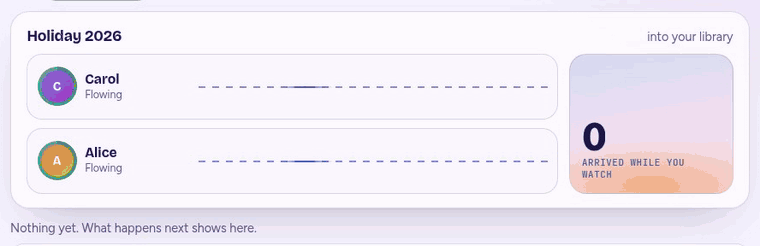<br>
  <sub>The live scene, recorded from the real page: every tagged photo travels along its sender's lane into the library.</sub>
</p>

Immich keeps every photo in the account that uploaded it. There is no built-in way to hand one to someone else's library: shared albums leave ownership with the person who uploaded, and partner sharing is read-only. **immich-handoff adds the missing step.** You tag a photo in the Immich app, and a few seconds later it is in another account, checked and ready to file.

> **Not affiliated with Immich.** immich-handoff is an independent, community project. It is not made, endorsed or supported by the Immich team. It is a companion that talks to your own Immich server through its public API. "Immich" is the name of that project and belongs to its authors. For help with Immich itself, use [Immich's own channels](https://immich.app).

Everyone's phone keeps backing up to their own account, and anyone can hand photos to anyone else on the same Immich server. Friends pool a trip into one library. A club or a team collects its photos in one place. A photographer hands a shoot to a client. Whoever receives decides who may send.


## Why you might like it

- **Nothing new to learn.** Sending is adding a tag in the Immich app you already use, on a phone or the web.
- **You decide about your own originals.** When you take part you choose: **keep** your photo and send a copy, or **move** it to your trash once the other side has it. The choice is yours, not the receiver's.
- **Anyone can offer a service.** Create one, decide who may send (people you approve, or anyone), and share an invitation link if you want it private.
- **Keys nobody can see, and a way out.** The app makes a named, restricted key in your account with your own login. Delete it in Immich, or press **Leave**, and everything stops safely without touching a photo.
- **Careful by design.** A photo is only removed after the other side holds a verified copy. Duplicates are recognised. If anything fails, your original stays put.
- **Small.** One container, no database server, nothing stored unless you let people join from the page.

## See it move

Everything below is recorded from the real page, in the dark theme or the light one.

<table>
  <tr>
    <td width="50%" valign="top">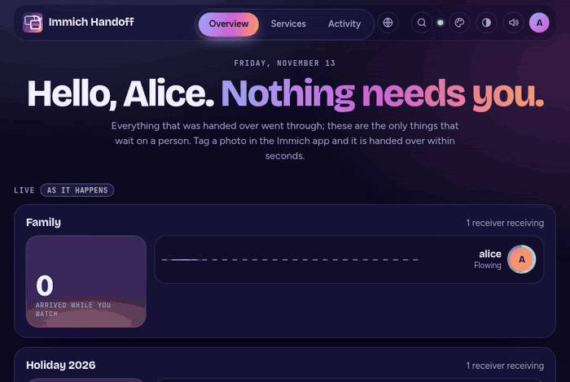<br><sub><b>Tag, and watch it go.</b> The numbers roll like a departures board.</sub></td>
    <td width="50%" valign="top" align="center">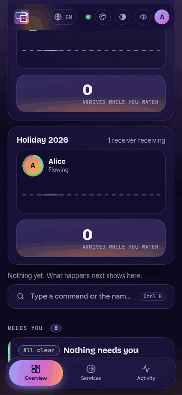<br><sub><b>On a phone,</b> the same page, and it installs like an app.</sub></td>
  </tr>
  <tr>
    <td width="50%" valign="top">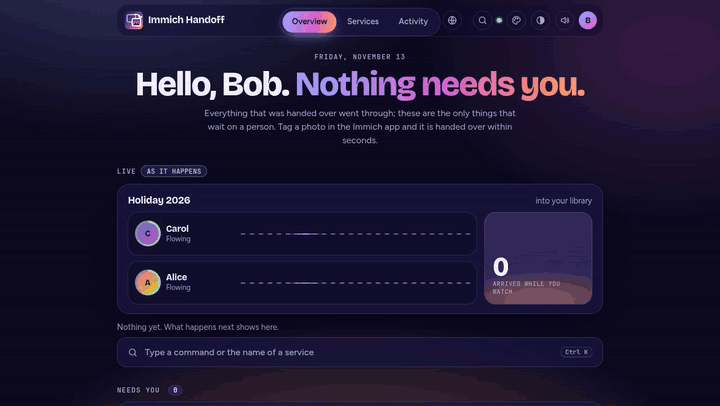<br><sub><b>Everything from the keyboard.</b> Ctrl K, type, Enter.</sub></td>
    <td width="50%" valign="top">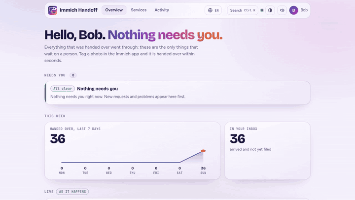<br><sub><b>Light or dark,</b> as you like it; it also follows your phone or browser.</sub></td>
  </tr>
  <tr>
    <td width="50%" valign="top">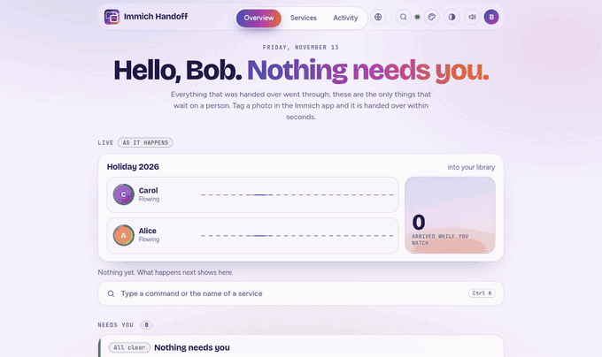<br><sub><b>Services open in place,</b> and the activity is a timeline.</sub></td>
    <td width="50%" valign="top">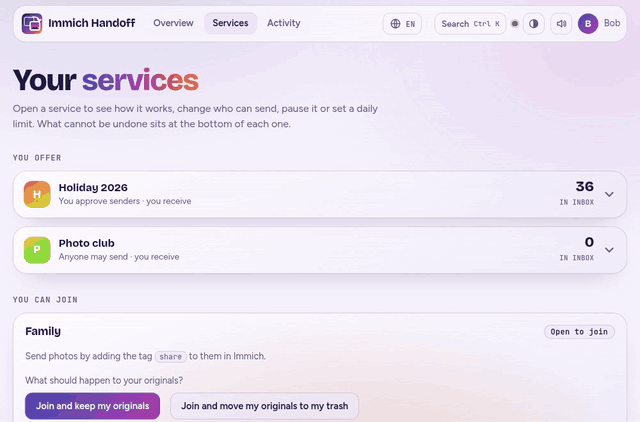<br><sub><b>Invite someone</b> with a link, a ready-written message or a QR code.</sub></td>
  </tr>
</table>

## A closer look

<table>
  <tr>
    <td width="50%" valign="top">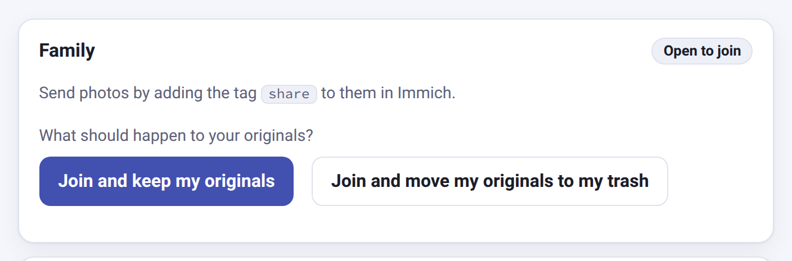<br><sub><b>You choose</b> what happens to your originals when you join.</sub></td>
    <td width="50%" valign="top">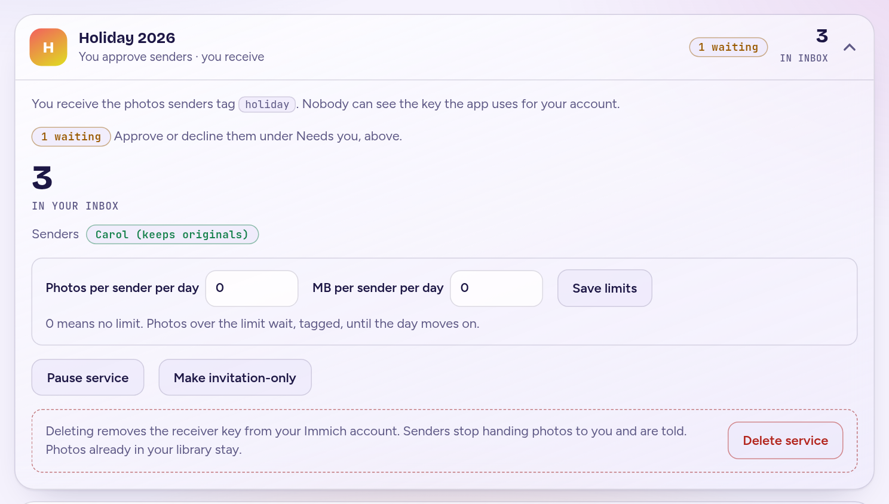<br><sub><b>Owners approve</b> senders and can share an invitation link.</sub></td>
  </tr>
  <tr>
    <td width="50%" valign="top">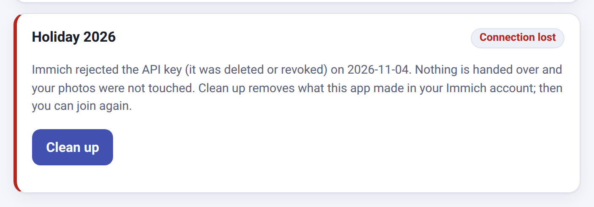<br><sub><b>Safe when keys disappear.</b> Nothing is handed over and no photo is touched.</sub></td>
    <td width="50%" valign="top">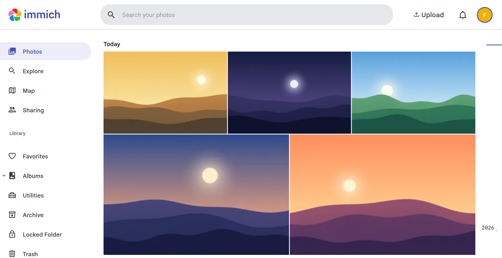<br><sub><b>What arrives</b> in the receiver's own Immich.</sub></td>
  </tr>
</table>

## Quick start

You need Immich 3.2.0 or newer and Docker.

> **Everyone who takes part needs Tags switched on in Immich.** It is off by default, per person. The page notices and offers a **Turn on Tags** button (or do it in Immich: Account Settings, Features, **Tags**). Senders need Tags to add tags to photos, and receivers need them to see the inbox tag on what arrives. Switching them on is not enough: **reload the Immich page (refresh the browser tab) afterwards**, or the tags still do not appear. Without Tags, the app can set tags but people cannot see or use them in Immich.

**Start from a release, not from `main`.** `main` is where the next version is being built, and it can be unstable or ahead of the published image. The latest release is [v1.1.0](https://github.com/vfuoglio/immich-handoff/releases/latest); the [releases page](https://github.com/vfuoglio/immich-handoff/releases) lists newer ones and, for each, what changed. If you do not use git, download that release's "Source code" archive from the same page.

```
git clone --branch v1.1.0 https://github.com/vfuoglio/immich-handoff.git && cd immich-handoff
cp .env.example .env
# edit .env: set WEBHOOK_SECRET and HANDOFF_STORE_KEY to long random text (openssl rand -hex 24)
docker compose up -d
```

Then open `http://<your-host>:8080/`, sign in to Immich, and offer your first service. The [install guide](docs/install.md) walks through it, including what to put in `.env`.

## Documentation

| Page | What it covers |
|---|---|
| [Install](docs/install.md) | Ten minutes from clone to first photo |
| [Using it](docs/using.md) | For the people who send and receive |
| [What is carried over](docs/what-is-carried-over.md) | What travels with a photo, and what does not |
| [The administrator's page](docs/admin.md) | See every service and member, check the connections, remove what is stuck |
| [Fixed accounts](docs/fixed-accounts.md) | Set the accounts up yourself, or run several fixed services |
| [Operations](docs/operations.md) | Reverse proxy, backups, upgrades, monitoring |
| [Make Handoff easy to find](docs/find-handoff.md) | A button in Immich's own header, so nobody types the address |
| [Settings](docs/settings.md) | Every option |
| [Security and trust](docs/security.md) | What it can do, what is stored, who sees what |
| [Troubleshooting](docs/troubleshooting.md) | When something does not work |
| [How it works inside](docs/architecture.md) | Design and testing |

## Tested with

Immich 3.2.0, end to end in Docker: every flow above runs against a real Immich in the project's tests. Tagging from the phone app is tested through the same call the app makes, not on a physical phone.

## Background

immich-handoff is based on the idea of immich_family_sync.

## License

MIT, see [LICENSE](LICENSE).
