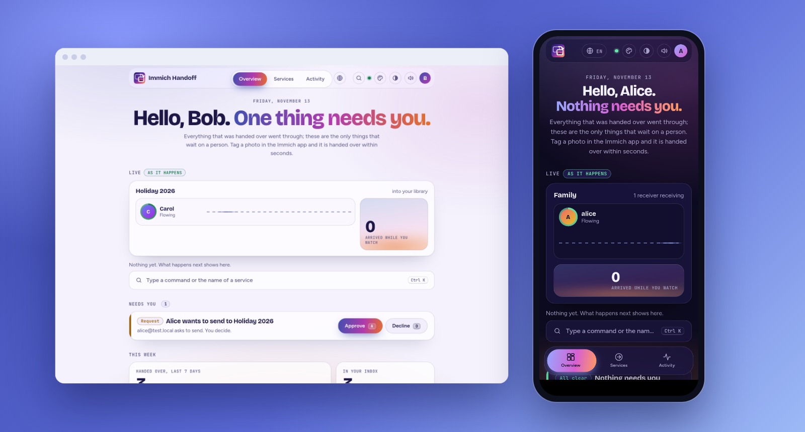
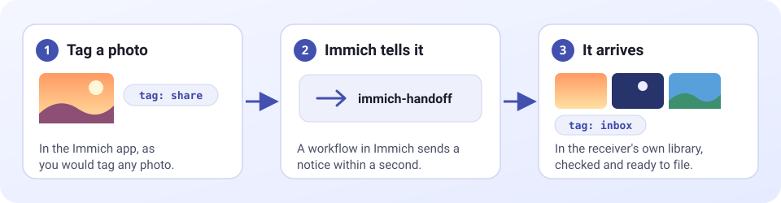

<p align="center">
  
</p>

# immich-handoff

**Hand photos from one Immich account to another, just by tagging them.**

[](https://github.com/vfuoglio/immich-handoff/actions/workflows/ci.yml)
[](https://github.com/vfuoglio/immich-handoff/releases/latest)
[](https://hub.docker.com/r/vfuoglio/immich-handoff)
[](docs/install.md#before-you-start)
[](LICENSE)

Immich keeps every photo in the account that uploaded it. There is no built-in way to hand one to someone else's library: shared albums leave ownership with the person who uploaded, and partner sharing is read-only. **immich-handoff adds the missing step.** You tag a photo in the Immich app, and a few seconds later it is in another account, checked and ready to file.

Everyone's phone keeps backing up to their own account, and anyone can hand photos to anyone else on the same Immich server. Friends pool a trip into one library. A club or a team collects its photos in one place. A photographer hands a shoot to a client. Whoever receives decides who may send.



## Why you might like it

- **Nothing new to learn.** Sending is adding a tag in the Immich app you already use, on a phone or the web.
- **You decide about your own originals.** When you take part you choose: **keep** your photo and send a copy, or **move** it to your trash once the other side has it. The choice is yours, not the receiver's.
- **Anyone can offer a service.** Create one, decide who may send (people you approve, or anyone), and share an invitation link if you want it private.
- **Keys nobody can see, and a way out.** The app makes a named, restricted key in your account with your own login. Delete it in Immich, or press **Leave**, and everything stops safely without touching a photo.
- **Careful by design.** A photo is only removed after the other side holds a verified copy. Duplicates are recognised. If anything fails, your original stays put.
- **Small.** One container, no database server, nothing stored unless you let people join from the page.

## A closer look

<table>
  <tr>
    <td width="50%" valign="top"><br><sub><b>You choose</b> what happens to your originals when you join.</sub></td>
    <td width="50%" valign="top"><br><sub><b>Owners approve</b> senders and can share an invitation link.</sub></td>
  </tr>
  <tr>
    <td width="50%" valign="top"><br><sub><b>Safe when keys disappear.</b> Nothing is handed over and no photo is touched.</sub></td>
    <td width="50%" valign="top"><br><sub><b>What arrives</b> in the receiver's own Immich.</sub></td>
  </tr>
</table>

## Quick start

You need Immich 3.2.0 or newer and Docker.

> **Everyone who takes part must switch Tags on in Immich, by hand.** It is off by default, per person: Immich, then Account Settings, Features, **Tags**. Senders need it to add tags to photos, and receivers need it to see the inbox tag on what arrives. Saving the setting is not enough: **reload the Immich page (refresh the browser tab) afterwards**, or the tags still do not appear. Without it, tags can be set by the app but people cannot see or use them in Immich.

```
git clone https://github.com/vfuoglio/immich-handoff.git && cd immich-handoff
cp .env.example .env
# edit .env: set WEBHOOK_SECRET and HANDOFF_STORE_KEY to long random text (openssl rand -hex 24)
docker compose up -d
```

Then open `http://<your-host>:8080/`, sign in to Immich, and offer your first service. The [install guide](docs/install.md) walks through it, including what to put in `.env`.

## Documentation

| Page | What it covers |
|---|---|
| [Install](docs/install.md) | Ten minutes from clone to first photo |
| [Using it](docs/using.md) | For the people who send and receive |
| [Fixed accounts](docs/fixed-accounts.md) | Set the accounts up yourself, or run several fixed services |
| [Operations](docs/operations.md) | Reverse proxy, backups, upgrades, monitoring |
| [Settings](docs/settings.md) | Every option |
| [Security and trust](docs/security.md) | What it can do, what is stored, who sees what |
| [Troubleshooting](docs/troubleshooting.md) | When something does not work |
| [How it works inside](docs/architecture.md) | Design and testing |

## Tested with

Immich 3.2.0, end to end in Docker: every flow above runs against a real Immich in the project's tests. Tagging from the phone app is tested through the same call the app makes, not on a physical phone.

## Background

immich-handoff is based on the idea of immich_family_sync.

## License

MIT, see [LICENSE](LICENSE).
