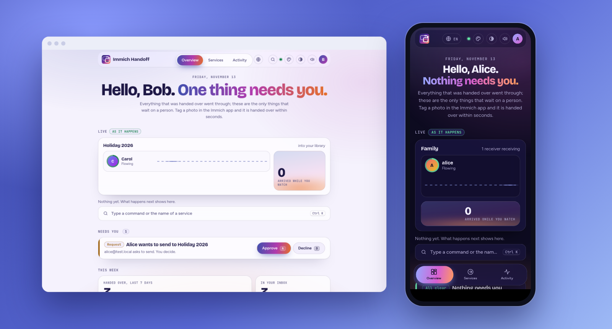

<p align="center">
  
</p>

<p align="center">
  
</p>

# immich-handoff

**Photos arrive in the right Immich library: by tag, button, rule or QR code.**

[](https://github.com/vfuoglio/immich-handoff/actions/workflows/ci.yml)
[](https://github.com/vfuoglio/immich-handoff/releases/latest)
[](https://hub.docker.com/r/vfuoglio/immich-handoff)
[](docs/admin/install.md#before-you-start)
[](LICENSE)

**See it in 75 seconds:** a host collects a party's photos from guests with a QR code, then hand over from inside Immich, rules, a client room and sharing between servers. (Music and captions, no sound needed. The photos are public-domain pictures from Wikimedia Commons; the music is "Mister Blues", CC0.)

https://github.com/user-attachments/assets/dbaa040c-3733-4286-99e1-42d5a2360485

<p align="center">
  <br>
  <sub>The live scene, recorded from the real page: every tagged photo travels along its sender's lane into the library.</sub>
</p>

Immich keeps every photo in the account that uploaded it. Shared albums and links let people *look* at your photos; partner sharing is read-only. None of them puts a photo **in someone else's library**, collects photos from people who have no account, or connects two servers. **immich-handoff adds that step.** Tag a photo, press a button in Immich, let a rule suggest it, or scan a QR code, and a few seconds later the photo is in the other library, checked and ready to file. Whoever owns a library decides who may send to it, and whoever owns a photo decides whether the original stays or moves.

> **Not affiliated with Immich.** immich-handoff is an independent, community project. It is not made, endorsed or supported by the Immich team. It is a companion that talks to your own Immich server through its public API. "Immich" is the name of that project and belongs to its authors. For help with Immich itself, use [Immich's own channels](https://immich.app).

## What do you want to do?

| I want to... | Start here |
|---|---|
| **Share photos with my household or friends** on one server | [Share with your household](https://vfuoglio.github.io/immich-handoff/guides/share/household/) |
| **Collect photos from guests** at a wedding or party, even without Immich | [Drop boxes and events](https://vfuoglio.github.io/immich-handoff/guides/collect/events/) |
| **Deliver a shoot to a client** | [Client rooms](https://vfuoglio.github.io/immich-handoff/guides/collect/client-rooms/) |
| **Share an album with a friend on another server** | [Albums shared between servers](https://vfuoglio.github.io/immich-handoff/guides/share/shared-albums/) |
| **Stop tagging by hand** | [Rules](https://vfuoglio.github.io/immich-handoff/guides/automate/rules/) and [the button inside Immich](https://vfuoglio.github.io/immich-handoff/admin/find-handoff/) |
| **Make a story, or show photos on a TV** | [Stories](https://vfuoglio.github.io/immich-handoff/guides/show/stories/) and [Cast to a TV](https://vfuoglio.github.io/immich-handoff/guides/show/cast-to-tv/) |

More, with pictures: **[the documentation site](https://vfuoglio.github.io/immich-handoff/)** ([why not shared albums or links?](https://vfuoglio.github.io/immich-handoff/start/why-handoff/)). The same pages are in [`docs/`](docs/README.md), and inside the app under the **?** button. The core pages are also in German, French, Spanish, Italian, Portuguese and Russian.


## Try it first

Not ready to install? [`demo/`](demo/README.md) starts a throwaway Immich with three people and sample photos, and Handoff with the button inside Immich, in one `docker compose up`. Nothing leaves your machine, and one command removes it.

## Quick start

You need Immich 3.2.0 or newer and Docker, about five minutes, and these four lines (on Linux; on a Mac use `sed -i ''`):

```
git clone --branch v1.3.1 https://github.com/vfuoglio/immich-handoff.git && cd immich-handoff
cp .env.example .env
sed -i -e "s/^WEBHOOK_SECRET=.*/WEBHOOK_SECRET=$(openssl rand -hex 24)/" -e "s/^HANDOFF_STORE_KEY=.*/HANDOFF_STORE_KEY=$(openssl rand -hex 24)/" .env
docker compose up -d
```

Then open `http://<your-host>:8080/` on the same hostname you use for Immich, sign in with your Immich account, choose **Offer a service of your own**, and tag a photo. That is all: nobody makes an API key by hand.

**Keep a copy of `HANDOFF_STORE_KEY`** (it is in `.env`): it encrypts the keys the app holds for people who join. If your Immich network is not called `immich_default`, set `IMMICH_NETWORK` in `.env`. The [install guide](https://vfuoglio.github.io/immich-handoff/admin/install/) explains each step and what to do if one fails.

> **Everyone who takes part needs Tags switched on in Immich.** It is off by default, per person. The page notices and offers a **Turn on Tags** button (or do it in Immich: Account Settings, Features, **Tags**). Senders need Tags to add tags to photos, and receivers need them to see the inbox tag on what arrives. Switching them on is not enough: **reload the Immich page (refresh the browser tab) afterwards**, or the tags still do not appear. Without Tags, the app can set tags but people cannot see or use them in Immich.

**Start from a release, not from `main`.** `main` is where the next version is being built and can be ahead of the published image. The latest release is [v1.3.1](https://github.com/vfuoglio/immich-handoff/releases/latest); the [releases page](https://github.com/vfuoglio/immich-handoff/releases) lists newer ones and what changed in each.

## Tested with

Immich 3.4.1, end to end in Docker: every flow above runs against a real Immich in the project's tests (3.2.0 is the oldest version that works: it is the first that tells the app when a tag is added). Tagging from the phone app is tested through the same call the app makes, not on a physical phone.

## Questions, ideas and bugs

- **A question, an idea, or how you use it:** [Discussions](https://github.com/vfuoglio/immich-handoff/discussions). Showing your setup there helps the next person.
- **Something is broken:** [open an issue](https://github.com/vfuoglio/immich-handoff/issues), with the output of `docker compose exec immich-handoff /immich-handoff doctor`.

## Background

immich-handoff is based on the idea of immich_family_sync.

## License

MIT, see [LICENSE](LICENSE).
