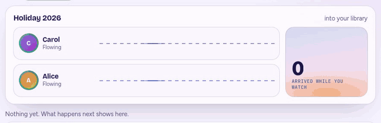
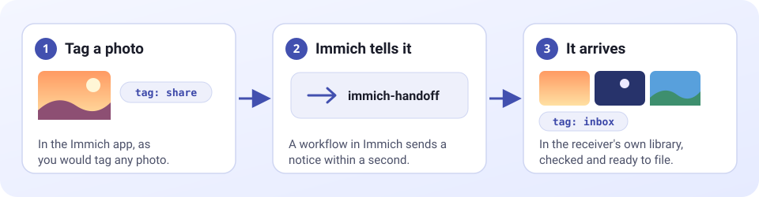
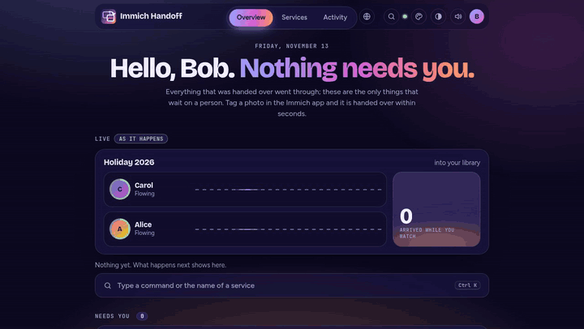
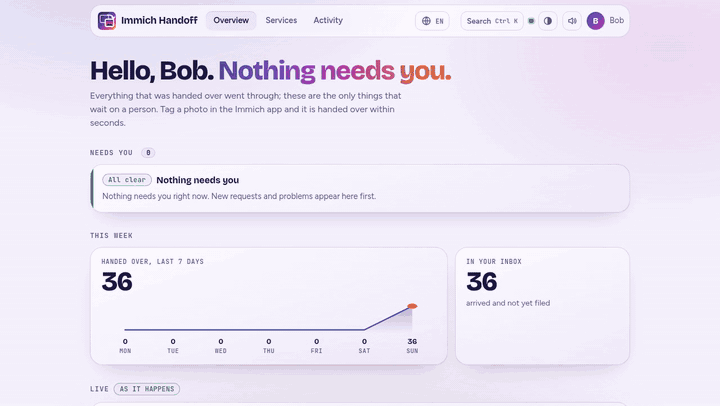
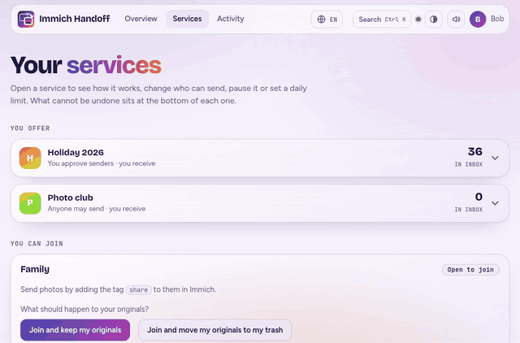
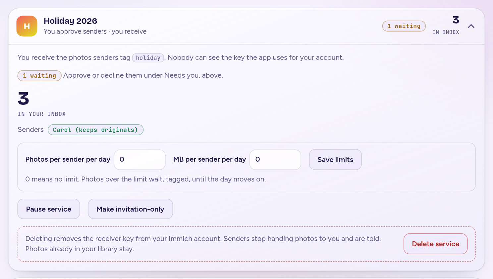

<p align="center">
  
</p>

<p align="center">
  
</p>

# immich-handoff

**Photos arrive in the right Immich library: by tag, button, rule or QR code.**

[](https://github.com/vfuoglio/immich-handoff/actions/workflows/ci.yml)
[](https://github.com/vfuoglio/immich-handoff/releases/latest)
[](https://hub.docker.com/r/vfuoglio/immich-handoff)
[](docs/install.md#before-you-start)
[](LICENSE)

**See it in 75 seconds:** a host collects a party's photos from guests with a QR code, then hand over from inside Immich, rules, a client room and sharing between servers. (Music and captions, no sound needed. The photos are public-domain pictures from Wikimedia Commons; the music is "Mister Blues", CC0.)

https://github.com/user-attachments/assets/dbaa040c-3733-4286-99e1-42d5a2360485

<p align="center">
  <br>
  <sub>The live scene, recorded from the real page: every tagged photo travels along its sender's lane into the library.</sub>
</p>

Immich keeps every photo in the account that uploaded it. Shared albums and links let people *look* at your photos; partner sharing is read-only. None of them puts a photo **in someone else's library**, collects photos from people who have no account, or connects two servers. **immich-handoff adds that step.** Tag a photo, press a button in Immich, let a rule suggest it, or scan a QR code, and a few seconds later the photo is in the other library, checked and ready to file. Whoever owns a library decides who may send to it, and whoever owns a photo decides whether the original stays or moves.

> **Not affiliated with Immich.** immich-handoff is an independent, community project. It is not made, endorsed or supported by the Immich team. It is a companion that talks to your own Immich server through its public API. "Immich" is the name of that project and belongs to its authors. For help with Immich itself, use [Immich's own channels](https://immich.app).

## What do you want to do?

| I want to... | You get | Start here |
|---|---|---|
| **Share photos with my household or friends** on one server | Anyone hands photos to anyone's library. Each sender chooses to keep or move their originals. | [Joining a service](docs/guides/household.md) |
| **Collect photos from guests** at a wedding, party or club, even without Immich | A link or QR code that only *receives*: moderation, a wall on a screen, a gallery and a best-of for the guests | [Drop boxes and events](docs/guides/events.md) |
| **Deliver a shoot to a client** | A room the client opens on a phone: favourites, notes, rounds, and you release the originals when you decide | [Client rooms](docs/guides/client-rooms.md) |
| **Share an album with a friend on another server** | Photos both ways between two Immich servers, signed, with no echo; works even if your friend does not run Handoff | [Albums shared with other servers](docs/guides/shared-albums.md) |
| **Stop tagging by hand** | A **Hand over...** button inside Immich, and rules that suggest photos of named people, places and dates | [Rules](docs/guides/automate.md) and [the button](docs/find-handoff.md#hand-over-from-inside-immich) |
| **Keep a photo someone shared with me** | An **Add to my library** button inside Immich copies a photo from a shared album or a partner into your own library, with its details, and Undo for 15 minutes; or follow an album and have what is added offered to you | [Add to my library](docs/find-handoff.md#add-to-my-library-from-inside-immich) and [following an album](docs/guides/automate.md#following-an-album-shared-with-you) |

A *service* is simply a named place photos are handed to ("Holiday 2026"); its owner decides who may send.



## Everything it does, and why you can trust it

- **Nothing new to learn.** Send by adding a tag in the Immich app you already use, or with the button inside Immich, on a phone or the web.
- **You decide about your own originals.** When you take part you choose: **keep** your photo and send a copy, or **move** it to your trash once the other side has it. The choice is yours, not the receiver's.
- **Anyone can offer a service.** Create one, decide who may send (people you approve, or anyone), and share an invitation link if you want it private.
- **Keys nobody can see, and a way out.** The app makes a named, restricted key in your account with your own login. Delete it in Immich, or press **Leave**, and everything stops safely without touching a photo.
- **Careful by design.** A photo is only removed after the other side holds a verified copy. Duplicates are recognised. If anything fails, your original stays put.
- **Beyond people with accounts.** A **drop box** is a link (or a QR code, or an email address) that anyone can send photos to, with no account, and it doubles as an **event**: a gallery for guests (hearts, downloads, a ZIP), a moderator link for a helper, a wall, an album of what guests loved and your own title, logo and colours; an **event pool** gives everybody everybody's photos for a trip or a party; a **frame** shows an album on a screen; a **weekly digest** picks the best of the week.
- **From your phone, too.** Besides tagging, the **Send** tab sends photos and videos from the phone in pieces that survive a lost connection, tagged for the service you pick; on Android it is in the Share menu of the gallery and finishes with the screen off. See the [phone guide](docs/guides/phone.md#send-photos-from-a-phone).
- **Rules instead of tags.** A sender can let a **rule** look in Immich for photos of named people, taken between two dates, in a place, in an album or looking like a phrase, and **suggest** them on the Overview with pictures: *Send*, *Not these* or *Always*, and after three *Always* the rule can send by itself. See [Rules](docs/guides/automate.md).
- **Hand over from inside Immich.** A **Hand over...** button in Immich's own photo viewer, selection bar and three-dot menus lists the services you send to and hands the photos over, with **Undo**, no tags needed. See [Hand over from inside Immich](docs/find-handoff.md#hand-over-from-inside-immich).
- **For photographers.** A **client room** shows an album to a client through pictures marked with your name, on a phone, behind a PIN if you like: the client chooses favourites (up to a limit, in rounds if you want), leaves notes, and you release the originals when you decide. See [Client rooms](docs/guides/client-rooms.md).
- **Told your way.** Notifications to ntfy, Home Assistant or any webhook, to your mailbox, and, if people ask for it, to their own phone or email, with buttons to approve a request from the message itself.
- **Small.** One container, no database server, nothing stored unless you let people join from the page.

## In action

Everything below is recorded from the real page, in the dark or the light variant of its two colour schemes.

<table>
  <tr>
    <td width="50%" valign="top"><br><sub><b>Tag, and watch it go.</b> Photos fly along their lane, both ways, and the counters climb.</sub></td>
    <td width="50%" valign="top" align="center"><br><sub><b>On a phone,</b> the same page, and it installs like an app.</sub></td>
  </tr>
  <tr>
    <td width="50%" valign="top"><br><sub><b>Everything from the keyboard.</b> Ctrl K, type, Enter.</sub></td>
    <td width="50%" valign="top"><br><sub><b>Two colour schemes, light or dark,</b> as you like them; they also follow your phone or browser.</sub></td>
  </tr>
  <tr>
    <td width="50%" valign="top"><br><sub><b>Services open in place,</b> and the activity is a timeline.</sub></td>
    <td width="50%" valign="top"><br><sub><b>Invite someone</b> with a link, a ready-written message or a QR code.</sub></td>
  </tr>
  <tr>
    <td colspan="2" valign="top" align="center"><br><sub><b>A wall for the party.</b> Photos guests send arrive on a big screen, in the style you choose.</sub></td>
  </tr>
</table>

## A closer look

<table>
  <tr>
    <td width="50%" valign="top"><br><sub><b>A button inside Immich,</b> so nobody has to know about tags.</sub></td>
    <td width="50%" valign="top"><br><sub><b>Rules suggest,</b> you decide with one tap.</sub></td>
  </tr>
</table>

<table>
  <tr>
    <td width="50%" valign="top"><br><sub><b>You choose</b> what happens to your originals when you join.</sub></td>
    <td width="50%" valign="top"><br><sub><b>Owners approve</b> senders and can share an invitation link.</sub></td>
  </tr>
  <tr>
    <td width="50%" valign="top"><br><sub><b>Safe when keys disappear.</b> Nothing is handed over and no photo is touched.</sub></td>
    <td width="50%" valign="top"><br><sub><b>What arrives</b> in the receiver's own Immich.</sub></td>
  </tr>
</table>

## Why not shared albums or share links?

Immich's own sharing is the right tool for *showing* photos. Handoff is for *moving, collecting and delivering* them.

| | Shared album / link | Partner sharing | immich-handoff |
|---|---|---|---|
| The photo ends up in the other person's library | No | No (read-only) | **Yes**, a real copy they own |
| You choose to keep or move your original | n/a | n/a | **Yes**, a move waits for a verified copy |
| People without Immich can send you photos | Upload links, but no review, no wall, no gallery for the guests | No | **Yes**, write-only drop box with moderation, wall and gallery |
| Between two servers | Public link only | No | **Yes**, signed, both ways |
| Photos picked automatically | No | Everything | **Rules** by person, place, date or phrase |
| Revoke it | Delete the link | Stop sharing | Delete the key in Immich; nothing else is touched |

## Try it first

Not ready to install? [`demo/`](demo/README.md) starts a throwaway Immich with three people and sample photos, and Handoff with the button inside Immich, in one `docker compose up`. Nothing leaves your machine, and one command removes it.

## Quick start

You need Immich 3.2.0 or newer and Docker, about five minutes, and these four lines (on Linux; on a Mac use `sed -i ''`):

```
git clone --branch v1.3.1 https://github.com/vfuoglio/immich-handoff.git && cd immich-handoff
cp .env.example .env
sed -i -e "s/^WEBHOOK_SECRET=.*/WEBHOOK_SECRET=$(openssl rand -hex 24)/" -e "s/^HANDOFF_STORE_KEY=.*/HANDOFF_STORE_KEY=$(openssl rand -hex 24)/" .env
docker compose up -d
```

Then open `http://<your-host>:8080/` on the same hostname you use for Immich, sign in with your Immich account, choose **Offer a service of your own**, and tag a photo. That is all: nobody makes an API key by hand.

**Keep a copy of `HANDOFF_STORE_KEY`** (it is in `.env`): it encrypts the keys the app holds for people who join. If your Immich network is not called `immich_default`, set `IMMICH_NETWORK` in `.env`. The [install guide](docs/install.md) explains each step and what to do if one fails.

> **Everyone who takes part needs Tags switched on in Immich.** It is off by default, per person. The page notices and offers a **Turn on Tags** button (or do it in Immich: Account Settings, Features, **Tags**). Senders need Tags to add tags to photos, and receivers need them to see the inbox tag on what arrives. Switching them on is not enough: **reload the Immich page (refresh the browser tab) afterwards**, or the tags still do not appear. Without Tags, the app can set tags but people cannot see or use them in Immich.

**Start from a release, not from `main`.** `main` is where the next version is being built and can be ahead of the published image. The latest release is [v1.3.1](https://github.com/vfuoglio/immich-handoff/releases/latest); the [releases page](https://github.com/vfuoglio/immich-handoff/releases) lists newer ones and what changed in each.

## Documentation

| Page | What it covers |
|---|---|
| [Questions people ask first](docs/faq.md) | Is it the right tool, and what does it do to my photos |
| [Install](docs/install.md) | Ten minutes from clone to first photo |
| [Guides by use case](docs/using.md) | Household, event guests, client rooms, other servers, rules, phone |
| [What is carried over](docs/what-is-carried-over.md) | What travels with a photo, and what does not |
| [The administrator's page](docs/admin.md) | See every service and member, check the connections, remove what is stuck |
| [Fixed accounts](docs/fixed-accounts.md) | Set the accounts up yourself, or run several fixed services |
| [Operations](docs/operations.md) | Reverse proxy, backups, upgrades, monitoring |
| [Make Handoff easy to find](docs/find-handoff.md) | A button in Immich's own header, so nobody types the address |
| [Settings](docs/settings.md) | Every option |
| [Security and trust](docs/security.md) | What it can do, what is stored, who sees what |
| [Troubleshooting](docs/troubleshooting.md) | When something does not work |
| [How it works inside](docs/architecture.md) | Design and testing |

## Tested with

Immich 3.4.1, end to end in Docker: every flow above runs against a real Immich in the project's tests (3.2.0 is the oldest version that works: it is the first that tells the app when a tag is added). Tagging from the phone app is tested through the same call the app makes, not on a physical phone.

## Questions, ideas and bugs

- **A question, an idea, or how you use it:** [Discussions](https://github.com/vfuoglio/immich-handoff/discussions). Showing your setup there helps the next person.
- **Something is broken:** [open an issue](https://github.com/vfuoglio/immich-handoff/issues), with the output of `docker compose exec immich-handoff /immich-handoff doctor`.

## Background

immich-handoff is based on the idea of immich_family_sync.

## License

MIT, see [LICENSE](LICENSE).
