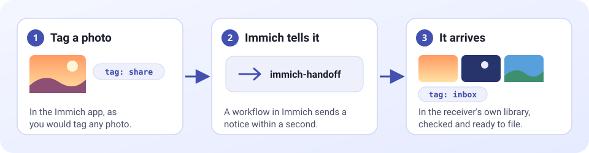

# How it works inside

For the curious, and for anyone changing the code.



```
 Immich app ──tag──►  Immich server
                           │  a workflow in the sender's account: "tag added" + "tag is <service tag>"
                           ▼  POST /webhook/immich  (with the secret)
                    ┌───────────────┐
                    │ immich-handoff│── Immich API ──► sender's account    (find, download, mark or trash the original)
                    │ (one Go       │── Immich API ──► receiving account   (upload, tag inbox, tidy tags)
                    │  container)   │── /data/handoff.db (encrypted keys, memberships, activity)
                    └───────────────┘
 Browser ── Immich login cookie ──► the page (same hostname as Immich) ── join / offer / approve / leave
```

## The ideas that hold it together

- **Events only wake the app.** When Immich reports a tag, the app asks Immich which photos carry the service's tag and handles those, using the sender's own key. A lost or repeated event cannot lose or duplicate a photo. Bursts are combined into one run, and an announced photo whose tag is not yet visible through Immich's API is retried for a short while.
- **Events do the work; two timers cover what events cannot.** Immich sends no event when a photo is added to an album, so a short timer (`CLEANUP_INTERVAL_MINUTES`, default 15) only removes inbox tags from filed or expired photos. It does nothing else, and a pass in progress makes it skip a round.
- **A third timer, for linked albums.** A sender can link an album to a service so everything in it is handed over (stored on their membership; their key gets `album.read`). Immich has no album event either, so `ALBUM_CHECK_MINUTES` (default 15) starts a pass when any album is linked, and every other pass includes the albums too. A photo in an album is "pending" if the sender owns it, it is not trashed and it has neither the service's sent nor refused tag; those two tags are the only memory, so nothing about handled photos is stored.
- **A safety net, not polling.** One run at startup and one a day (`SWEEP_INTERVAL_HOURS`) pick up anything missed while the app was down, check that stored keys still work, and tidy the inbox tags. A pass also runs as soon as workflows exist after a delayed setup.
- **Streaming copy.** A photo is streamed straight from the sender's account into the receiver's, never stored on the app's disk. The app computes its SHA-1 on the way and compares it with what Immich stored.
- **The original is touched last,** only after every receiver holds a verified copy, and never while a connection is broken or a service has no healthy receiver. In move mode it goes to the trash; in copy mode it gets the sent tag and loses the service tag.
- **The sender's choice lives with the sender.** Each membership stores move or copy, and the sender's key is created with or without delete permission to match.
- **Tag changes are verified.** Immich can drop a tag changed right after another change to the same photo, so the app checks each change took effect and adds a new tag before removing the old one. Photos handled in the last two minutes are skipped, because Immich's search lags behind tag removals.
- **Self-configuring.** At startup and every daily run the app makes sure each sender has the service's tag and workflow, and repairs the workflow if the URL or secret changes. Immich reports healthy about half a minute before its workflow plugins load, so this retries until it works.
- **Keys are made by the person they belong to.** Joining and offering use the person's own Immich session to create a named, restricted API key, so the app never handles anyone's password.
- **Typed everywhere.** The Immich API client is generated from Immich's published OpenAPI description (kept in `api/`), and the web pages are type-checked templates, so an incompatible Immich change or a template mistake stops the build instead of failing quietly.

## The pieces

| Folder | What it does |
|---|---|
| `cmd/immich-handoff` | Starts everything from the environment. |
| `internal/syncer` | The engine: passes, hand-overs, tag cleanup, workflow setup. |
| `internal/hub` | People and services: joining, offering, approval, invitations, key health, the administrator's overview and removals. |
| `internal/doctor` | The setup check behind `immich-handoff doctor` and the admin page's **Check now**. |
| `internal/store`, `internal/vault` | The SQLite file and the encryption of keys in it. |
| `internal/immich` | The generated client plus a small wrapper. |
| `internal/web` | The page: templates, handlers, styles, live updates. Its scripts are TypeScript in `internal/web/ts`, bundled into `static/app.js` (see below). |
| `internal/config` | Environment and routes file. |
| `test/` | The end-to-end suite and the throwaway Immich it runs against. |
| `tools/typecheck` | Type-checks the page's TypeScript. Used by CI only. |
| `tools/screenshots` | Makes the pictures in `docs/images` from a real running demo. |

## Testing

```
go test ./...        # unit tests, no Docker needed
test/run.sh          # end-to-end: starts a throwaway Immich 3.2.0, runs the real app against it, tears it down
```

`test/run.sh` creates users with the exact API-key permissions the docs list and checks the whole flow against a real Immich: workflow creation, a tag arriving through the real workflow, duplicates, trashed copies, the inbox tidy-up, one-to-many routes, joining and leaving, offering services with approval and invitation links, move and copy, tagging the way the phone app does, and keys deleted on either side. `keep=1 test/run.sh` leaves Immich running afterwards, and `test/dev.sh` starts the app against it. `IMMICH_VERSION=<tag> test/run.sh` tests another Immich release. `E2E_PORT` and `E2E_APP_PORT` move the test ports if the defaults are taken.

Generated code (`go generate ./...`: the Immich client, the templates and the page's script bundle) is committed; CI fails if it is stale.

### The page's look

`internal/web/static/app.css` is a small design system: colour, type, spacing and shape are CSS tokens at the top (the twilight palette of the app icon, light and dark, following the browser unless the person chose one with the icon in the bar), and the components use only those tokens. The fonts (Bricolage Grotesque, Figtree and JetBrains Mono, latin and latin-ext) are variable woff2 files in `static/fonts` with their licences beside them (SIL Open Font License), served by the app itself: the Content-Security-Policy allows fonts from the app only, and nothing is ever requested from a font service. No page may use an inline style or script (the policy blocks them), and a test checks this. The light/dark choice is a script of its own (`static/theme.js`) loaded first and without `defer`, so a saved choice applies before the first paint; it is kept in the browser's `localStorage`, never on the server.

Questions (`hx-confirm`) are asked in a native `<dialog>` that every page carries, not the browser's own pop-up: `app.ts` catches htmx's `htmx:confirm` event, shows the question in the dialog and lets the request go ahead only on OK. A button names the dialog's title and button with `data-confirm-title` and `data-confirm-label`, and marks a destructive action with `data-danger`; a test checks every question has them.

### The page's scripts

They are written in TypeScript (`internal/web/ts/*.ts`) and bundled by esbuild into `internal/web/static/app.js`, which is committed and embedded like the templates. esbuild is a pinned Go tool in `go.mod`, so `go generate ./...` rebuilds the bundle with nothing else installed, and building, running and testing the program never needs Node. esbuild strips types without checking them, so the types are checked separately: `cd tools/typecheck && npm ci && npm run check` runs `tsc --noEmit` in strict mode, and CI does the same in its `types` job. That job is the only place Node is used. Edit the `.ts` files, never `app.js`; the `.map` file next to it lets the browser's developer tools show the original source. The strict Content-Security-Policy still applies: scripts load from the app itself, never inline. Notes on the Immich behaviour this project relies on are in [immich-api-notes.md](immich-api-notes.md).

## Documentation images

`tools/screenshots` makes the pictures from a real running demo, so they can be remade whenever the page changes. See its README.

## Releasing

The steps, with a checklist, are in [Releasing](releasing.md). In short: pushing a version tag such as `v1.2.3` runs the tests, builds and smoke-tests the image for amd64 and arm64, publishes it to GitHub's container registry and creates a GitHub Release from the changelog.
