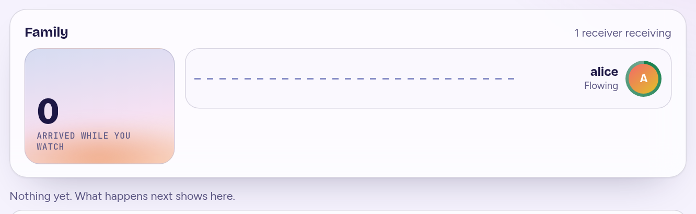
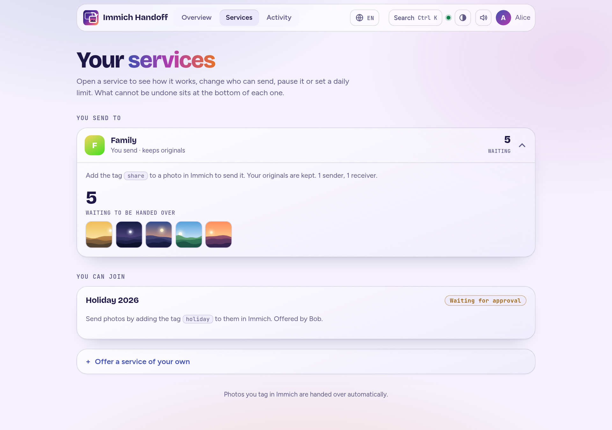
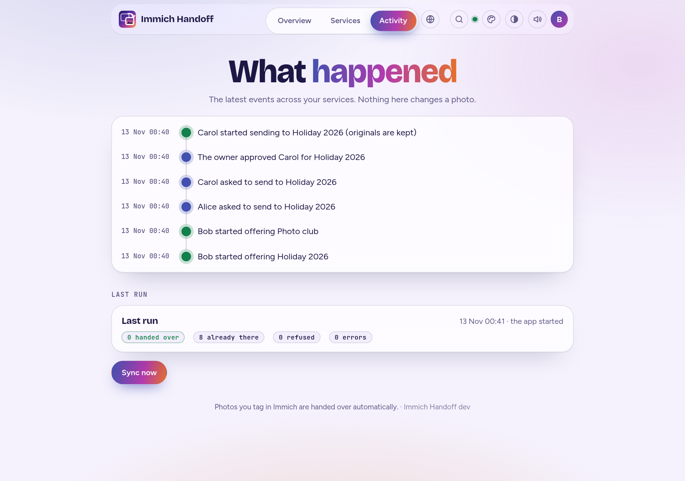
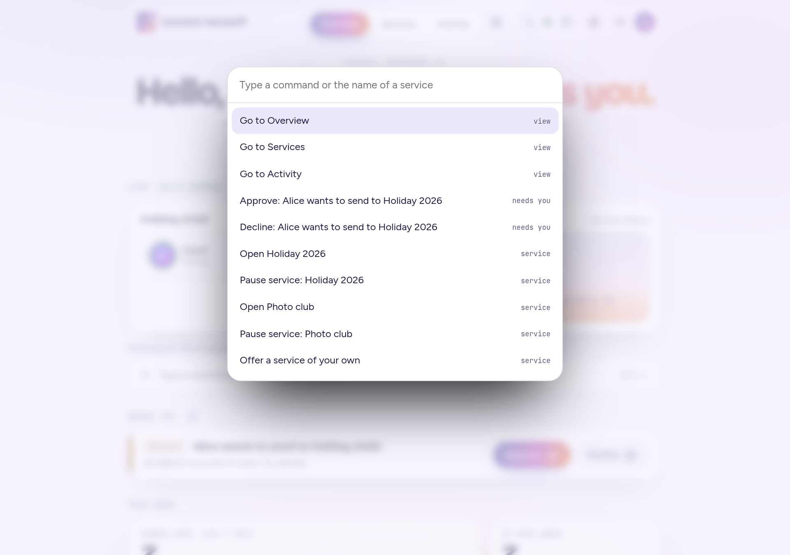

> [!NOTE]
> Diese Seite wurde maschinell übersetzt und noch nicht von einer Person geprüft. Die Bilder zeigen die englische Oberfläche. Im Zweifel gilt die englische Fassung.

# Sich auf der Seite zurechtfinden

Die Seite hat vier Ansichten und eine Suchleiste, die tut, was du verlangst. Das ist der Fünf-Minuten-Rundgang: wo was ist, was die Wörter bedeuten und was die Live-Szene dir zeigt.

## Zuerst: Tags

Handoff arbeitet mit Immich-**Tags**, und Tags sind **standardmäßig aus**, für jede Person einzeln. Wenn deine aus sind, zeigt die Seite einen Hinweis mit einer Schaltfläche **Tags aktivieren** (du kannst es auch in Immich tun: Kontoeinstellungen, Funktionen, **Tags**). Absender brauchen Tags, um Fotos zu markieren, Empfänger, um das Eingangs-Tag zu sehen und danach zu filtern. Einschalten genügt nicht: **Lade danach den Immich-Tab oder das Fenster neu**, sonst erscheinen die Tag-Optionen nicht (in der Handy-App: schließen und neu öffnen).

## Die vier Ansichten

Die Leiste oben hat vier Ansichten, in einer Pille in ihrer Mitte (auf einem Handy sind sie eine Leiste am unteren Rand, mit je einem Symbol). Die Adresse merkt sich die Ansicht (`#services`), du kannst sie also als Lesezeichen speichern, und die Seite kehrt nach einer Aktion dorthin zurück.

- **Übersicht.** Das Datum und eine Begrüßung, die Suchleiste, dann **Aktion nötig**, die **Live-Szene** und **Diese Woche**, untereinander. Die Karte **Loslegen** steht am Ende, bis du damit fertig bist.
- **Dienste.** Jeder Dienst, an den du sendest, von dem du empfängst, den du anbietest oder dem du beitreten kannst. Wenn du mehr als Dienste anlegen kannst, wechselt ein Schalter oben zwischen deinen Diensten, Drop-Boxen, Kundenräumen, Rahmen und geteilten Alben.
- **Aktivität.** Was passiert ist, der letzte Lauf und **Jetzt synchronisieren**.
- **Einstellungen.** Das, was du einmal einrichtest und dann vergisst, in Kategorien (Benachrichtigungen, Fotos, Wird geteilt, Bildschirme). Die Ansicht gibt es nur, wenn darin etwas für dich eingeschaltet ist.

### Aktion nötig

Alles, was auf eine Person wartet, steht zuerst, das Dringendste oben, jeweils mit seiner Schaltfläche. Wenn nichts wartet, steht das da.

- **Verbindung verloren** und **Vom Besitzer entfernt**: **Aufräumen**, das löscht, was die App in deinem Immich-Konto angelegt hat (danach kannst du wieder beitreten).
- **Getrennt** (ein Dienst, den du anbietest): **Neu verbinden**.
- **Anfrage**: Jemand möchte an einen Dienst senden, den du anbietest. **Genehmigen** oder **Ablehnen**; eine Anfrage wird hier beantwortet und nirgends sonst.
- **Pausiert**: ein Dienst, den du pausiert hast, oder dein eigenes Senden (**Fortsetzen**), oder ein Dienst, den sein Besitzer pausiert hat (für dich gibt es nichts zu drücken).
- **Limit**: Ein Absender hat das Tageslimit erreicht, oder du (siehe [Tageslimits](../../guides/automate/controls.md)).

### Diese Woche

Eine kleine Grafik mit einem Punkt pro Tag (UTC-Tage, heute rechts), wie viele Fotos in den letzten sieben Tagen übergeben wurden: die Fotos, die **du gesendet hast**, und die, die **in Diensten angekommen sind, die du anbietest**. Gezählt wird, was die App für Leute aufgezeichnet hat, die über die Seite beigetreten sind; Absender aus der `.env` oder einer Routendatei erscheinen also nicht. Daneben aktualisieren sich **Wartet auf Übergabe** (Fotos, die du markiert hast und die noch gehen müssen) und **In deinem Eingang** (was angekommen und noch nicht einsortiert ist) von selbst, sobald eine Übergabe fertig ist.

### Loslegen

Die Karte schaltet Tags ein, hilft dir, einem Dienst beizutreten oder einen anzubieten und ein erstes Foto zu übergeben, und schlägt weitere Schritte vor, die zu dem passen, was du tust (jemanden einladen, eine Benachrichtigung). Jeder Schritt hat **Zeig mir** und ein **?** zu seiner Anleitung, und ein Ring zeigt, wie weit du bist. Sie verschwindet, wenn du fertig bist oder **Diese Anleitung ausblenden** drückst.

## Die Live-Szene

Direkt unter der Suchleiste zeigt **Live**, was gerade passiert. Jeder Dienst, an dem du teilnimmst, hat eine Bühne: eine **Bahn** für jeden Absender und ein Tor in die empfangende Bibliothek. Ein leuchtendes farbiges Quadrat wandert die Bahn des Absenders entlang ins Tor, und ein Ring breitet sich dort aus, wo es landet; wenn du selbst sendest, verlässt stattdessen ein umrandetes Quadrat mit einem Pfeil dein Tor. Der Zähler **angekommen, während du zusiehst** steigt für jedes. Die Quadrate sind nur Quadrate: Die Szene zeigt nie ein Foto oder einen Dateinamen, und nur echte Übergaben, nie erfundene.

Eine Bahn sagt auch in Worten, in welchem Zustand sie ist, damit die Farbe nie das einzige Zeichen ist: **Läuft**, **Vom Besitzer pausiert** oder **Vom Absender pausiert** (gestrichelte Bahn), **Tageslimit erreicht** mit der Zahl der Wartenden und bis wann (bernsteinfarben), **Verbindung verloren** (rot, mit einem Kreuz). Ein kurzes Protokoll unter den Bühnen listet die letzten Dinge in je einem Satz, und ein Screenreader bekommt denselben Satz vorgelesen.

Sie bleibt ruhig: Nichts bewegt sich, solange nichts passiert, nur wenige Quadrate fliegen gleichzeitig, und bei reduzierter Bewegung oder einem verborgenen Tab werden die Quadrate übersprungen und nur Beschriftungen, Zähler und Protokoll ändern sich. Bricht die Verbindung zur App ab, dunkelt die Szene ab und sagt es, dann holt sie von selbst auf.

Jeder Dienst ist eine Zeile: sein Anfangsbuchstabe, Name, was er ist, ein Zustand wie Pausiert oder Limit, und die Zahl, auf die es ankommt (wartende Fotos oder in deinem Eingang). Drücke darauf, um ihn an Ort und Stelle zu öffnen und seine Einstellungen zu sehen: das Tag, das Album, wer sendet und wie viel, die Limits, den Einladungslink und die Pause-Schaltfläche. Was sich nicht rückgängig machen lässt, steht abgesetzt am Ende eines geöffneten Dienstes, in einem gestrichelten Kasten, der sagt, was er tut: **Verlassen** (für einen Dienst, an den du sendest) und **Dienst löschen** (für einen, den du anbietest). Jede Frage wird in einem Dialog in der Seite selbst gestellt, mit einem klaren Satz und einer Schaltfläche, die nach dem benannt ist, was sie tut (rot, wenn es sich nicht rückgängig machen lässt); Esc oder Abbrechen ändert nichts.

## Mach sie zu deiner

- **Strg K** (oder **Cmd K** auf einem Mac, oder die Lupe in der Leiste, oder die Suchleiste auf der Übersicht) öffnet die **Befehlspalette**: tippe ein paar Buchstaben, um zu einer Ansicht oder einem Dienst zu springen oder zu tun, was du tun darfst (eine Anfrage genehmigen, pausieren oder fortsetzen, synchronisieren, Hilfe öffnen, den Rundgang machen). Sie listet nur auf, was du darfst, und drückt dieselbe Schaltfläche wie die Seite, Fragen werden also weiter gestellt.

  

- **Farben.** Das Palettensymbol wählt das **Farbschema** (**Dämmerung**, die Farben des App-Symbols, oder **Immich**, ruhiges Blau auf fast neutralem Grau), das Halbmond-Symbol wechselt zwischen hell und dunkel, und das Lautsprechersymbol schaltet den leisen Ton und das kurze Handy-Summen ein und aus, wenn ein Foto landet (der erste Klick oder Tastendruck weckt den Ton, eine Browserregel). Was du wählst, bleibt in diesem Browser gespeichert und geht vor, was der Administrator festgelegt hat (`THEME` und `THEME_MODE`, siehe [Einstellungen](../../reference/settings.md)).
- **Sprache.** Das Kürzel neben dem Globus (en, de, fr, es, it, pt, ru) ist das Sprachmenü: Die Seiten folgen der Sprache deines Browsers, und hier wählst du dauerhaft eine andere. Übersetzt sind nur die Seiten, nicht das Protokoll.
- **Tasten.** **A** und **D** beantworten die wartende Anfrage (die Schaltflächen tragen ihre Taste), und **G** dann **O**, **S**, **A** oder **T** springt zu Übersicht, Dienste, Aktivität oder Einstellungen. Sie schweigen, während du tippst oder ein Dialog offen ist.
- **Auf dem Handy** kannst du die Seite zum Startbildschirm hinzufügen, damit sie wie eine App öffnet: siehe [Betrieb](../../admin/operations.md).
- **Bewegung.** Das Licht hinter der Seite treibt und flackert auf, wenn ein Foto landet, Karten neigen sich zur Maus, und Zahlen rollen wie eine Abflugtafel. Auf einem Touchscreen oder bei reduzierter Bewegung entfällt alles, und nichts bewegt sich, solange die Seite ruht.
- **Alben als Ordner** (ein Name wie `Reisen / 2024 / Rom`) haben eine eigene Seite: [Albumbaum](../../guides/show/album-tree.md).
- Die Fußzeile nennt die laufende **Version**, für Leute, die bei Immich angemeldet sind.

## Hier verwendete Wörter

| Wort | Bedeutung |
|---|---|
| **Dienst** | Ein benannter Ort, an den Fotos übergeben werden können, mit einem Tag. „Urlaub 2026“ mit dem Tag `share` ist ein Dienst. |
| **Empfänger** (oder **Besitzer**) | Die Person, in deren Bibliothek die Fotos landen. Sie legt den Dienst an und bestimmt, wer senden darf. |
| **Absender** | Jemand, der Fotos markiert, um sie an einen Dienst zu übergeben. |
| **Tag** | Die Markierung, die du in Immich einem Foto gibst, um es zu senden. Jeder Dienst hat seine eigene. |
| **Eingang** | Ein Tag auf allem, was gerade angekommen ist, damit der Empfänger findet, was neu ist. |
| **Drop-Box** | Ein Link, QR-Code oder eine E-Mail-Adresse, an die jeder ohne Konto Fotos senden kann. Sie kann auch eine **Veranstaltung** mit Galerie, Wand und Best-of sein. |
| **Pool** | Ein Dienst, in dem alle senden und alle empfangen, für eine Reise oder eine Feier. |
| **Kundenraum** | Ein Link, über den ein Kunde ein Album durch markierte Bilder ansieht und Favoriten auswählt. |
| **Regel** | Eine Suche in deinem Immich (Personen, Orte, Daten, eine Wendung), die Fotos zur Übergabe vorschlägt. |
| **Geteiltes Album** | Ein Album, das zwei Personen auf verschiedenen Servern im Gleichschritt halten. |
| **Schlüssel** | Der eingeschränkte API-Schlüssel, den die App beim Beitritt in deinem eigenen Immich-Konto anlegt, damit sie für dich markieren und übergeben kann. Niemand sieht ihn, und sein Löschen in Immich stoppt alles sicher. |

## Gut zu wissen

- **Nichts wird ohne Kopie entfernt.** Ein Foto kommt erst in den Papierkorb, wenn jeder Empfänger eine geprüfte Kopie hat, und nie, solange eine Verbindung gestört ist.
- **Ein Foto, das der Empfänger schon in seinem Papierkorb hat, wird nicht übergeben.** Das Original bleibt erhalten und bekommt das Tag `share-duplicate` (das Tag des Dienstes wird ersetzt), damit du den Grund siehst. Sobald der Empfänger seinen Papierkorb leert, füge das Tag wieder hinzu.
- **Handy-Sicherungen.** Ein Foto in deinem Papierkorb wird von der Sicherung deines Handys übersprungen. Sobald Immich den Papierkorb leert, kann ein Handy, das das Foto noch hat, es erneut sichern.
- **Ein gerade hinzugefügtes Tag ist weg.** Immich verliert gelegentlich ein Tag, das in den ersten Augenblicken nach dem Hochladen eines Fotos gesetzt wurde. Füge es erneut hinzu.

Etwas funktioniert nicht? Siehe [Fehlerbehebung](../../reference/troubleshooting.md).

## Wann das Eingangs-Tag verschwindet

- **In einem Album einsortiert:** Das Tag wird innerhalb von etwa 15 Minuten entfernt, nicht sofort.
- **In keinem Album:** Das Tag wird entfernt, sobald das Foto so lange in der Bibliothek des Empfängers liegt, wie der Dienst als Ablauf festlegt (standardmäßig 30 Tage). Die Uhr beginnt, wenn das Foto durch die Übergabe nach Immich hochgeladen wurde, nicht wenn es aufgenommen wurde, und Bearbeiten oder erneutes Markieren des Fotos startet sie nicht neu.

**Warum eine Verzögerung?** Die App erfährt von neuen Fotos, weil Immich es ihr sagt: Ein Workflow wird ausgelöst, wenn ein Tag hinzugefügt wird, und ruft die App auf. Immich 3.2.0 bietet kein solches Ereignis für Alben (die einzigen Auslöser sind: ein Asset wird angelegt, seine Metadaten werden gelesen, ein Tag wird hinzugefügt), also kann man es nur durch Nachsehen bemerken. Die App prüft per Zeitschaltung, und die Prüfung ist bewusst klein: eine Suche nach Fotos mit dem Eingangs-Tag pro Empfänger, und nichts weiter, wenn sie leer ist.

**Schneller oder langsamer?** Ändere `CLEANUP_INTERVAL_MINUTES` ([Einstellungen](../../reference/settings.md)). Kürzer bedeutet mehr (kleine) Anfragen an Immich und kürzeres Warten; `0` schaltet die Zeitschaltung ab und überlässt es der täglichen Prüfung. Wenn Immich in einer künftigen Version ein Album-Ereignis hinzufügt, kann das sofort passieren.

## Wie es weitergeht

- Dein erstes Foto übergeben: [Schnellstart](quickstart.md)
- Ein Ziel wählen: [Benutzung](../using.md)
- Etwas nachschlagen: [Fragen, die Leute zuerst stellen](../reference/faq.md)
