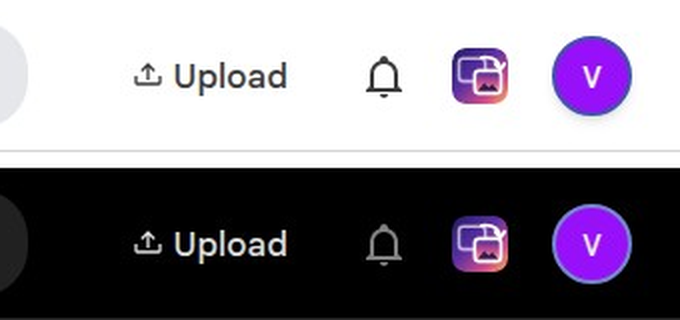

# Make Handoff easy to find

The page is reached by its address, and people who have never used it have to be told that address. This page shows how to put a way in **inside Immich**, so nobody has to type anything. Use the first part, or both.

## A button in Immich's own header



Your reverse proxy adds one line to Immich's pages. A small script from this app then puts the Handoff icon **between the notification bell and the avatar**, in line with the other buttons, and a click opens the page. It works in the light and the dark theme, on a desktop and in a phone's browser, and it stays while people move around Immich.

**What you need**

- Immich behind a reverse proxy that you control and that can change the pages it passes on. The configuration below is for **nginx**, tested against Immich 3.2.0. Another proxy that can rewrite a response can do the same (it only has to add one `<script>` tag); that has not been tried here.
- The Handoff page on **the same address as Immich, under a path** such as `/handoff/`. This is the second way in [Operations](operations.md#putting-the-page-behind-your-reverse-proxy): the page signs people in with Immich's cookie, and the script finds the page by where it was loaded from, so it needs no setting.

**The configuration.** Add the `map` to the `http` block, and the three marked lines to the `location` that passes Immich's pages on (the `/handoff/` location is the one from [Operations](operations.md#putting-the-page-behind-your-reverse-proxy)):

```nginx
# http block: add the script only for people who are signed in to Immich
map $cookie_immich_is_authenticated $handoff_script {
  default '</body>';
  'true'  '<script src="/handoff/static/immich-button.js" defer></script></body>';
}

server {
  # ... the /handoff/ location from Operations ...

  location / {
    proxy_pass http://immich-server:2283;
    proxy_http_version 1.1;
    proxy_set_header Host $host;
    proxy_set_header Upgrade $http_upgrade;
    proxy_set_header Connection "upgrade";

    proxy_set_header Accept-Encoding "";      # 1: the proxy has to read the page to change it
    sub_filter_once on;                        # 2: only the first </body>
    sub_filter '</body>' $handoff_script;      # 3: put the script tag in front of it
  }
}
```

Reload nginx, then reload an Immich page. If the page is `https://photos.example.com`, the script is `https://photos.example.com/handoff/static/immich-button.js`: open it in a browser to check that it loads.

**How it behaves**

- It is shown only to people signed in. The `immich_is_authenticated` cookie only decides whether to add the tag; it is not a security check, and the Handoff page checks the sign-in itself, as always.
- It uses the app's own icon and needs no setting. The text on hover is "Immich Handoff".
- Immich offers no place for a link, so the script finds Immich's avatar by what is true in every language (its title holds the person's email) and puts the link in front of it. **If an Immich update changes the header and the script cannot find it, a round button floats at the bottom right instead**, so the way in is never lost. The project's end-to-end tests run this against the Immich version they are pinned to, so a change shows up when that version is raised.
- Nothing else of Immich's page is changed, and the script reads nothing from it.
- If you add a Content Security Policy to Immich's pages in the proxy, the script comes from the same address, so `script-src 'self'` allows it. The icon needs `img-src 'self'`.

**What it does not do**

- The **Immich phone app** (not the browser) is a native app and does not show it. People using the app can open the page in the phone's browser once and use **Add to Home Screen**; see [Operations](operations.md#installing-the-page-on-a-phone).
- It does not tell people anything: it is only a way in. Immich's own notifications are not used for this (see below).

## Before people have signed in

Immich shows an optional message on its login page, set by an administrator (`server.loginPageMessage` in Immich's configuration; in the settings it is the login page message under server settings). It accepts a link, which was tried: it renders as a normal clickable link under the "Login" heading. For example:

```html
New here? <a href="https://photos.example.com/handoff/">Open Immich Handoff</a> to send photos to someone.
```

It is only seen while signing in, and Immich keeps people signed in for a long time (the cookie lasts over a year in the version tried), so this mainly helps new accounts. Use it together with the button.

## When you invite someone

An owner's **invitation link** (on their service's card, **Copy**) already takes the person straight to that service, so it needs no address at all: send it by message. Installing the page on the phone from that link keeps it on the home screen for next time.

## What was tried and does not work

- **Immich notifications.** An administrator's key can create a notification for a person, and it shows under the bell with a badge, but as plain text: an address in it is not a link and HTML is shown as typed. It also needs an administrator's API key, which this app never holds. Not recommended.
- **A panel or frame of the page inside Immich.** The page refuses to be framed (`frame-ancestors 'none'`), and Immich has no place to put one.
- **Immich's custom CSS setting** can restyle Immich but cannot add a link. It is only useful to restyle the button.
- **An extension for Immich's interface.** None was found; Immich's plugins are for workflow steps.
