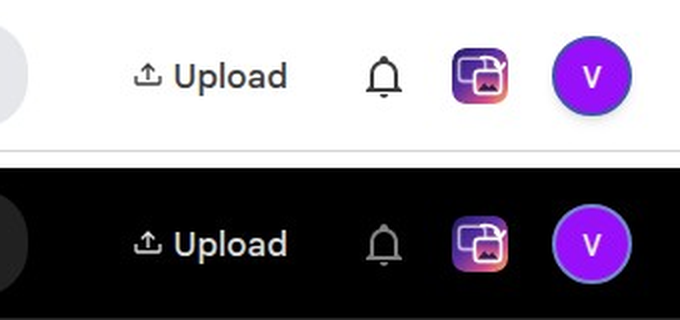
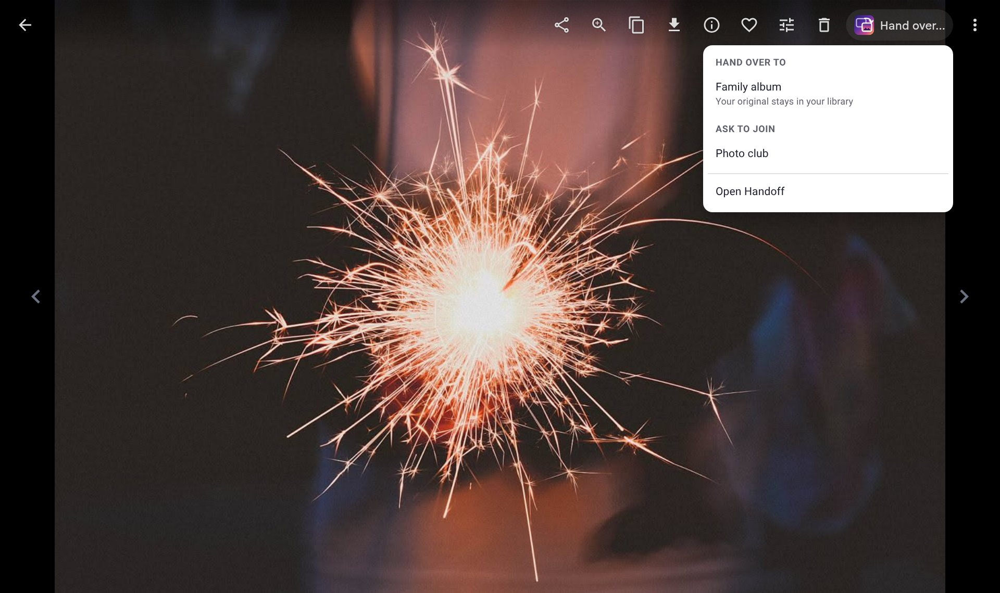
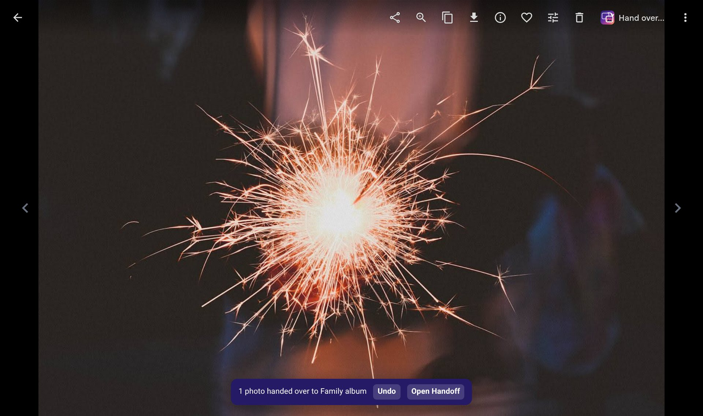

# Make Handoff easy to find

The page is reached by its address, and people who have never used it have to be told that address. This page shows how to put a way in **inside Immich**, so nobody has to type anything. Use the first part, or both.

## A button in Immich's own header



Your reverse proxy adds one line to Immich's pages. A small script from this app then puts the Handoff icon **between the notification bell and the avatar**, in line with the other buttons, and a click opens the page. It works in the light and the dark theme, on a desktop and in a phone's browser, and it stays while people move around Immich.

**What you need**

- Immich behind a reverse proxy that you control and that can change the pages it passes on. The configuration below is for **nginx**, tested against Immich 3.4.1. Another proxy that can rewrite a response can do the same (it only has to add one `<script>` tag); that has not been tried here.
- The Handoff page on **the same address as Immich, under a path** such as `/handoff/`. This is the second way in [Operations](operations.md#putting-the-page-behind-your-reverse-proxy): the page signs people in with Immich's cookie, and the script finds the page by where it was loaded from, so it needs no setting.

**The configuration.** Add the `map` to the `http` block, and the three marked lines to the `location` that passes Immich's pages on (the `/handoff/` location is the one from [Operations](operations.md#putting-the-page-behind-your-reverse-proxy)):

```nginx
# http block: add the script only for people who are signed in to Immich
map $cookie_immich_is_authenticated $handoff_script {
  default '</body>';
  'true'  '<script src="/handoff/static/immich-button.js" defer></script></body>';
}

server {
  # ... the /handoff/ location from Operations ...

  location / {
    proxy_pass http://immich-server:2283;
    proxy_http_version 1.1;
    proxy_set_header Host $host;
    proxy_set_header Upgrade $http_upgrade;
    proxy_set_header Connection "upgrade";

    proxy_set_header Accept-Encoding "";      # 1: the proxy has to read the page to change it
    sub_filter_once on;                        # 2: only the first </body>
    sub_filter '</body>' $handoff_script;      # 3: put the script tag in front of it
  }
}
```

Reload nginx, then reload an Immich page. If the page is `https://photos.example.com`, the script is `https://photos.example.com/handoff/static/immich-button.js`: open it in a browser to check that it loads.

**How it behaves**

- It is shown only to people signed in. The `immich_is_authenticated` cookie only decides whether to add the tag; it is not a security check, and the Handoff page checks the sign-in itself, as always.
- It uses the app's own icon and needs no setting. The text on hover is "Immich Handoff".
- Immich offers no place for a link, so the script finds Immich's avatar by what is true in every language (its title holds the person's email) and puts the link in front of it. **If an Immich update changes the header and the script cannot find it, a round button floats at the bottom right instead**, so the way in is never lost. The project's end-to-end tests run this against the Immich version they are pinned to, so a change shows up when that version is raised.
- The link changes nothing of Immich's page. The hand-over button below does read the page, to find its place and the photos you chose, and adds its own button and message; it changes nothing else.
- If you add a Content Security Policy to Immich's pages in the proxy, the script comes from the same address, so `script-src 'self'` allows it. The icon needs `img-src 'self'`.

**What it does not do**

- The **Immich phone app** (not the browser) is a native app and does not show it. People using the app can open the page in the phone's browser once and use **Add to Home Screen**; see [Operations](operations.md#installing-the-page-on-a-phone).
- It does not tell people anything: it is only a way in. Immich's own notifications are not used for this (see below).

## Hand over from inside Immich



With the same one line in your proxy, the script also adds a **Hand over...** button to Immich's own pages, so nobody has to know about tags:

- in the **photo viewer's toolbar**, before the three dots, for the photo being shown;
- in the **bar that appears when photos are selected**, before the three dots, for the selected photos;
- as a **Hand over...** line in the three-dot menu of both.

For a photo that is **not the person's own** (one from an album shared with them, or from a partner who shares their library) the same places show **Add to my library** instead: [see below](#add-to-my-library-from-inside-immich). A selection that mixes both kinds shows both buttons, each acting on its own part.

It opens a small list of **the services the person sends to**, each with whether the original stays or goes to the trash, and a note when photos will wait (the owner paused the service, the person paused their own sending, or a daily limit is reached). Choosing one hands the photos over exactly as if the service's tag had been put on them: the same pass, limits, quiet hours and taking back apply. A message in Immich's page says "3 photos handed over to Holiday" with **Undo** (it takes the tag off, so a pass that has not taken them yet leaves them) and a link to the app. 

The service used last is offered first (kept in that browser only; **Forget my choice** clears it), and services whose owner decides appear under **Ask to join**, so a person can ask without leaving Immich. Words come in the person's language.

**What it needs.** The same as the header link, because the button asks the app on the same address (`/handoff/immich/...`) with the person's Immich cookie: no key, no token and no cross-site setting are involved. It works for people who joined their services **from the page** (the app has their own key to tag with); people whose accounts are fixed in the configuration do not get a list.

**What it does not do.**

- It offers a button only when it can find its place and, for several photos, when it can be sure which are selected. Immich draws only the photos near the screen, so after **Select all** on a long timeline the number Immich shows can be larger than what the script has seen; then the button is not shown rather than guess. Choose photos one screen at a time, or tag them as before.
- **Hand over** is only for the person's **own** photos (at most 200 at a time); a photo from someone else's shared album is not handed over, it gets **Add to my library** instead.
- It sends nothing until a service is chosen.
- It does not work in the Immich phone app, only in a browser.

## Add to my library, from inside Immich

Immich keeps every photo in the account that uploaded it, so a photo someone shared with you can be looked at but is not yours: if the owner deletes it or stops sharing, it is gone. **Add to my library** copies it into your own library. It works for photos in **albums shared with you** and for photos of a **partner** who shares their library with you, and it needs no service and no one's permission: the app does it with your own Immich sign-in.

- **What is copied:** the file, its name and dates, the description and rating, the location, the archived state, and for a live photo the clip, linked to your own copy. The photo is a real photo of yours, and the person who shared it is not asked or told. (This is the same thing as downloading it and uploading it again; the original is never touched.)
- **Where it goes**, your choice the first time, and you can change it on the Overview page of the app (**Add to my library**): in your library tagged with who shared it (`from/<their name>`), in your library as it is, or in an album of yours (one you pick from the list, or a new name).
- **A photo that is already yours** is left alone, and pressing twice does not make a second copy.
- **Undo** takes the copies out again for 15 minutes after they were added: they go to Immich's trash, from where they can be restored. A copy you have since put in an album of your own stays.
- **A copy takes as much room as the photo does.** Adding a whole shared album doubles what it uses on the server.
- **To have an album's new photos offered to you automatically,** [follow the album](guides/automate.md#following-an-album-shared-with-you).

It shows in Immich for everyone who is signed in, including people who send to no service. It uses the same address, switch and limits as the **Hand over...** button below (at most 200 photos at a time).

**Switching it off.** `IMMICH_BUTTON_ACTIONS=false` keeps only the link in the header ([settings](settings.md)); the app then answers nothing for the button. If the app cannot be reached on the same address, or Immich's markup is not what the script looks for, the button is simply not there and the header link stays.

**Immich versions.** The script looks for a handful of things in Immich's page (a test id on the viewer's toolbar, an id on the selection bar, data attributes on the photos, ARIA roles on the menus); [the design note](design/immich-button-design.md) lists them. The end-to-end tests check them on the Immich version they are pinned to, so a change shows up when that version is raised. On another version the button can disappear; nothing else breaks.

## Before people have signed in

Immich shows an optional message on its login page, set by an administrator (`server.loginPageMessage` in Immich's configuration; in the settings it is the login page message under server settings). It accepts a link, which was tried: it renders as a normal clickable link under the "Login" heading. For example:

```html
New here? <a href="https://photos.example.com/handoff/">Open Immich Handoff</a> to send photos to someone.
```

It is only seen while signing in, and Immich keeps people signed in for a long time (the cookie lasts over a year in the version tried), so this mainly helps new accounts. Use it together with the button.

## When you invite someone

An owner's **invitation link** (on their service's card, **Copy**) already takes the person straight to that service, so it needs no address at all: send it by message (**Copy a message** writes one for you) or show its **QR code**; both are next to the link. Installing the page on the phone from that link keeps it on the home screen for next time.

## What was tried and does not work

- **Immich notifications.** An administrator's key can create a notification for a person, and it shows under the bell with a badge, but as plain text: an address in it is not a link and HTML is shown as typed. It also needs an administrator's API key, which this app never holds. Not recommended.
- **A panel or frame of the page inside Immich.** The page refuses to be framed (`frame-ancestors 'none'`), and Immich has no place to put one.
- **Immich's custom CSS setting** can restyle Immich but cannot add a link. It is only useful to restyle the button.
- **An extension for Immich's interface.** None was found; Immich's plugins are for workflow steps.
