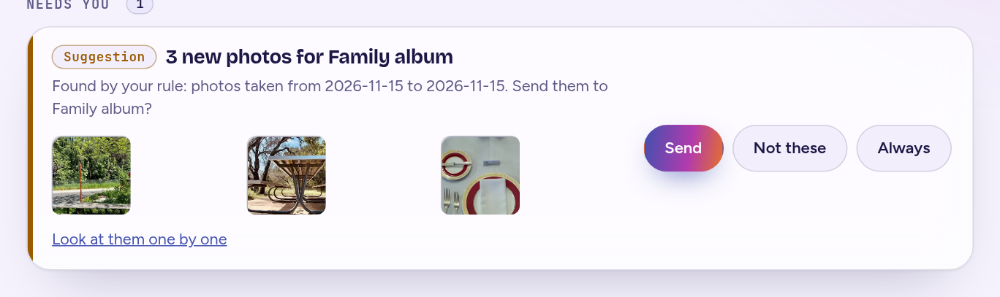
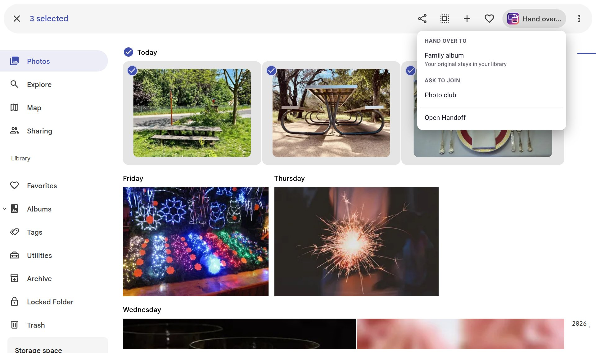

# Stop tagging by hand: rules and the button inside Immich

**Who it is for:** Senders who hand over often.

**What you get:** Rules that suggest photos of named people, places and dates, with one tap to send, and a **Hand over...** button inside Immich's own pages.

**What you see:** Suggestions with pictures on the Overview, and a message with **Undo** in Immich after a press.





## Rules: photos by who, where and when

Instead of tagging, a **rule** looks in your Immich for photos by **who is in them, where and when**, and asks you before anything is handed over. On the service's card (a service you joined from this page), under **Rules**, press **Make a rule** and choose what to look for. Everything you choose must hold for a photo to match:

- **Photos of** one or more people Immich has **named** in your library (with their faces), and **but not photos with** other people;
- **Taken between** two dates;
- a **place**, a country and optionally a city, picked from the places your own library holds photos from (Immich matches them exactly, and sometimes names a neighbourhood instead of a city);
- **In the album** one of yours, and **but not in the album** some others;
- a **phrase** ("a beach at sunset"), which needs smart search on your Immich server (machine learning). A rule with a phrase always asks you first.

The rule is shown as a sentence ("photos of Nora without Leo taken from 2026-05-03 to 2026-05-09 in Portugal") and can be paused or ended; to change one, end it and make another. A rule looks only at photos that reach Immich **from now on**, never at your old ones. Archived, hidden, locked and trashed photos never match, nor photos that are not yours. Photos wait a few minutes after they arrive in Immich before a rule can offer them, so that Immich has time to find the faces; a rule keeps looking at the past week of new photos, so a face found later still makes the photo appear.

**What a rule does with what it finds.** Every few minutes (`RULES_CHECK_MINUTES`, ten by default) each rule asks your Immich for matching photos among those that arrived in the last week and keeps the ones that really match: yours (not another person's in a shared album), not archived, trashed or hidden, with none of the people or albums you left out, a few minutes old, and not handled by this rule before. Each match is remembered with the reason it matched ("Nora in it, in Portugal"), and a photo is never found twice by the same rule. If something goes wrong (Immich does not accept the app's key, or a phrase is used on a server without smart search) the rule says so. Matches wait for you in a batch, shown on the Overview under **Needs you** as "3 new photos for Family" with small pictures and the rule that found them, with three answers:

- **Send** tags those photos with the service's tag in your Immich, exactly as if you had done it by hand, so everything else follows as usual (daily limits, quiet hours, take-back, the live scene). The tag is the one the service already uses, and it is taken off again when the photo is handed over.
- **Not these** remembers those photos as declined for that rule: they are never suggested by it again, and the rule goes on.
- **Always** sends them and counts. After a few, the rule can be let go on by itself (see below). A rule with a phrase has no **Always**.

**One rule for several services.** In the form, **Make the same rule for these services too** makes a copy of the rule for each other service you sent to, so "photos of Nora" can go to one service and to another. Each copy is a rule of its own, answered on its own (and can be paused, made automatic or ended on its own). **A photo goes to a service once**, however many of your rules for that service find it: when one has sent it, the others no longer offer it and a second yes does not hand it over again.

**How long a rule waits.** Immich finds the faces in a photo a little after it arrives and never says when it has finished, so a rule waits before it offers a photo: five minutes by default (`RULES_SETTLE_MINUTES`). When you make a rule you can choose a shorter or longer wait, from 1 to 60 minutes. A shorter wait shows new photos sooner, but a person who is found late may be missing when the photo is offered, or a person you left out may not have shown yet; a rule that sends by itself waits six times as long, so with two minutes it sends after twelve. The rule's row says when it has its own wait.

**Also look back.** A new rule only looks at photos that reach Immich from now on. **Also look back** on a rule's row suggests the **older** photos that match too, up to 200, newest first, as one batch of suggestions like any other: nothing old is sent without your yes, and the button waits until you have answered what is already waiting.

**Letting a rule send by itself.** A rule that sends photos of people to a service offers **Send by itself** from the start, and you do not have to answer **Always** first; the rules that make albums, add photos to your library or stack photos still offer it after three **Always**. Before it turns on, the app says which photos go where and that a wrong photo can reach the service. From then on it sends, without asking, the photos that reach Immich **after you switched it on**, once they have been there half an hour (six times the rule's wait, so every face has been found and a person you left out has shown), within the service's daily limit and quiet hours; you can still take a hand-over back. What was already waiting stays a suggestion, a line in your Activity says what was sent, and **Ask me first again** turns it back at any time. A rule with a phrase never sends by itself.

A card also has **Look at them one by one**: a page with every photo large, the reason under each and a tick on each. **Send the ticked photos** sends those and leaves the unticked out for good (this rule will not offer them again); there is **Not these** for the whole batch too. When a batch begins, you are told once (in your Activity, and on your devices or by email if you asked for those), with **Send** and **Not these** as one-tap buttons in the message: the link asks first and works once, as the other one-tap links do. A photo that joins a batch later does not tell you again.

Ending a rule never touches photos already handed over, and leaving the service ends its rules. The permissions the rule needs are the ones your key for the service has; for the albums it asks you to give the key **read albums**, through your own sign-in, as when you link an album.

**A rule for a pet.** Immich cannot tell animals apart, so a pet has no name to give a rule. Under **Make a rule for a pet**, pick **3 to 8 photos of your own** of the animal from your newest ones. The rule then asks Immich for the photos it finds most like each of them and offers those that arrived after the rule was made, with pictures, as suggestions: **Send** or **Not these**. It starts with the ten nearest to each example and learns from you: every photo you send becomes one more example (up to twelve) and widens how far down Immich's list the rule looks. Be ready for a **noisy start**: Immich gives no score, only an order, so the first batches may hold wrong photos; a pet that looks like another, or a small one beside people, is found badly (a dog that fills the frame is found best). A pet rule **always asks first**, has no *Always* and never sends by itself. It needs Immich's smart search (machine learning) to be on, and says so when it is not. **Also look back** suggests older photos in the same way.

### The optional pet helper

The pet rule is much more accurate with a small second container, the **pet helper**. It finds the cat or dog in each photo and compares **that animal** with the animal in your examples, so a pet that is small beside people is not lost among them, and about six times fewer wrong photos are offered at the same recall (measured in [#228](../design/pairing-design.md)). It is optional and the person who runs the app switches it on once for everybody:

```yaml
services:
  immich-handoff:
    environment:
      PET_SIDECAR_URL: http://pets:8090
  pets:
    image: vfuoglio/immich-handoff-pets:1
    restart: unless-stopped
    mem_limit: 512m
    # nothing outside the app needs to reach it, and it needs no network of its own beyond the app
```

- **What it costs:** an image of about 400 MB, about 110 MB of memory when idle and 200 to 300 MB at work, and about 0.4 seconds a photo on two processors; the pass looks at up to 30 new photos at a time, and a look back at up to 150.
- **What it does with photos:** the app sends it a **preview** of each photo of a person who has a pet rule, never the original; it keeps nothing, writes nothing to disk and calls nobody. Give it no other network access. The pet rule's key gets the permission to look at previews (`asset.view`) through your own sign-in when you make the rule, and loses it again when the helper is switched off and you next open the page.
- **What changes in the rule:** each example must show the animal (the app says which photo shows none) and the rule's card shows a box round the animal it found in each one, so that a photo with two animals is not ambiguous. A photo is offered when the animal in it is alike enough (a cutoff near 0.45 that your answers move: it goes down to what you accepted, and up when you turn a whole batch down). Each photo you send becomes one more example.
- **When it is down:** the rule says "the pet helper is not answering" and looks with Immich's own search until it is back. `doctor` checks the address and that it answers.
- **What it does not do:** it cannot tell two look-alike pets apart, a cat is found less well than a dog, and a pet rule still only suggests.

## Following an album shared with you

An album someone shared with you can be **followed**: what they add to it is offered to you, with pictures, to copy into your own library, so photos do not stay only in their account. On the Overview, under **Add to my library**, open **Follow an album shared with me**, choose the album, whether to start with what is in it now or only with what is added from now on, and where the copies go (in your library tagged with who shared it, in your library as it is, or in an album). This is the same copy as the [Add to my library button](../find-handoff.md#add-to-my-library-from-inside-immich).

- **It asks first.** New photos wait on the Overview as **N new photos in Trip, shared by Anna**, with **Add to my library**, **Not these** and **Always**; the card links to a page where you can look at them one by one. After you have answered **Always** three times you can let the album **add by itself**: photos added from then on are copied without asking, and you can turn that off at any time.
- **A key of your own.** The first time, the app makes a key named `handoff: library` in your Immich account, with your own sign-in. It can read what is shared with you and add to your own library and tag it, and it cannot delete or change a photo. You can delete it in Immich whenever you like (the album then says so), and the app deletes it when you stop following your last album.
- **Stop following** ends it; photos already copied stay in your library. If the owner stops sharing the album, the page says "the album is not shared with you any more".
- The person who shared the album is not told. A copy takes as much room as the photo does.

How it works: [the design note](../design/library-design.md).

## Smart albums that fill themselves

Immich has no album that keeps itself up to date from a rule. The app can: on the **Settings** view, under **My library**, **Smart albums**, open **Make a smart album** and choose:

- **The album.** One of your own, or a new one with the name you type (an album of yours with that name is used).
- **What belongs in it.** The same choices as any rule: people (and people to leave out), dates, a place, an album to look in (or leave out), a **camera** (make and model), **tags** (a photo must have all you pick) and a phrase that needs smart search. Everything you choose must hold.
- **Take out photos that no longer match** (off by default). Then, each time the rule looks, a photo **the app put in the album** that Immich no longer finds for the rule is taken out of the album (it stays in your library). A photo you added by hand is never touched, and a photo taken out is not offered again. It does not work with a phrase, because a phrase only finds the closest 100 photos.

Then the rule works like the others:

- **It asks first.** New matches wait on the Overview as **N new photos for the album …**, with **Put them in the album**, **Not these** and **Always**; the card links to a page where you can look at them one by one. A rule only looks at photos that reach Immich after it was made, and waits for each photo to settle, like any rule. After you have answered **Always** three times you can let the album **fill itself** with photos that arrive from then on; a rule with a phrase always asks first.
- **Older photos ask first too.** **Look for older photos** offers up to 500 of the photos that match and were in Immich before the rule (or before last week); press it again for the next 500. Photos already in the album are never offered.
- **It only adds,** unless you switched on taking out. It never deletes a photo, renames or deletes an album.
- **A key of your own.** The first time, the app makes a key named `handoff: smart albums` with your own sign-in. It can read your photos and albums, make an album and put photos in it; with taking out switched on it can also take photos out of an album. It cannot change, share or delete an album, or touch a photo. You can delete it in Immich whenever you like (the rule then says so), and the app deletes it when you stop your last smart album.

The camera and the tags can also be chosen in the form of an ordinary rule for a service.

How it works: [the design note](../design/albums-design.md).

## Albums from the folders of an external library

If part of your Immich is an **external library** (folders on the server that Immich reads in place), its photos are not in any album. The app can offer an album for each folder, named after it, and put the photos in it. On the Overview, under **Albums from my folders**, open **Make albums from a folder** and fill in:

- **The folder, as Immich knows it**, such as `/external/photos`. Immich lets only its administrator list libraries, so you type it: it is the path Immich shows for one of your photos from the library, up to the folder you want. As you type, the form says how many of your photos it finds under that folder and which albums it would make. Only your own photos count, and `/external/photos` does not also take `/external/photos-old`.
- **Which folder is an album.** By default the folder each photo is in. Or the first, second or third folder below the one you typed, so `/photos/2025-02/paris/a.jpg` goes in `paris`, `2025-02`, or `paris` again. A photo with no folder at that level (directly in the folder you typed, say) has no album and is left alone.
- **The name.** After the folder (`paris`) or after the folder and the one above it (`2025-02 / paris`). With the first, two folders with the same name in different places make **one** album; the second keeps them apart.

Then the rule works like the others:

- **It asks first.** What is there now waits on the Overview as **N photos for M albums from your folders**, with the album names, and **Make the albums**, **Not these** and **Always**; the card links to a page where you can look at the photos one by one, each with its album. After you have answered **Always** three times you can let the rule **make albums by itself** for photos that arrive from then on.
- **It only adds.** An album of yours with that name is used; otherwise it is made. Nothing is ever removed from an album, renamed or deleted. If you rename a folder, the new name makes a new album and the old one stays.
- **A big folder takes its time.** The first look at a folder of hundreds of thousands of photos is spread over several passes (at most 500 new photos each); after that a pass only lists what came to Immich since the last one.
- **A key of your own.** The first time, the app makes a key named `handoff: folders` with your own sign-in. It can read your photos and your albums and make an album and put photos in it, and it cannot change, share or delete an album, or touch a photo. You can delete it in Immich whenever you like (the rule then says so), and the app deletes it when you stop your last folder rule.

How it works, and what Immich does with an external library: [the design note](../design/folders-design.md).

## Stacking photos that belong together

A camera that shoots RAW and JPEG leaves two files of each shot, an editor leaves an edit next to its original, and a burst leaves many frames: Immich shows each as a photo of its own, unless they are **stacked**. The app can offer to stack them. On the Overview, under **Stack photos that belong together**, open **Stack photos by a rule** and choose:

- **A RAW and its JPEG.** Two files with the same name in one folder (`IMG_0042.CR2` and `IMG_0042.JPG`) taken at the same moment.
- **An edit and its original.** A file named like another with `-edited`, `_edit` or a number in brackets (`IMG_0042-edited.jpg`, `IMG_0042 (1).jpg`), taken at the same moment. A RAW, its JPEG and an edit are one stack.
- **A burst.** Three or more shots from one camera, each a moment after the last. This is a guess, so it **always asks first**, whatever you answer.
- **The cover.** The JPEG (the default), the RAW, or the edit.
- **A folder** (optional), to stack only what is in it; empty means your whole library. As you choose, the form says how many of your photos it looked at and what it found.

Then the rule works like the others:

- **It asks first.** The groups wait on the Overview as **N groups of photos to stack**, with one photo of each and **Stack them**, **Not these** and **Always**; the card links to a page showing every photo of every group, where you can untick a group. After you have answered **Always** three times you can let the rule **stack by itself**: pairs and edits that arrive from then on are stacked without asking; bursts still ask. A rule that only stacks bursts cannot be let go on by itself.
- **It only stacks.** It never changes or deletes a photo. A photo that is already in a stack is left alone, and a group with a photo in a stack is skipped, never merged.
- **Undo.** For 15 minutes after the app has made stacks, the rule's row offers **Undo**: it takes apart the stacks the app made, and only those (the photos stay, and are not offered again). A stack you changed yourself in the meantime is left as it is.
- **A late RAW.** A RAW that comes an hour after its JPEG is still paired with it. A big library is looked at in passes of at most 500 photos; later passes look only at what is new.
- **A key of your own.** The first time, the app makes a key named `handoff: stacks` with your own sign-in. It can search your photos, make a stack, read it and take it apart, and it cannot delete or change a photo. You can delete it in Immich whenever you like (the rule then says so), and the app deletes it when you stop your last stacking rule.

Immich's phone app already stacks edits made in other apps when they are uploaded (since 3.3.0); this covers what that does not: a camera's RAW and JPEG, bursts, and edits already in the library. How it works: [the design note](../design/stacks-design.md).

## Handing over from inside Immich

If your administrator has put the Handoff button in Immich's pages ([Make Handoff easy to find](../find-handoff.md#hand-over-from-inside-immich)), you can hand photos over without tags: open a photo, or select several, and press **Hand over...** in the toolbar (or choose **Hand over...** in the three-dot menu). Pick the service; Immich's page then says how many photos were handed over, with **Undo** for a moment. The list shows only services you send to from this page, says whether your original stays or goes to your trash, and warns when photos will wait (a pause, a daily limit). The service you used last is first in the list; **Forget my choice** clears it. A service whose owner decides is listed under **Ask to join**; pressing it asks, and the list then says **Waiting for approval**. Only your own photos can be handed over, up to 200 at once. It does the same as putting the tag on, so everything above about limits, quiet hours and taking back applies.
