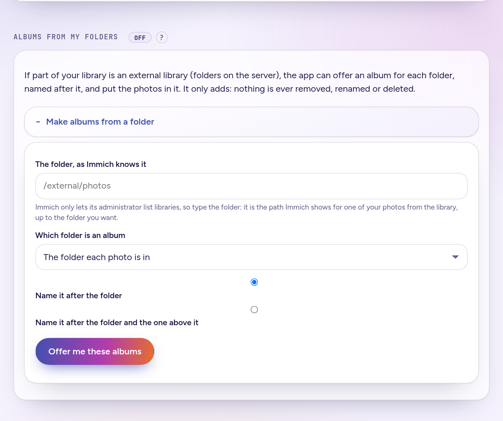

# Albums from the folders of an external library

If part of your Immich is an **external library** (folders on the server that Immich reads in place), its photos are not in any album. The app can offer an album for each folder, named after it, and put the photos in it.

## Make albums from a folder

On your page, in **Settings** under **Albums from my folders**, open **Make albums from a folder** and fill in:

- **The folder, as Immich knows it**, such as `/external/photos`. Immich lets only its administrator list libraries, so you type it: it is the path Immich shows for one of your photos from the library, up to the folder you want. As you type, the form says how many of your photos it finds under that folder and which albums it would make. Only your own photos count, and `/external/photos` does not also take `/external/photos-old`.
- **Which folder is an album.** By default the folder each photo is in. Or the first, second or third folder below the one you typed, so `/photos/2025-02/paris/a.jpg` goes in `paris`, `2025-02`, or `paris` again. A photo with no folder at that level (directly in the folder you typed, say) has no album and is left alone.
- **The name.** After the folder (`paris`) or after the folder and the one above it (`2025-02 / paris`). With the first, two folders with the same name in different places make **one** album; the second keeps them apart.

## Then it works like the other rules

- **It asks first.** What is there now waits on the Overview as **N photos for M albums from your folders**, with the album names, and **Make the albums**, **Not these** and **Always**; the card links to a page where you can look at the photos one by one, each with its album. After you have answered **Always** three times you can let the rule **make albums by itself** for photos that arrive from then on.
- **It only adds.** An album of yours with that name is used; otherwise it is made. Nothing is ever removed from an album, renamed or deleted. If you rename a folder, the new name makes a new album and the old one stays.
- **A big folder takes its time.** The first look at a folder of hundreds of thousands of photos is spread over several passes (at most 500 new photos each); after that a pass only lists what came to Immich since the last one.

## Good to know

- **A key of your own.** The first time, the app makes a key named `handoff: folders` with your own sign-in. It can read your photos and your albums and make an album and put photos in it, and it cannot change, share or delete an album, or touch a photo. You can delete it in Immich whenever you like (the rule then says so), and the app deletes it when you stop your last folder rule.

## If something is off

- **The form finds 0 photos.** The folder is not the path Immich shows for your photos: open one of them in Immich, read its path and type it up to the folder you want.
- **A photo has no album.** It sits directly in the folder you typed, with no folder at the level you chose.

## What next

- Smart albums from a rule: [Smart albums](smart-albums.md)
- See your albums as folders: [Album tree](../show/album-tree.md)

How it works, and what Immich does with an external library: [the design note](../../contributing/design/folders-design.md).
