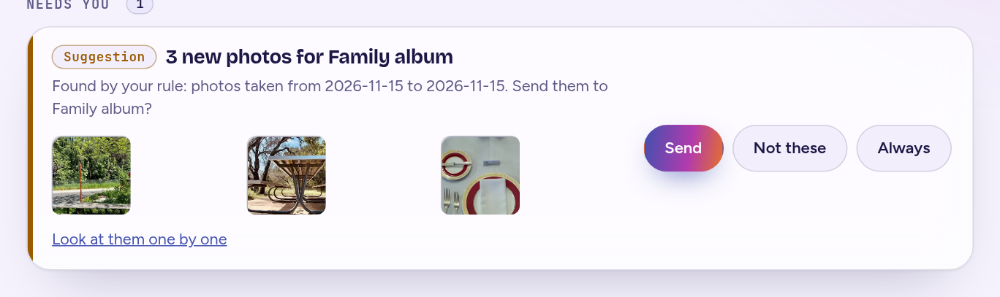
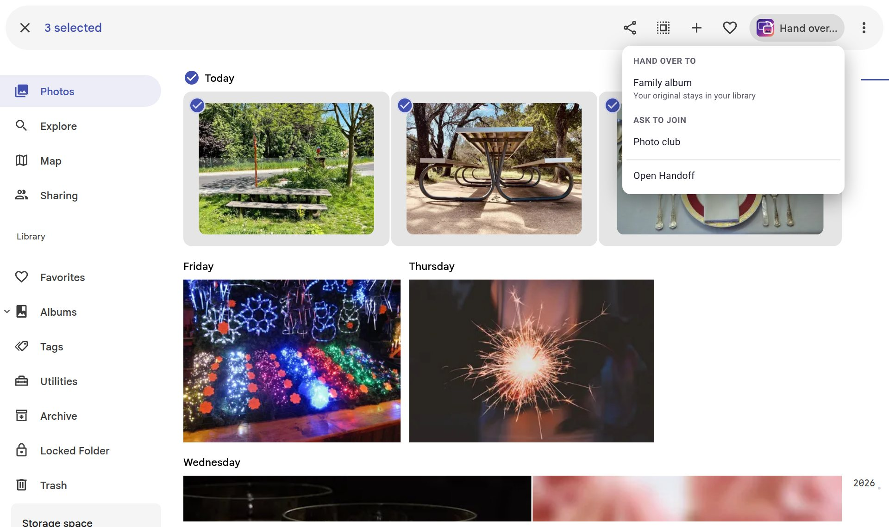

# Rules: photos by who, where and when

**Who it is for:** Senders who hand over often.

**What you get:** Rules that suggest photos of named people, places and dates, with one tap to send, and a **Hand over...** button inside Immich's own pages.

**What you see:** Suggestions with pictures on the Overview, and a message with **Undo** in Immich after a press.

Instead of tagging, a **rule** looks in your Immich for photos by **who is in them, where and when**, and asks you before anything is handed over. On the service's card (a service you joined from this page), under **Rules**, press **Make a rule** and choose what to look for. Everything you choose must hold for a photo to match:

- **Photos of** one or more people Immich has **named** in your library (with their faces), and **but not photos with** other people;
- **Taken between** two dates;
- a **place**, a country and optionally a city, picked from the places your own library holds photos from (Immich matches them exactly, and sometimes names a neighbourhood instead of a city);
- **In the album** one of yours, and **but not in the album** some others;
- a **phrase** ("a beach at sunset"), which needs smart search on your Immich server (machine learning). A rule with a phrase always asks you first.

The rule is shown as a sentence ("photos of Nora without Leo taken from 2026-05-03 to 2026-05-09 in Portugal") and can be paused or ended; to change one, end it and make another. A rule looks only at photos that reach Immich **from now on**, never at your old ones. Archived, hidden, locked and trashed photos never match, nor photos that are not yours. Photos wait a few minutes after they arrive in Immich before a rule can offer them, so that Immich has time to find the faces; a rule keeps looking at the past week of new photos, so a face found later still makes the photo appear.

**What a rule does with what it finds.** Every few minutes (`RULES_CHECK_MINUTES`, ten by default) each rule asks your Immich for matching photos among those that arrived in the last week and keeps the ones that really match: yours (not another person's in a shared album), not archived, trashed or hidden, with none of the people or albums you left out, a few minutes old, and not handled by this rule before. Each match is remembered with the reason it matched ("Nora in it, in Portugal"), and a photo is never found twice by the same rule. If something goes wrong (Immich does not accept the app's key, or a phrase is used on a server without smart search) the rule says so. Matches wait for you in a batch, shown on the Overview under **Needs you** as "3 new photos for Family" with small pictures and the rule that found them, with three answers:

- **Send** tags those photos with the service's tag in your Immich, exactly as if you had done it by hand, so everything else follows as usual (daily limits, quiet hours, take-back, the live scene). The tag is the one the service already uses, and it is taken off again when the photo is handed over.
- **Not these** remembers those photos as declined for that rule: they are never suggested by it again, and the rule goes on.
- **Always** sends them and counts. After a few, the rule can be let go on by itself (see below). A rule with a phrase has no **Always**.

**One rule for several services.** In the form, **Make the same rule for these services too** makes a copy of the rule for each other service you sent to, so "photos of Nora" can go to one service and to another. Each copy is a rule of its own, answered on its own (and can be paused, made automatic or ended on its own). **A photo goes to a service once**, however many of your rules for that service find it: when one has sent it, the others no longer offer it and a second yes does not hand it over again.

**How long a rule waits.** Immich finds the faces in a photo a little after it arrives and never says when it has finished, so a rule waits before it offers a photo: five minutes by default (`RULES_SETTLE_MINUTES`). When you make a rule you can choose a shorter or longer wait, from 1 to 60 minutes. A shorter wait shows new photos sooner, but a person who is found late may be missing when the photo is offered, or a person you left out may not have shown yet; a rule that sends by itself waits six times as long, so with two minutes it sends after twelve. The rule's row says when it has its own wait.

**Also look back.** A new rule only looks at photos that reach Immich from now on. **Also look back** on a rule's row suggests the **older** photos that match too, up to 200, newest first, as one batch of suggestions like any other: nothing old is sent without your yes, and the button waits until you have answered what is already waiting.

**Letting a rule send by itself.** A rule that sends photos of people to a service offers **Send by itself** from the start, and you do not have to answer **Always** first; the rules that make albums, add photos to your library or stack photos still offer it after three **Always**. Before it turns on, the app says which photos go where and that a wrong photo can reach the service. From then on it sends, without asking, the photos that reach Immich **after you switched it on**, once they have been there half an hour (six times the rule's wait, so every face has been found and a person you left out has shown), within the service's daily limit and quiet hours; you can still take a hand-over back. What was already waiting stays a suggestion, a line in your Activity says what was sent, and **Ask me first again** turns it back at any time. A rule with a phrase never sends by itself.

A card also has **Look at them one by one**: a page with every photo large, the reason under each and a tick on each. **Send the ticked photos** sends those and leaves the unticked out for good (this rule will not offer them again); there is **Not these** for the whole batch too. When a batch begins, you are told once (in your Activity, and on your devices or by email if you asked for those), with **Send** and **Not these** as one-tap buttons in the message: the link asks first and works once, as the other one-tap links do. A photo that joins a batch later does not tell you again.

Ending a rule never touches photos already handed over, and leaving the service ends its rules. The permissions the rule needs are the ones your key for the service has; for the albums it asks you to give the key **read albums**, through your own sign-in, as when you link an album.
