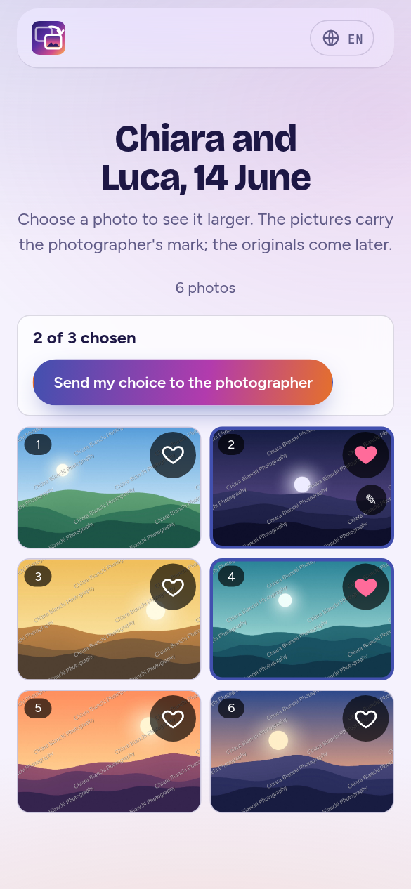
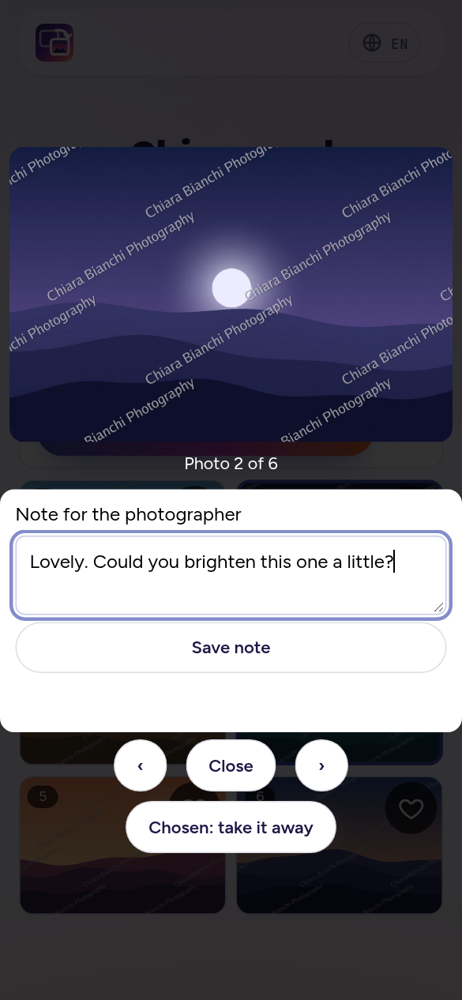
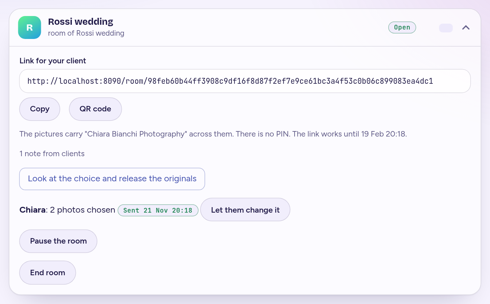
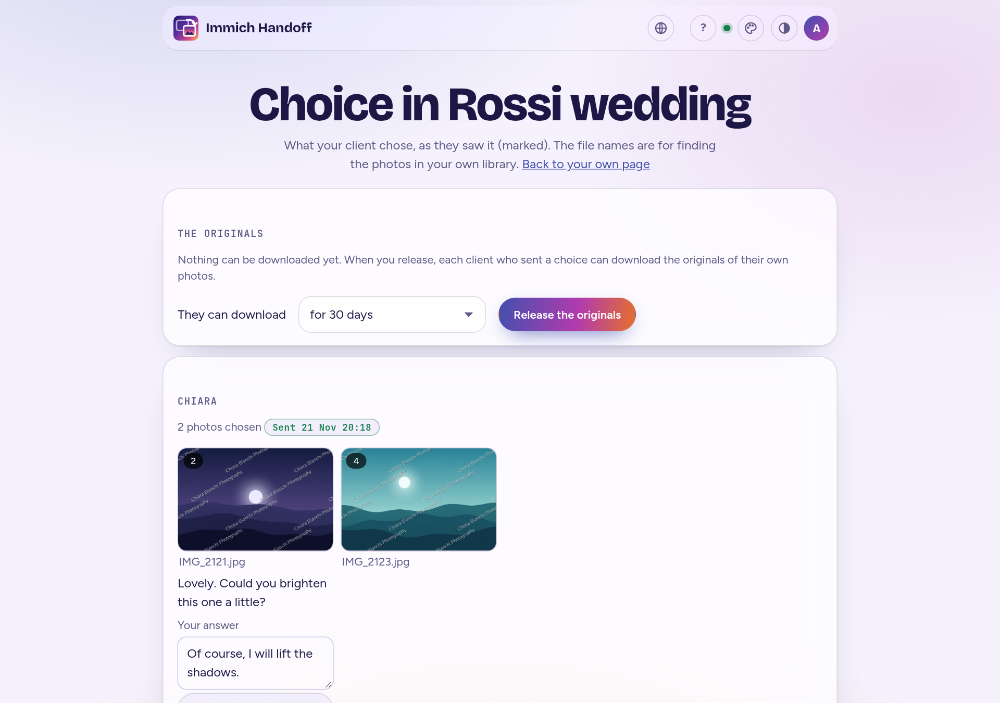

# Deliver a shoot to a client

**Who it is for:** Photographers and small studios.

**What you get:** A room the client opens on a phone, through marked pictures: favourites up to a limit, notes, rounds, and you release the originals when you decide.

**What you see:** The client's choices and notes on your page, and the originals released only by you.

## Client rooms: a shoot for a client to look at and choose from

A **client room** is for photographers: a link where your client looks at one of your albums through pictures marked with your name, and, as the next releases arrive, chooses favourites and takes the originals when you release them. It is a kind of its own next to drop boxes: on the Services tab, **Make a client room** asks for a name (yours), a title for the client (optional), the album, a PIN (optional, 4 to 40 characters) and how long the link works.

 

### Making a room

On the Services tab, **Make a client room** asks for a name (yours), a title for the client (optional), the album, how the pictures are marked, who chooses and how many photos at most, whether clients may write notes, whether the room goes through several rounds, whether the originals are released by themselves, a PIN (optional, 4 to 40 characters) and how long the link works. You can have 20 rooms.

- **The photos are the album's.** Photos you add to the album appear in the room within a couple of minutes, and photos you take out disappear. Photos and videos are shown in the order they were taken; archived and trashed ones never are. A room shows at most 2000 photos.
- **The link** has a QR code and is as private as its length; with a PIN the client needs both. **Pause the room** to make the link show nothing for a while; **End room** deletes the link and the key at once. You can have 20 rooms.

### What the client sees

- **What the client sees.** The link opens a page with the room's title and the marked pictures as a grid, in the order they were taken, numbered (a video has a small play mark and shows its marked poster picture). A tap opens a picture larger, and the arrow keys, the buttons or a swipe move to the next one. Nothing on the page says whose Immich it is, which album it is, or where the originals are: a client sees the title you gave, the pictures and numbers, and nothing else. The page is in the client's language (the six the app speaks), works on a phone first and in both colour schemes, is never indexed or cached, and sends no referrer.
- **The PIN.** With a PIN the page shows nothing, not even the title, until it is given; it is then remembered in that browser for a week. Five wrong tries from one connection in ten minutes silence it for ten minutes more. While you have paused the room the page says it is closed for now; once it has ended, or for a link that never existed, the answer is the same "not found".
- **The pictures are marked.** The client never sees a plain picture: the app fetches Immich's preview (about 1440 pixels on the long side), draws your mark on it and sends that. You choose how when you make the room: **text repeated across the picture** (diagonally, white with a soft shadow so it reads on light and dark photos; your name if you give no text), **your logo in the bottom right corner** (JPEG, PNG or WebP up to 300 KB), or **both**. The text is repeated over the whole picture, so it cannot be cropped out. A picture that cannot be marked is not shown at all, never shown plain. Immich can make previews as JPEG or WebP; both are read. A video is shown as its marked poster picture; the video itself comes with the release. A mark that is photographed off a screen is still a copy of a marked picture, which is what it is for.

### Choosing, notes and rounds

- **Choosing.** Each photo has a heart; the client presses it to choose the photo and again to take it back, and a counter says "12 of 30 chosen" (or "12 photos chosen" when there is no limit). The most photos is yours to set when you make the room (1 to 5000, or none); beyond it the client is told, in words, to take one away first. In the large view the photo can be chosen too. **Send my choice to the photographer** finishes the choice: it is locked from then on, shown read-only, and you are told through your notification settings (kind *Drop boxes*; the room's card on the Services tab and the *Needs you* card come with a later release). A client who sends fewer than the limit is asked first whether to go ahead. Without the script every press is a form that comes back to the page, so it works everywhere.
- **Who chooses** is yours to set per room. **Everyone with the link, together**: one choice for the room (a couple choosing together), and the name each person gave is kept with each pick. **Each person on their own**: every visitor has a choice of their own and sends it on their own (one person's Done does not lock another's). **One named client**: the first visitor to give a name is the one who chooses; the others see the photos and the choice but cannot change it. A visitor is told apart by a secret that their browser keeps (hashed with the room's link, never shown to you or anyone); the name is what they typed.
- **Notes on photos** are a choice you make per room: **None** (clients only choose), **a short note to me on each photo**, or **notes, and I can answer each one**. A client writes a note in the large view of a photo ("brighten this one", "crop here"; plain text, up to 280 characters, up to 200 for one choice) and a small pencil marks the photo. Notes belong to a choice (in a room where everyone chooses together they share them) and can be written until the choice is sent, then they are locked with it. You see each note under its photo on the review page, and the room's row counts them; a photo that has only a note and was not chosen is marked **only a note**. Where replies are on, a form under the note sends your answer, which the client sees in the large view of that photo. Writing a note again makes it a new note (its answer is cleared). Notes go with the room when it ends.
- **Rounds.** A room is made for **one round** or for **several rounds**. In a room for several, once clients have sent their choices, the review page has **Start round 2**, with the most photos to choose in that round (empty: no limit). In the new round each client sees **only the photos they chose in the round before** (a visitor who chose nothing has nothing to choose from; in a shared or named room it is the group's or the named client's choice), the photos keep the numbers they have in the room, and the choice starts empty with the new limit. The photographer can look at every round: earlier rounds are listed on the review page and stay as they were. Notes do not carry over: each round is a new conversation. A room has at most five rounds. **What is delivered is the last round's choice**; once you have released the originals the room cannot start another round (take the release back first).

### What you see, and releasing the originals

- **What you see.** The room's row on the Services tab lists each selection (the name the client gave, how many photos, **Sent** with the time or **Still choosing**) and **Let them change it** gives a sent choice back to its client. When a client sends a choice you get a line in your Activity ("Chiara finished choosing in Rossi wedding: 28 photos"), a **Choice sent** card under *Needs you*, and, if you turned them on, a notification on your device or an email, which also reach you under "only what needs me"; the app's administrator is told too (kind *Drop boxes*).
- **Looking at the choice, and releasing the originals.** **Look at the choice and release the originals** on the room's row opens a page with each selection: the chosen photos as the client saw them (marked), numbered as in the room, with their **file names** (and a box with them all, one on each line, for finding the photos in your own library). **Release the originals** is yours to press (after you have been paid, say), with how long the downloads work (7, 30 or 90 days, or as long as the room works). Releasing adds the download permission to the room's key with your own sign-in, which is the first moment it has it; each client who sent a choice then sees **Your photos are ready** with a ZIP of the originals of *their own* photos (and a download on each), made while they download, and only for the choice they sent (a named room: only for the client who chose). **Take the release back** removes the permission again and stops all downloads. The ZIPs started are counted; a room gives out at most three ZIPs at a time and a client one.
- **Release by itself.** In the room's form, **Release the originals as soon as the client sends their choice** skips your step. Nobody is signed in when a client presses *Done*, so the room's key has the download permission from the start; the app still gives out nothing before a choice is sent. Taking the release back also switches this off.
- **The key cannot download.** The room has a key of its own in your Immich account that can only look at pictures and list an album's photos. It has no permission to download an original: that is added by your own session when you release the photos, and never before.

### What a room cannot do

- **A marked picture can still be photographed off a screen.** The mark makes a copy worth little, not impossible.
- **The room's key can look at any picture in your account** (Immich cannot limit a key to one album), so the app is what limits it; see [Security](../security.md#drop-boxes) for what is checked and tested.
- **Videos are shown as a marked still**; the video itself comes only with the release.
- **A client has no account**: the room cannot tell two people apart except by the browser they use, so a client who uses another browser starts a new choice (in a room where everyone chooses together they join the same one).
- **Very large shoots**: a room shows at most 2000 photos of its album.
