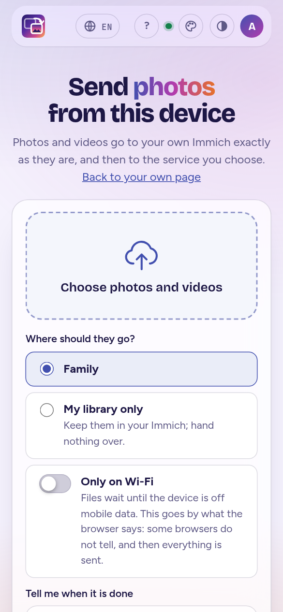
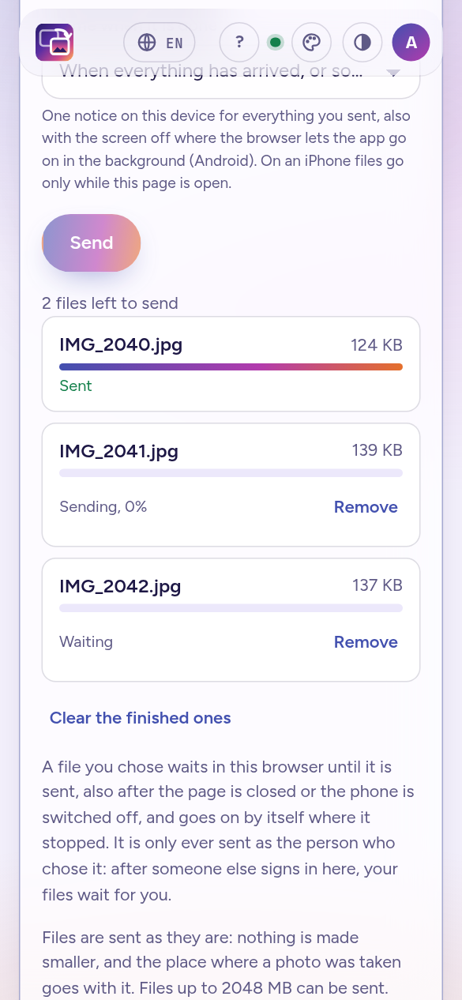

# Send photos from a phone

**Who it is for:** Anyone who wants to send straight from the phone's gallery.

**What you get:** A **Send** tab that sends photos and videos in pieces that survive a lost connection, and a Share-menu entry on Android.

**What you see:** Each file's progress on the Send tab, then the photo in the receiver's library.

## Send photos from a phone

Tagging in the Immich app is one way to send. The other is the **Send** tab of this page (or **Send photos from this device** in the command palette): choose photos and videos from the phone you are holding, choose **where they go**, and press **Send**. This guide says what each kind of phone can and cannot do. It was tried in Chrome (with a real service worker, in the tests) and has not been tried on a real Android or iPhone, so where it says what a phone's browser does, that is what the browsers document, and phones differ.

 

### What happens to the photos

- **Where they go.** Every service you send to is listed, the one you chose last on top and selected; **My library only** keeps them in your own Immich and hands nothing over. A person who sends to no service has only that choice, and anyone signed in to Immich may use the page.
- **Where they land.** In **your own Immich**, stored with your own sign-in (so Immich's rules for your account apply), exactly as they are: nothing is made smaller, and the place where a photo was taken goes with it. For a service they are then tagged with the service's tag, and from there everything is the same as for a photo you tagged yourself: the daily limit, quiet hours, what the service accepts, the expiry and taking back. A photo Immich already has is reported as **Already in your library**.
- **A lost connection costs a piece, not a video.** Files go in pieces of at most 4 MB. The app keeps the pieces on its disk, in the data folder (`phone-uploads`, not in backups), until the file is whole, and deletes them when the file is stored, when you remove it, and after 48 hours if nobody finished it (`PHONE_UPLOAD_KEEP_HOURS`). If the connection drops the page waits and carries on from where the server says it stands.
- **Limits.** One file may be at most 2 GB (`PHONE_UPLOAD_FILE_MB`) and one person may have 4 GB waiting at a time (`PHONE_UPLOAD_WAITING_MB`); a file over a limit is refused before it starts, with the reason. Only photos and videos are accepted, by what the file really is, not by its name. This needs the app's data folder; without it the page says so.
- **Whose files.** A file waits in the browser as the person who chose it and is only ever sent as that person: if someone else signs in to Immich in the same browser, they do not see your files and cannot send them, and the app refuses a file named for another person. When you sign in again your files go on where they stopped.
- **Locations.** Photos keep the place where they were taken, and Handoff changes nothing in them, so the place goes with them to your Immich and to the people you send them to. The page says so once, the first time you send from a browser.

### The queue

What you send waits in a list that is kept in the browser's own database, so it survives a closed page, a restarted phone and a night without signal. Each file shows its progress; **Waiting for the network** is shown while there is none, and it goes on by itself when the connection is back; a file that was refused says why and has **Send again**; **Remove** takes a file out of the line (and tells the app to throw its pieces away); **Clear the finished ones** tidies the list. Files go one at a time. If the browser has no room left to keep a file waiting, the page says which and keeps the rest; if it cannot keep anything past the page at all (a private window, say), it says so, and the page must stay open.

**Only on Wi-Fi** holds files back while the device is on mobile data. It is a hint: it goes by what the browser says about the connection, and many browsers (Safari on iPhone among them) say nothing, so there everything is sent. Before a video of about 100 MB or more goes over mobile data, the page asks whether to send it now or wait for Wi-Fi.

### On Android

1. Open the Send page in Chrome and press **Install Handoff** (or the browser's menu, **Install app** or **Add to Home screen**).
2. In the gallery choose photos and videos, tap **Share**, then **Handoff**. The page opens with what you shared waiting: pick where it goes and press **Send**. Nothing is sent before you choose, and the shared files are kept in the browser meanwhile. If you were not signed in to Immich at that moment, the page asks you to sign in; open **Send** again afterwards and the files are there.
3. **With the screen off.** Chrome has Background Sync, so what is left goes on in the app's worker when the screen goes off or the page is closed, at once if there is a network and when it comes back if not (when **Only on Wi-Fi** holds it back, it waits for you to open the page).
4. **Tell me when it is done** chooses what you hear: one notice on the device, when the queue has emptied, for everything that ended since the last one (a batch of fifty is one message: "38 photos arrived in your Immich", "2 photos could not be sent"), or only trouble, or never. Notices need the browser's permission, asked when you choose anything but **Never**, and you are not told while you are looking at the page. A photo sent to a service also shows on the live stream of the Overview like any other hand-over.

Limits: Chrome offers the Share entry only to an **installed** app (without it the page tells you to choose the photos on the Send page instead), and the shared files pass through the phone's memory once, so share a few at a time and choose very large videos on the Send page.

### On an iPhone

- Open the Send page in Safari, tap **Share**, then **Add to Home Screen**. It then opens like an app, with the same sign-in.
- Tap **Choose photos and videos** and pick from the photo library. The picker's own **Options** decide whether the location goes with a photo, and Safari may hand over a HEIC photo as a JPEG; the page cannot change either. For exact originals use [Immich's own app](#sending-the-camera-roll-automatically).
- **Shortcut.** To get to the page in one tap, make a shortcut: in the **Shortcuts** app, **+**, **Add Action**, **Open URLs**, type the address of your Handoff page followed by `/send`, name it "Send to Handoff", and **Add to Home Screen**. A shortcut can only **open** the page: it has no Immich sign-in, so it cannot carry photos in or send them itself.
- **What an iPhone cannot do.** A web page has no entry in the iPhone's Share menu, so there is no "Share, Handoff"; Safari has no Background Sync, so files go **only while the page is open** (the page says so; the screen may dim but not lock); and the arrival notice needs notifications turned on for the home-screen app (iOS 16.4 and later). Files that were cut off carry on from where the server has them the next time the page is open.

### Sending the camera roll automatically

Handoff cannot watch a phone's camera roll: a web page is not allowed to. The route that does is **Immich's own mobile app**, which backs up the camera roll to your account, together with Handoff's [whole-album hand-over](../share/household.md#handing-over-a-whole-album):

1. On the phone, make an album (in the gallery) for what you want to hand over, for example "To share".
2. In the Immich app, **Backup**: select that album for backup and switch on **Sync albums** (the name may differ between versions of the app), which makes an album of the same name in your Immich as the photos arrive.
3. On the Handoff page, link that Immich album to the service (**Hand over a whole album**, on the service's card). Everything that lands in it is handed over, under the service's rules, and the app looks at the album every 15 minutes.

For one photo at a time, tagging it in the Immich app (**Add tags**) still works as always.

See [Settings](../../reference/settings.md) for the three settings and [Security](../../reference/security.md#drop-boxes) for what is kept and who can reach it.
