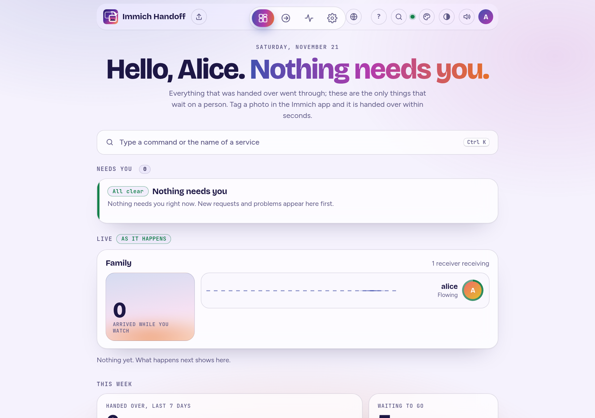
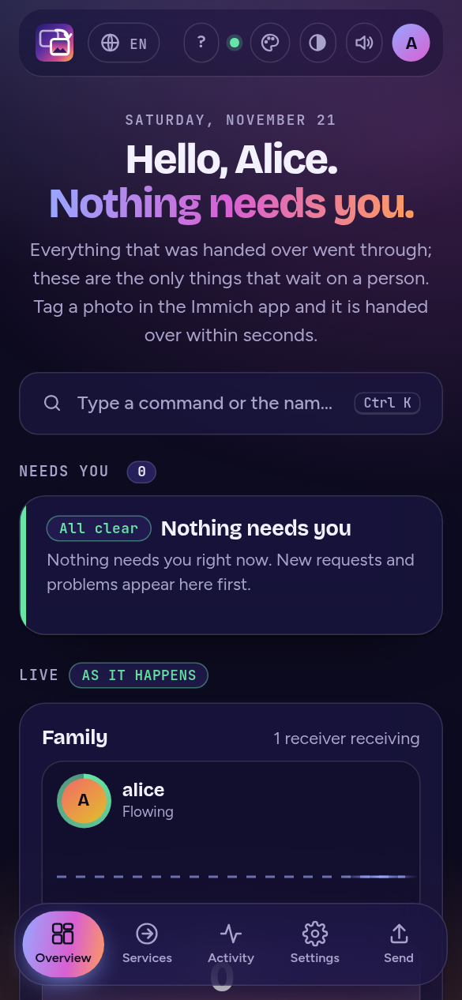
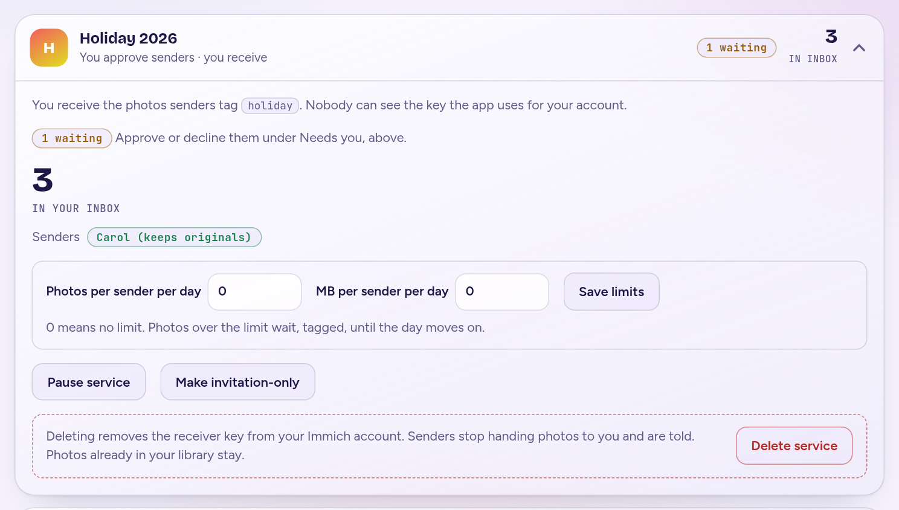
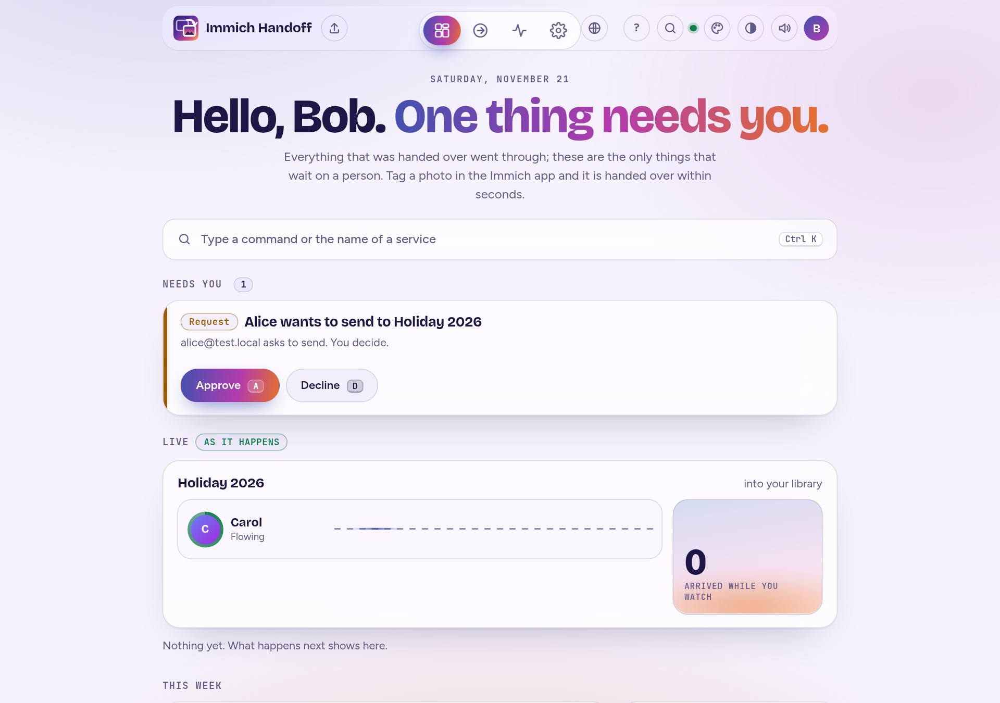
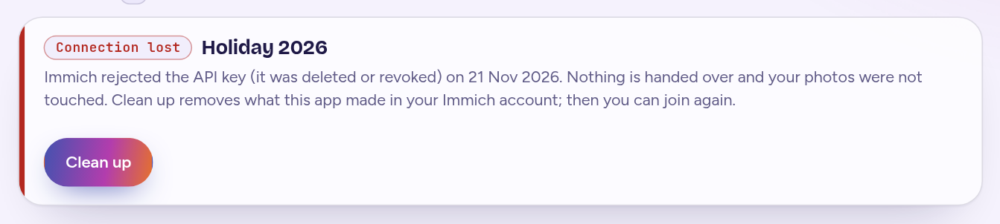

# Share photos with your household or friends

**Who it is for:** People on one Immich server who want photos to land **in each other's libraries**.

**What you get:** Tag a photo (or press a button) and a few seconds later it is in the other person's library, with your choice to keep or move your original.

**What you see:** The Overview shows what is waiting and what was handed over, and Immich shows the photo in the other library.

## In five steps

For people on one Immich server who want photos to end up **in each other's libraries**, not just in a shared album.

1. **One person offers a service** ("Holiday photos", "Photos of the kids") on **Services**, and chooses who may send: anyone, or people they approve. They share the invitation link if it should be private.
2. **Each sender joins** and answers one question that is theirs alone: keep my originals (a copy is sent) or move them to my trash once the other side has a verified copy.
3. **Send.** Add the service's tag to a photo in Immich, press **Hand over...** if the button is installed, or let a [rule](../guides/automate.md#rules-photos-by-who-where-and-when) suggest photos of named people, places and dates. A few seconds later the photo is in the receiver's library, tagged `inbox` so they can find what is new.
4. **Stop any time.** Delete the key in Immich or press **Leave**: nothing more is handed over and no photo is touched.

**What you see:** the Overview shows what is waiting, what was handed over and any problem, and Immich shows the photo in the other library.

**Worth knowing:** everyone who takes part needs **Tags** switched on in Immich (the page offers a button). Pause sending, daily limits and quiet hours are in [Using it](../guides/controls.md#pausing).

## Sending photos

Open the page. It shows your services and what is waiting:

What reaches the receiver is the photo's file, its name, its dates and the favourite mark. Things Immich keeps only in its own database, such as a description you typed in Immich, albums and edits, do not travel: see [What is carried over](../what-is-carried-over.md). To send a photo, add the service's tag to it in the Immich app (select photos, **Add tags**). Within a few seconds the photo is copied into the receiver's library, and the page's **Waiting** count goes back to zero. The page also works on a phone, and follows its light or dark setting:

## Joining a service

Under **Services you can send to** you see the services you may join. Joining asks one question that is yours alone to answer, **what should happen to your originals?**

- **Join and keep my originals** (the usual choice). A copy goes to the receiver and your photo stays where it is. The app's key for you has no permission to delete anything.
- **Join and move my originals to my trash.** Once the receiver has a verified copy, your photo goes to your trash, where Immich keeps it for 30 days, so a mistake can be undone.

You can choose differently for different services. To change your mind, leave the service and join again.

When you join, the app creates an API key named `handoff: <service>` in your own Immich account, using your login, and keeps it encrypted. Nobody sees it, not even you. You can end it any time (see below).

Some services need the owner's approval. You press **Ask to join**, the owner approves, and then you press **Activate**. (The app can only create a key in your account while you are signed in, which is why the last step is yours.)

## Receiving photos

### Offering a service

Under **Offer a service of your own**, choose:

- a **name** and the **tag** senders will use;
- **who can find it**: everyone on this Immich server, or only people you send a link to;
- **who may send**: people you approve, or anyone;
- optionally (**More options**) the tag put on what arrives, how many days an unfiled photo keeps it, and an **album** to put arrivals in.

Each service gets its own inbox tag by default, for example `inbox/Holiday 2026`, which Immich shows nested under `inbox`. Filter by it in Immich to see what arrived through that service. The inbox tag removes itself once a photo is in an album, or after 30 days; photos are never deleted by that. [When exactly](the-page.md#when-the-inbox-tag-goes-away) is explained below.

### Putting arrivals in an album

Give a service an album (for example "Holiday 2026") and every photo handed over to it is put in that album in your Immich account, so there is nothing to file by hand.

- **Instead of the inbox tag.** A photo in the album does not also get the inbox tag. The album is where you look; the page counts its photos. (The inbox tag would be removed within minutes anyway, because the photo is in an album.)
- **The album is yours.** The app uses an album you own with exactly that name, and makes one when the first photo arrives if you do not have it. It never uses an album that was only shared with you. If two of your albums have that name, it uses the first Immich lists.
- **If you delete or rename it,** the next photo makes a new album under the configured name. Photos already in the old one stay with it.
- **Photos you already had** (the same photo handed over again) are left where you put them; only new arrivals are filed.
- **It cannot get in the way of a hand-over.** If the album cannot be used, for example because the key is missing the album permissions, the photo still arrives, tagged inbox as without an album, and the log and the notification say why.
- **The key asks for more.** Creating a service with an album gives its key permission to find, create and add to albums, and nothing more. A service without an album does not. See [Security](../security.md#what-a-key-can-do). The album is chosen when the service is created.

### Approving senders and sharing a link

Your services appear on the page with who is waiting and who is connected:

- **Approve** or **Decline** each request. Anyone you approve then activates their own side.
- For an invitation-only service the card shows an **invitation link**. Whoever opens it, signed in to Immich, lands on a page for exactly that service. **New link** makes a fresh link and the old one stops working at once; people already approved or joined are not affected. **Copy a message** copies a short invitation with the link in it, and **QR code** shows a code a phone can scan from your screen. The link is only as private as the way you share it. The administrator's page has a **Share this page** box with the same three, for the address people use to join.
- **List for everyone** and **Make invitation-only** switch between the two. **Delete service** ends it.

You see each sender's name and, on a request, their email address. Senders see only your name.

## Handing over a whole album

Instead of tagging photos one by one, you can link one of your own albums to a service you joined from this page. On the service's card press **Hand over a whole album**, choose the album, and confirm. Everything in it is handed over to that service, **now and whatever you add to it later**, with no tag.

- **Why not just tag the album?** Immich tags belong to single photos, not to albums, so there is no such thing as tagging an album. Linking is different: the app keeps looking at the album.
- **It is checked on a timer.** Immich sends no event when a photo is added to an album (see [why the inbox tag takes minutes to go](the-page.md#when-the-inbox-tag-goes-away)), so the app looks at linked albums every 15 minutes (`ALBUM_CHECK_MINUTES`). Linking an album starts a pass at once, so what is already in it goes within seconds; photos added to it later wait for the next round. Tagging a photo is still instant.
- **Each photo goes once.** With **keep my originals**, a handed-over photo stays in your album and is marked with the `handed-over` tag, which is how the app knows to leave it alone. With **move**, the original goes to your trash. A photo the receiver refused (they have it in their trash) is tagged `share-duplicate` and left alone until you remove that tag.
- **Only your own photos.** An album can hold other people's photos (a shared album); those are never handed over.
- **One album per service.** Linking another replaces the first. **Stop handing over this album** on the card unlinks it. Photos already handed over stay where they are.
- **Move mode asks first,** because it sends every photo in the album to your trash once the other side has a copy.
- **The key gets one more permission.** Linking adds `album.read` to your existing key, using your own login, so you do not have to join again. It can read albums and nothing more. See [Security](../security.md#what-a-key-can-do).
- **Progress.** The "waiting to be handed over" number on the card counts down photo by photo while a long hand-over runs. When photos from an album have been handed over, a line appears under **Recent events**, and a big one (20 photos or more) also sends a notification to `NOTIFY_URL` if the person running the app set one.
- **If the album cannot be read** (you deleted it, or the key lost the permission), photos you tag are still handed over, and the problem is logged and notified once. Link another album to fix it.
- Services defined in a routes file or `.env` cannot have a linked album; this is for services you joined from the page.

## Leaving, and when a connection breaks

- A sender presses **Leave** on a service to stop. The app deletes the key it made in their account and the workflow it set up.
- An owner presses **Delete service**. Its senders then see **Removed by its owner** and press **Clean up** to remove their own key.
- Either side can also delete the key named `handoff: ...` in Immich (Account Settings -> API Keys). The app notices, pauses that connection, tells both sides, and **does not touch any photo**.

A sender whose key was deleted presses **Clean up** and can join again; photos they tagged meanwhile are handed over once they have. An owner whose own key was deleted presses **Reconnect**, and senders resume by themselves.

If an Immich administrator removes you from a service, or removes the service, you see why on this page with a **Clean up** button. Your API key in Immich stays valid until you delete it, which **Clean up** does for you ([why](../admin.md#why-removal-cannot-delete-the-keys)).

The page also lists recent events (joined, asked, approved, connection lost, reconnected) for the services you take part in.
