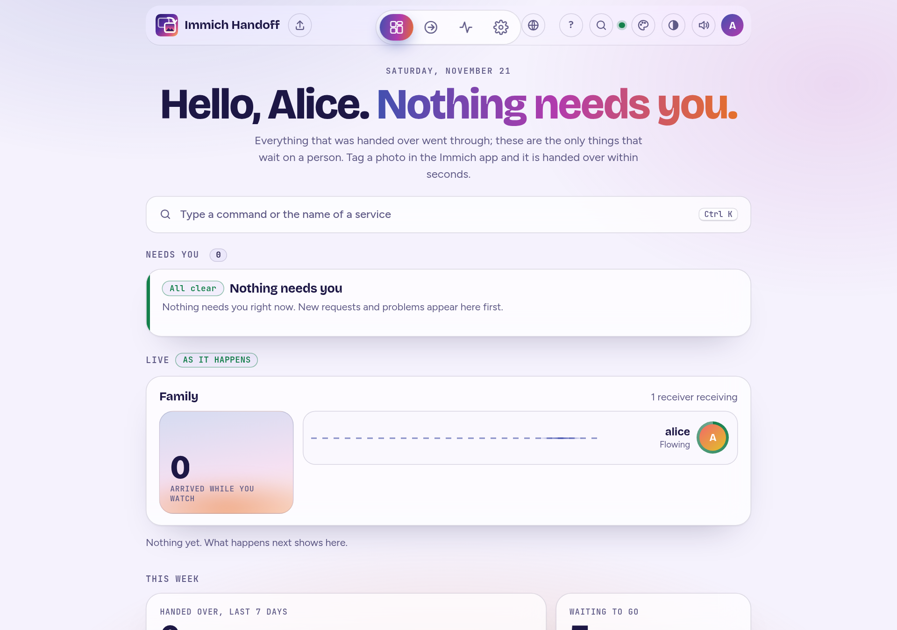
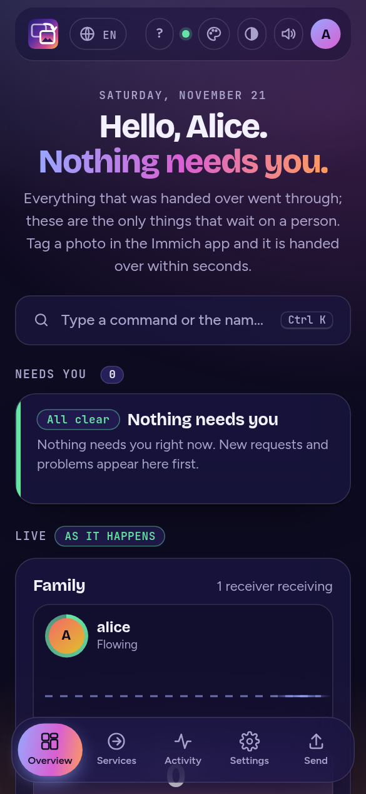
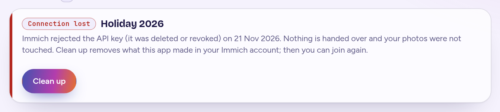

# Share photos with your household or friends

Alice tags a photo in Immich. A few seconds later it is in Bob's library, a copy of its own, with no shared album to open and nothing to download.

This is for people on **one Immich server** who want photos to land **in each other's libraries**, and keep them if the other person leaves. It works from the Immich app you already use, on a phone or the web.

## Set it up

1. **One of you offers a service.** A service is a named place photos are handed to, such as "Holiday 2026". On **Services**, open **Offer a service of your own** and choose a **name**, the **tag** senders will use, **who can find it** (everyone on this server, or only people you send a link to) and **who may send** (anyone, or people you approve).

   

2. **Everyone who sends joins.** They find the service under **You can join**, or open the invitation link or QR code the owner shares. Joining asks one question that is theirs alone: **what should happen to my original?**
   - **Join and keep my originals** (the usual choice): a copy goes to the receiver and your photo stays where it is. The key the app makes for you has no permission to delete anything.
   - **Join and move my originals to my trash**: once the receiver has a verified copy your photo goes to your trash, where Immich keeps it for 30 days, so a mistake can be undone.

   Some services need the owner's approval. You press **Ask to join**, the owner presses **Approve**, and then you press **Activate** yourself (the app can only make a key in your account while you are signed in, which is why the last step is yours).

   

3. **Send a photo.** In the Immich app, select photos and **Add tags**, using the service's tag. Or press **Hand over...** if your administrator has put [the button inside Immich](../automate/immich-button.md) in place, or let a [rule](../automate/rules.md) suggest photos of named people, places and dates. A few seconds later the photo is in the receiver's library and the sender's **Waiting** count goes back to zero.
4. **Find what arrived.** Receivers see it in Immich tagged `inbox` (each service has its own, such as `inbox/Holiday 2026`, nested under `inbox`), or in the service's album if it has one. The Overview shows what is waiting and what was handed over.

   

5. **Stop any time.** Press **Leave**, or delete the key named `handoff: ...` in Immich (Account Settings, API Keys). Nothing more is handed over and no photo is touched.

On a phone the page looks like this, and it follows the light or dark setting of the device:

## Looking after a service you offer

Your services show on **Services** with who is waiting and who is connected.

- **Approve** or **Decline** each request. Anyone you approve then activates their own side.
- **Invite people.** An invitation-only service shows an **invitation link**: whoever opens it, signed in to Immich, lands on a page for exactly that service. **New link** makes a fresh one and the old one stops working at once (people already joined are not affected), **Copy a message** copies a short invitation with the link in it, and **QR code** shows a code a phone can scan from your screen. The link is only as private as the way you share it. The administrator's page has a **Share this page** box with the same three, for the address people use to join.
- **List for everyone** and **Make invitation-only** switch between the two.
- **Delete service** ends it. Its senders see **Removed by its owner** and press **Clean up** to remove their own key.
- **Recent events** (joined, asked, approved, connection lost, reconnected) are listed for the services you take part in.

## More ways to hand over

- **Put arrivals in an album.** Give a service an album (say "Holiday 2026") when you offer it, and every photo handed over is put in that album in your Immich, so there is nothing to file by hand. The album is one of yours with exactly that name; if you do not have one, the app makes it when the first photo arrives. Photos in the album do not also get the inbox tag. This gives the service's key permission to find, create and add to albums, and nothing more.
- **Hand over a whole album.** On a service you joined from this page, press **Hand over a whole album** and choose one of your own. Everything in it goes to the service, now and whatever you add later, with no tag. The app looks at linked albums every 15 minutes (`ALBUM_CHECK_MINUTES`), and linking one starts a pass at once. Services set up in a routes file or `.env` cannot have a linked album. Linking an album adds the `album.read` permission to your existing key, using your own sign-in. Choosing **move** asks first, because every photo in the album goes to your trash once the other side has a copy.
- **Keep a photo someone shared with you.** Immich's shared albums and partner sharing let you look at photos that stay in the other person's account. With the [button inside Immich](../../admin/find-handoff.md#add-to-my-library-from-inside-immich), **Add to my library** gives you a copy of your own, with its description, rating, location and a live photo's clip, and **Undo** takes it out again for 15 minutes.
- **Pause, limit and take back.** See [Control what is handed over](../automate/controls.md#pausing).

## Good to know

- **Everyone who takes part needs Tags switched on in Immich.** The page notices and offers a **Turn on Tags** button; after that, reload the Immich page.
- **What travels with a photo:** the file, its name, its dates and the favourite mark. Things Immich keeps only in its own database, such as a description you typed in Immich, albums and edits, do not travel: see [What is carried over](../../reference/what-is-carried-over.md).
- **Each photo goes once.** With **keep**, a handed-over photo is marked with the `handed-over` tag so the app leaves it alone. A photo the receiver refused (they have it in their trash) is tagged `share-duplicate` and left alone until you remove that tag. Only your own photos are handed over, never those in a shared album that belong to someone else.
- **The inbox tag tidies itself.** It goes once a photo is in an album, or after 30 days, and no photo is ever deleted by that. [Why it takes minutes](../../start/the-page.md#when-the-inbox-tag-goes-away).
- **Keys nobody can see.** The app makes a key named `handoff: <service>` in your own account with your own sign-in, and keeps it encrypted. Nobody sees it, not even you. See [Security](../../reference/security.md#what-a-key-can-do).
- **You see** each sender's name and, on a request, their email address. Senders see only your name.

## If something is off

- **A sender's key was deleted.** The page tells both sides and pauses that connection, and no photo is touched. The sender presses **Clean up** and can join again; photos tagged meanwhile are handed over once they have.
- **An owner's own key was deleted.** The owner presses **Reconnect** and the senders resume by themselves.
- **The service was removed, or you were removed from it.** You see why on the page, with a **Clean up** button that deletes your key in Immich ([why](../../admin/admin-page.md#why-removal-cannot-delete-the-keys)).
- **A photo did not arrive.** Check that Tags are on, that the tag is the service's, and the Overview's recent events; or run the [setup check](../../reference/troubleshooting.md#check-your-setup-first).

## What next

- Stop tagging by hand: [rules](../automate/rules.md) and [the button inside Immich](../automate/immich-button.md)
- A trip or party where everybody gets everybody's photos: [Pool a trip](trip-pool.md)
- Two people sharing the photos of the people they choose: [Share a person's photos](share-people.md)
- Collect photos from guests: [drop boxes](../collect/events.md)
