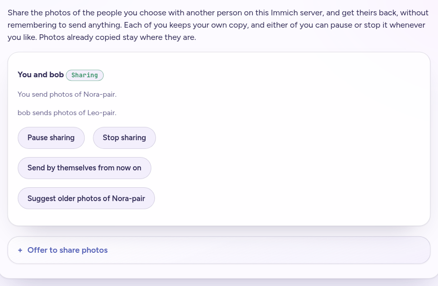

# Share a person's photos with your partner, both ways

**Who it is for:** Two people on the same Immich server who want the photos of the people they care about (a child, a dog's owner, each other) to reach the other's library without anyone remembering to share.

**What you get:** One offer, one yes. From then on the photos of the people you chose go to the other person, and theirs come to you, tagged `from/<name>`, offered first with pictures and, if you switch it on, sent by themselves.

## In a few steps

1. **Offer.** In **Settings**, under **Offer to share photos**, give the other person's email (as Immich knows it) and tick the people **of your own library** whose photos go to them. Optionally choose how long a rule waits before it offers a photo.
2. **Give them the link.** The card shows a link and a QR code. Nothing is made for the other person until they say yes.
3. **They say yes.** They open the link, read what it means (photos of the named people go both ways, only photos that arrive from then on, every copy stays if it ends) and tick which of **their own** people go back to you.
4. **Photos are offered.** Each of you sees *Needs you* suggestions with pictures of the other person's photos to be sent: *Send*, *Not these* or *Always*. **Suggest older photos** looks back, again as suggestions.
5. **Send by themselves from now on** (on your side of the card) sends without asking, only photos that arrive afterwards and have settled. The confirmation says that a wrong photo can reach the other person; you can switch it off at any time. Each of you chooses for your own side.
6. **Pause or stop** from the card, either of you. Sending stops at once.

## What to know

- **Face names are per account.** The person you call "Anna" in your library is named separately in theirs, which is why each of you picks your own people. A wrong face match can send a wrong photo, so photos wait for a short time before they are offered: 5 minutes by default, 1 to 60 as you choose (a rule that sends by itself waits six times as long). Immich does not say when it has finished finding faces, so this wait is the only protection against a photo going before a second person in it is known.
- **Each library holds its own copy.** Immich gives no way to make a photo someone's own other than copying it, so shared photos use disk in **both** libraries and count against each person's Immich quota. As a rule of thumb, 1,000 photos of 4 MB is about 4 GB in each library.
- **When it stops, every copy stays** where it is and nothing is deleted from anyone's library. If the person who offered it stops it, everything is taken apart at once and the other person cleans up their own key with **Clean up**. If the other person stops it, sending stops at once and the one who offered it presses **Stop** on their next visit.
- **The pieces are locked.** The private pool and the two rules of a sharing do not show in Services or Rules and cannot be changed there; the card is the only place, so a sharing is never left half broken.
- **An offer lapses** after 7 days if nobody says yes.
- **At most five sharings** at once for a person, and at most ten people in one.
- **A pet can be part of a sharing.** Under **Also share photos of a pet**, pick 3 to 8 of your own photos of the animal (the person who says yes can do the same for their pet). Immich cannot tell animals apart, so this is a [rule for a pet](../automate/rules.md#rules-photos-by-who-where-and-when): it offers the photos most like your examples, **always asks first** (a pet rule has no *Always*, and the sharing's switch to send by itself leaves it alone), and starts noisy. The optional [pet helper](../automate/pets.md#the-optional-pet-helper) makes it much more accurate. The person who offers sends at least a person or a pet; the person who says yes may send nothing.

## Compared with Google Photos

Google Photos has partner sharing (one partner only, all photos or those of chosen people, one-way until the partner sets theirs up, and dependent on face grouping that Google says is not available in every country) and live albums that add photos of chosen people and pets by themselves (reported limits of 10,000 or 20,000 photos). This does not copy that: it works for any two people (and a pool for more), both ways in one step, with no regional limit and no photo cap, and the photos stay on your own server. It is **slower**: photos are offered after a wait of minutes (30 to 60 minutes before one goes by itself with the usual wait, less with a shorter wait), not at once, and a pet is found by a rule that suggests photos you answer, not by a name.

Details: [Security](../../reference/security.md#sharing-photos-with-another-person), [Rules](../automate/rules.md), and the [design note](../../contributing/design/pairing-design.md).
