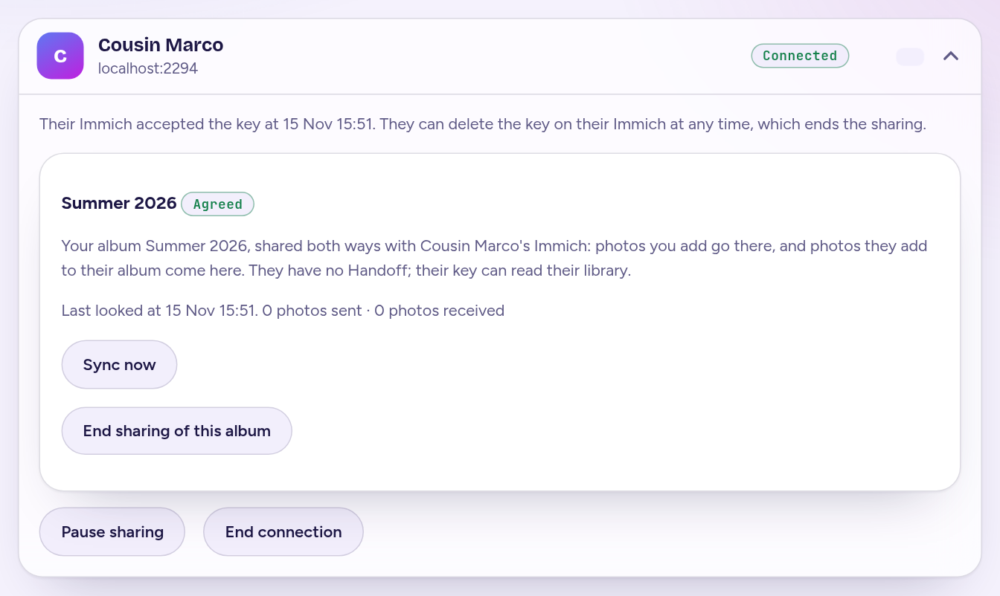

# Share albums across servers

Keep an album the same in two libraries on two different Immich servers: what either of you adds appears at the other, as a real copy in each library. It works for a relative who runs their own Immich, with or without Handoff on their side.

Nothing leaves your library except the photos of the albums you agree to share, and ending a sharing is always one button.

## Pick a way

- **Two Handoffs** (the normal way): each person runs a Handoff next to their own Immich and the two apps talk to each other. **Each app only ever touches its own Immich**, and no Immich key goes to the other server. Read on: [connect](#connect-with-someone), then [agree on an album](#agree-on-an-album).
- **A group of several servers**, through the person who made the album: [more than two people](#more-than-two-people).
- **One app only**, for a relative who has an Immich and will not run Handoff: [sharing with someone who has no Handoff](#sharing-with-someone-who-has-no-handoff). This one does not need `PUBLIC_APP_URL`.

The administrator switches the feature on with `SHARED_ALBUMS_ENABLE` ([Settings](../../reference/settings.md)); the two-Handoff way also needs `PUBLIC_APP_URL`, and the two apps must be able to reach each other over https.

## Connect with someone

1. **Invite someone** (the Services tab, *Albums shared with other servers*) makes an **invitation link** with a QR code. Give it to the other person; it works once, for a week.
2. The other person opens **their own Handoff**, chooses **Join with an invitation link**, pastes it and presses **Look at the invitation**. Their app asks yours who it is from and says so (name and address); **Accept the invitation** connects the two. Opening the link in a browser only explains what it is for and joins nothing.

From then on each app shows the connection with its state (**Connected**, **Paused**, **Not reachable**, **Ended**). Either person can **Pause sharing** or **End connection** (which tells the other app); photos already in either library stay where they are. A connection is not made unless the inviter's app can call the other app back, so an app that cannot be reached from the internet cannot join.

## Agree on an album

On a connection, press **Share an album with {name}** and choose:

- a **name** (what it is called between the two of you) and **which of your albums** (one you have, or a new one);
- **what you share at the start**: *only what I add from now on* (the photos already in the album stay yours alone) or *everything in the album now, and what I add*. Each side makes this choice for itself;
- **when someone takes a photo out of the album**: *nothing happens on the other side* (the default; each of you keeps what you have) or *it is taken out of the other album too* (the photo itself stays in the library). Deleting a photo never travels. The proposer sets this one and the other person agrees by accepting.

The other person sees the proposal on their own page, with what you share and what removing does, chooses their own album (or a new one) and what they share, and **Accepts** or **Declines**. Either side can **End sharing of this album** at any time (the other app is told; photos already copied stay), and ending the connection ends all its albums.

For each shared album the app makes a **key in your own Immich** (named "handoff: shared album ..."), through your own sign-in, which can read the album and its originals, put photos in it, make it and take photos out of it, and nothing that deletes a photo or shares anything (`user.read`, `asset.read`, `asset.download`, `asset.upload`, `album.read`, `album.create`, `albumAsset.create`, `albumAsset.delete`). Immich cannot limit a key to one album, so the app does; the key is deleted when you end the sharing.

## More than two people

An album can be shared with **several people**, up to ten, with no extra setting: the person who made it (the creator) shares **the same album** with each of them, one connection each. The creator's app passes the photos on: what one member adds arrives in the creator's album and is sent from there to every other member, and the other way round. Members never connect to each other.

- **Nothing loops and nothing is copied twice.** Each connection remembers, by checksum, what arrived over it and never sends it back.
- **A member sees the others' names, nothing more.** Under their album's row it says *Also in this album, through {creator}: ...*, and the proposal they accept says other people may join.
- **A member leaving** ends only their own connection; the others carry on, and the creator's page shows *Ended by {name}* until they remove it. Photos already copied stay everywhere.
- **If the creator's server is off,** the members' photos wait and are sent when it is back; nothing is lost, but nothing moves between members meanwhile.
- With the rule *taken out of the other album too*, a photo the creator's app takes out because one member did is taken out for the other members that agreed to it, within a few minutes.

## Sharing with someone who has no Handoff

For a relative or friend who has an Immich and will never run Handoff, press **Share an album with someone who has no Handoff** (Services tab, under *Albums shared with other servers*). This one app then works on both sides. You need the address of their Immich and a **key they make on their own Immich** (Account settings, API keys) and give to you. Give them the exact permissions below, and tell them they can delete the key at any time, which ends the sharing at once. The page shows the same list.

- **To only send them the album:** `user.read`, `asset.upload`, `album.create`, `albumAsset.create`. The key can put photos into their library and make an album; it cannot read, search or delete anything. Your album's photos are copied into a new album on their Immich named like the shared album; nothing comes back.
- **To share both ways:** those four plus `asset.read`, `asset.download`, `album.read`. Photos they add to that album come to yours and what you add goes to theirs, never echoing back. If they already have an album with that name it is used and what is in it comes to you; otherwise a new one is made. **Immich cannot limit a key to one album, so this key can read their whole library**; the app only ever asks for the one album and copies only what is in it. That is a trust decision for them, which is why the page says it plainly.
- **A key with any other permission is refused**, and so is one with fewer (or only some of the reading permissions): the rule is exactly what is needed. The app checks every ten minutes that the key still works and says on the connection if their Immich stops accepting it.
- **What is different from two Handoffs:** taking a photo out of the album does not travel (the small key cannot see what is in the album), there is no proposal to answer (they agreed by giving the key), and the other person is not told by an app when photos arrive. Their deleting is respected as far as the key can see it. Everything else works as above.

## Good to know: how the photos move

- **Every few minutes.** Each app looks at its own copy of the album every few minutes (`SHARED_ALBUMS_EVERY_MINUTES`, three by default; Immich sends no event when a photo is added to an album) and sends what is **new** to the other app, which stores it in its own Immich and puts it in its own album. **Sync now** on the album's row looks at once.
- **Nothing comes back.** What arrived is remembered by the photo's checksum and never sent back. A photo already in the other person's library is not stored again, only put in the album.
- **Their deleting is respected.** A photo the other person has put in their trash is left there and is not put in the album.
- **Originals, whole.** Photos and videos are streamed as the original file, without being kept on either server's disk, with their name and the date they were taken. A file larger than `SHARED_ALBUMS_MAX_MB` (2048 by default) is left out, with a reason on the album's row, and is not tried again.
- **Taking a photo out.** With *taken out of the other album too*, a photo you take out of the shared album is taken out of theirs within a few minutes; only the album changes, never the library. If you take out a lot at once (more than five photos or a quarter of the album) nothing is told until you answer on the album's row: *Yes, take them out there too* or *No, leave them there*. A photo you put back is shared again.
- **Pausing.** While either side has paused the connection nothing moves.

## If something is off

- **The row says the other app could not be reached.** The next look tries again. If it stays that way, check that both apps are reachable over https and `PUBLIC_APP_URL` is right. `immich-handoff doctor` checks the settings.
- **A file was left out.** It is larger than `SHARED_ALBUMS_MAX_MB`; the row says so.
- **You are told once** when sharing stops working and once when it works again, in your Activity (and on your devices or by email if you asked), not at every look.

## What next

- A receiver on another server without sharing an album: [Receive on another Immich server](other-server.md)
- Share with a group on your own server: [Circles](circles.md)
- What the keys can do: [Security](../../reference/security.md)
