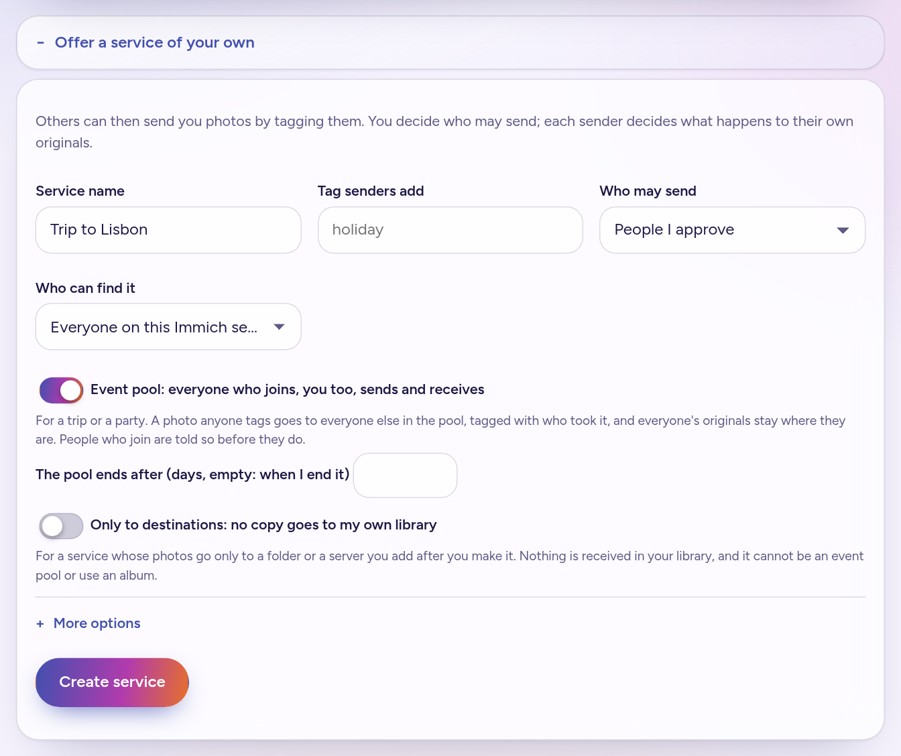

# Pool a trip: everybody gets everybody's photos

Everyone on the trip tags the photos they like, and every photo goes to everyone else, labelled with who took it. Nobody has to collect anything afterwards.

This is for friends who all have an account on **one Immich server**: a holiday, a wedding weekend, a party. Everyone keeps taking photos with their own phone; their originals stay where they are.

## Set it up

1. **Offer an event pool.** On **Services**, open **Offer a service of your own**, give it a name, and tick **Event pool**. Optionally give it an end (1 to 366 days) and choose how people join: by invitation, with your approval, or open to anyone on the server.
2. **Invite the others** with the link or the QR code. Each person joins from the page. The join question says plainly what it means: **every photo you tag goes to everyone in the pool, and everyone's photos come to you.** They must say yes; a pool cannot be joined without it.
3. **Tag a photo** with the service's tag in Immich, or press **Hand over...** if your administrator [added the button](../../admin/find-handoff.md#hand-over-from-inside-immich). Everyone else gets a copy tagged `from/<your name>` as well as the inbox tag (or in the service's album), so in Immich they can browse by photographer.
4. **End it** when the trip is over, from the pool's row. What was handed over stays.

## Good to know

- **Everyone is both.** In a pool everyone who joins, you too, sends and receives. A photo is never sent back to its sender, and a copy that arrives is not passed on again.
- **Joining late.** A person gets what is shared **from the moment they join**, not what was shared before.
- **Leaving** stops what comes to you and what you send. You keep what you received, and what you sent stays with those who got it.
- **Ending.** The owner can end the pool now, give it an end date, or let it go on until they end it. When it has ended nothing more is handed over, tagged photos stay tagged and nobody can join; everything already handed over stays. An ended pool can be opened again by giving it a new end.
- **Limits.** The service's daily limits per sender apply to each member. Photos a member's key cannot read, or that a receiver already has in their trash, are handled as in any service.
- **Privacy.** Joining a pool lets everyone in it have your tagged photos, and anyone the owner lets in (the whole server, if the pool is open) is in it. Offer a pool by invitation or with approval if you want to choose who is in. See [Security](../../reference/security.md#event-pools).

## If something is off

- **A friend gets nothing.** They may have joined after the photo was handed over, or Tags may be off in their Immich account: see the [Quick start](../../start/quickstart.md) and the [setup check](../../reference/troubleshooting.md#check-your-setup-first).
- **I do not want a photo to go to everyone.** Do not tag it. If it already went, **Take back the last hand-over** (see [Control what is handed over](../automate/controls.md)) moves the copies of the last hand-over to the receivers' trash, within 24 hours.

## What next

- Copies between a few people, not a whole group: [Share photos with your household or friends](household.md)
- Collect photos from people with no account: [drop boxes](../collect/events.md)
- Make a recap of the trip: [Stories](../show/stories.md)
