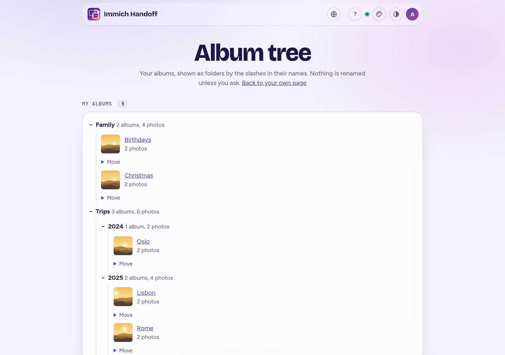

# Album tree: albums as folders

Immich has no folders for albums. Name your albums with slashes and this shows them as a tree you can open, with covers, and a helper that renames an album into a folder.

## Open the tree

1. Open **Settings**, **Photos**, **Album tree**, then **Open the album tree**. Or press **Ctrl K** (**Cmd K** on a Mac) and choose **Open the album tree**, or go to `/albums` on this page's address. Any person signed in to Immich can open it; it does not need the app to have a service for you.
2. **Name your albums with slashes.** `Trips / 2024 / Rome` and `Trips/2024/Rome` are the same: the part before each slash is a folder, the last part is the album's own name. Empty parts and extra spaces are ignored, folders go up to eight levels deep, and a folder is the same folder whatever the capitals (`trips` and `Trips`).
3. **Open folders** to see what is in them. A folder says how many albums and photos it holds in all.
4. **Move an album into a folder.** Under an album of your own, **Move** shows the folder it is in. Type another (or pick one that exists) and the page says `Old name will be renamed to New name.` before anything is changed. **Rename the album** then renames it in Immich. Nothing else is touched, and an album that is somebody else's cannot be renamed here (Immich would not allow it either).

## Good to know

- **It only changes a name.** Immich still has no folders: the album keeps its photos, its sharing and its place everywhere else; only its name now has the slashes. If you rename it in Immich, the tree follows.
- **Two albums with the same path** are both shown, side by side. A name longer than 100 characters is refused when you move an album.
- **Opening an album in Immich** needs `PUBLIC_IMMICH_URL` (the address of Immich as your browser sees it, see [Settings](../../reference/settings.md)). Without it the names are not links, and the page says so.
- **Covers** are the picture Immich shows for the album, fetched by the app with your own sign-in; an empty album has none.

## If something is off

- **An album is not in the folder I expect.** The name decides: `Trips / 2024 / Rome` and `Trips/2024/Rome` are the same, and a folder is the same whatever the capitals.
- **The names are not links.** Set `PUBLIC_IMMICH_URL` (see [Settings](../../reference/settings.md)).
- **I cannot rename an album.** It is somebody else's: Immich does not allow it either.

## What next

- Make albums from folders: [Albums from folders](../automate/folder-albums.md)
- Share new albums with a group: [Circles](../share/circles.md)

How it works: [the design note](../../contributing/design/album-tree-design.md).
