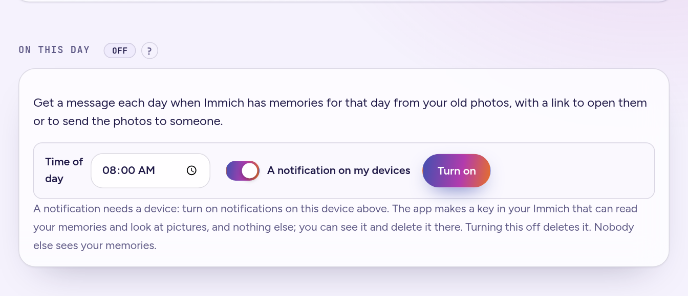

# A daily "On this day" message

One message a day, at the time you choose, when Immich has memories for today that you have not watched yet, with up to three pictures, a link that opens the memory and a link to hand some of those photos on.

## Turn it on

**Settings** has an **On this day** card when the person who runs the app has set up notifications on devices, email for people, or both (see [Be told](notifications.md)). Choose:

- **Time of day.** The message is sent once a day, when that time has come where you are. Your time zone is taken from your browser when you save.
- **A notification on my devices** and/or **An email**, the ones that are set up. A notification needs a device: turn on notifications on this device in the card above first. The email goes to the address Immich shows for your account.
- **With up to three pictures in the email**, or without.

Press **Turn on**. The app makes a key in your own Immich named `handoff: memories`, with your sign-in, and keeps it encrypted. The key can **read your memories and look at pictures, and nothing else**. You can see it in Immich's settings and delete it there. **Turn off** on the card deletes it for you.

## Good to know

- Only your own memories, from your own old photos. Nobody else sees them.
- Nothing is sent when Immich has no memory for today, or when you have already watched it in Immich. A day with nothing new is simply skipped.
- Several years on one day make **one** message with the years listed, oldest first. The pictures in the email are the first from each year, up to three.
- A notification carries text and its buttons only, no picture. The notification reaches your device through your browser's push service, which sees that a message was sent, not what it says.
- Immich decides what a memory is and when it makes one. The app only reads what Immich made; it makes no memory of its own.

## What the links do

- **Open the memory** opens it in Immich. It appears when the person who runs the app has told it where Immich is (`PUBLIC_IMMICH_URL`).
- **Send to someone** opens a page of this app with that day's photos. Tick some, choose the service to send them to, and press **Hand over the ticked photos**: it is the same hand-over as the button inside Immich, with the same checks and the same rules (pause, limits, keep or move your originals). You need to be signed in to Immich in that browser, like every page of the app. It appears when the app knows its own address (`PUBLIC_APP_URL`).

## If something is off

If you delete the key in Immich, the app notices once, tells you in your Activity (and by your notification or email) and leaves you alone: **Save** on the card makes a new key. If Immich or the mail server is down at your time, the app tries again every few minutes until the day is done.

## For the person who runs the app

`MEMORIES_CHECK_MINUTES` (default 10) is how often the app looks at who is due; each person picks their own time of day. Notifications and email must be set up for the card to appear. Set `PUBLIC_IMMICH_URL` and `PUBLIC_APP_URL` for the links. [Settings](../../reference/settings.md) lists them; `immich-handoff doctor` checks the interval. How it works and what was tried: [the design note](../../contributing/design/memories-design.md).

## What next

- More ways to be told: [Be told](notifications.md)
- Hand a day's photos on: [Share photos with your household or friends](../share/household.md)
