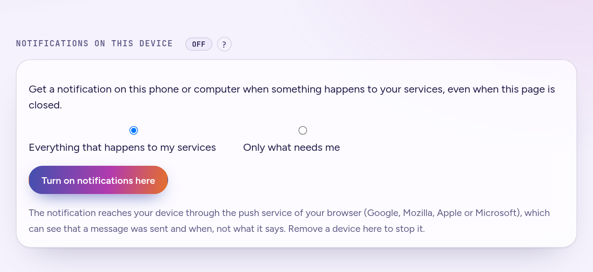

# Be told: email, your phone, or a message you can answer

Get the lines of your Activity list as an email or a notification on your phone or computer, and answer a request with one tap from the message itself.

## Email about what happens to you

If the person who runs the app has set up mail for people (see [Email to the people taking part](../../admin/operations.md#notifications)), **Settings** has an **Email me** card. Turn it on and you get an email about what happens to your services, so you do not have to open the page to find out:

- **Everything that happens to my services** sends the same lines you see under Activity (someone joined, a connection was cut, a limit was reached, a request needs you).
- **Only what needs me** sends just the things that ask something of you or tell you something stopped: a request to join, a connection that broke, a limit reached, a removal.

The emails go to the address Immich shows for your account (change it in Immich and the app follows at your next visit), in the language of your page. Lines are gathered for a few minutes and sent as **one email**, and you get at most six an hour. A photo arriving is not a line of its own (the Activity list does not have one either). **Send a test email** shows that it works. Every email has a link, **Stop these emails**, that asks once and then turns them off without signing in; **Turn off** on the card does the same.

## Notifications on your phone or computer

If the person who runs the app has turned it on (see [Notifications on devices](../../admin/operations.md#notifications-on-devices)), **Settings** has a **Notifications on this device** card. Press **Turn on notifications here**; your browser asks once. From then on this device gets a notification when something happens to your services, even with the page closed, in the language the page was in:

- **Everything that happens to my services** gives the lines of your Activity list and also tells you when photos arrive ("12 photos arrived from Bob in Holiday") or when photos you sent were not handed over because the receiver has them in the trash.
- **Only what needs me** gives only what asks something of you or tells you something stopped: a request to join, a broken connection, a limit reached, photos that were not handed over.

The card lists your devices. Each can have its own choice, **Send a test notification** shows that it works, and **Remove** stops it (it also stops when you clear the browser's data for the site). Things that happen within about ten seconds come as one notification. On an iPhone or iPad, add the page to the Home Screen first and turn it on from there.

## A daily message about memories

The **On this day** card sends one message a day about the memories Immich has for you: see [On this day](memories.md).

## Answering from a message

A mail or notification about something you can answer carries buttons, so you do not have to open the page:

- when someone **asks to send to a service of yours**, you get **Approve** and **Decline**;
- when you **pause a service of yours**, you get **Resume service**; when you **pause your own sending**, **Resume sending**.

Opening a link only shows what it will do ("Approve Bob to send photos to Holiday?") and a button; nothing happens until you press it, and you do not need to be signed in to Immich. A link works **once** and stops working after **24 hours**; the two answers to one request cancel each other, so pressing Approve ends the Decline link, and a request you already decided on the page cannot be changed by an old link. If it no longer works, do it from your page. On a phone, the notification shows the buttons where the system allows (Android, Chrome, Edge); on an iPhone, tapping it opens the page. Links are only in mail and notifications to the person who can do the action, never in the administrator's messages. They need the page's address to be set (`PUBLIC_APP_URL`).

## If something is off

- **I get no email.** The person who runs the app has to have set up mail for people; the card is there only when it is. Check the address Immich shows for your account, and press **Send a test email**.
- **I get no notification.** Your browser must have allowed notifications for the site; on an iPhone add the page to the Home Screen first. **Send a test notification** shows whether it works.
- **A button in a message says it no longer works.** A link works once and for 24 hours; do it from your page.

## What next

- A daily message about memories: [On this day](memories.md)
- Set up mail and notifications as the administrator: [Operations](../../admin/operations.md#notifications)
