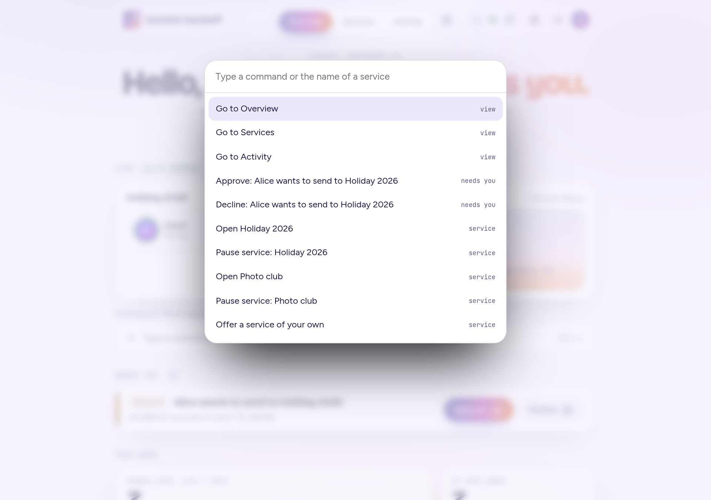
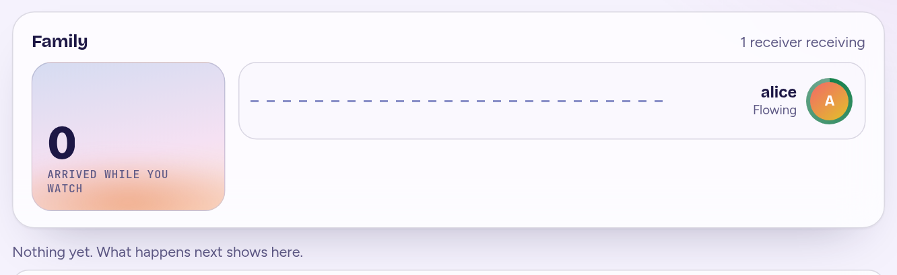
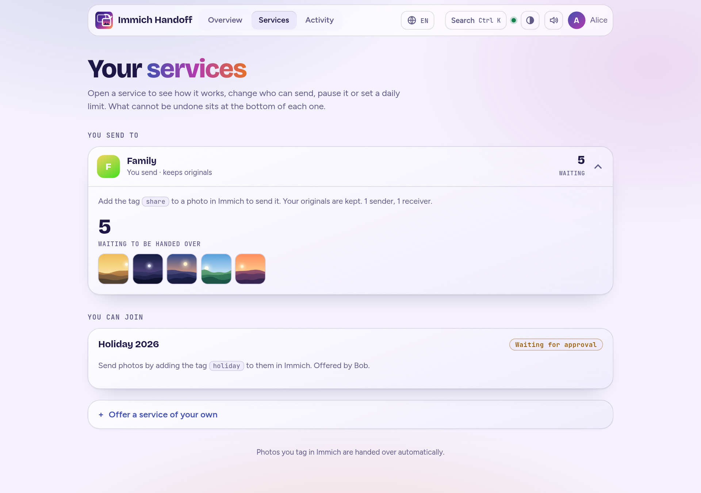
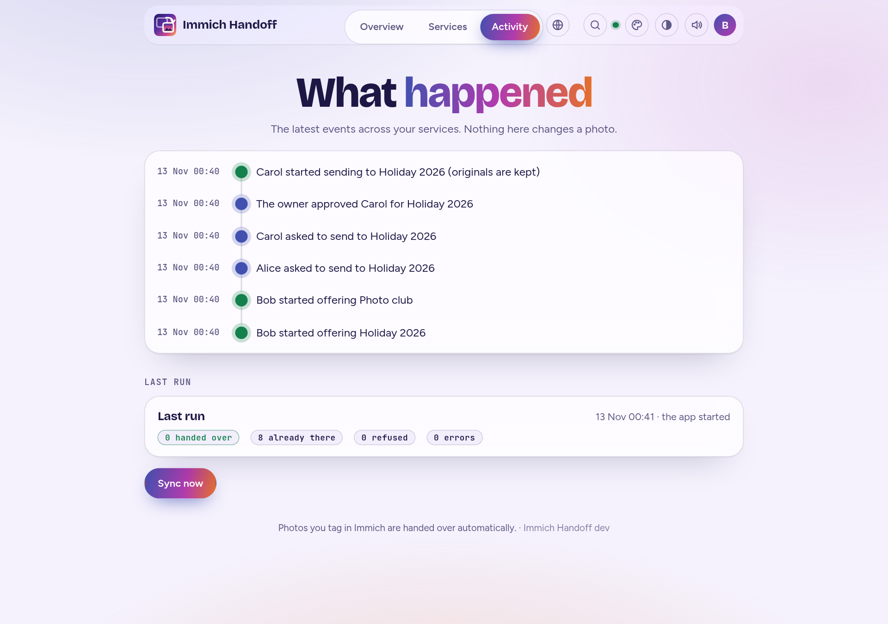

# Finding your way around the page

**Who it is for:** Everyone who uses Handoff.

**What you get:** The page's three views (Overview, Services, Activity), what the words mean, what the live scene shows, and the few things worth knowing before anything else.

**What you see:** You know where to look for what needs you, what was handed over and how to change your look and language.

## Words used here

| Word | Meaning |
|---|---|
| **Service** | A named place photos can be handed to, with one tag. "Holiday 2026" with the tag `share` is a service. |
| **Receiver** (or **owner**) | The person whose library the photos land in. They create the service and decide who may send. |
| **Sender** | Someone who tags photos to hand them to a service. |
| **Tag** | The label you add to a photo in Immich to send it. Each service has its own. |
| **Inbox** | A tag on everything that just arrived, so the receiver can find what is new. |
| **Drop box** | A link, QR code or email address that anyone can send photos to without an account. It can also be an **event** with a gallery, a wall and a best-of. |
| **Pool** | A service where everybody sends and everybody receives, for a trip or a party. |
| **Client room** | A link for one client to look at an album through marked pictures and choose favourites. |
| **Rule** | A search in your Immich (people, places, dates, a phrase) that suggests photos to hand over. |
| **Shared album** | An album two people on different servers keep in step. |
| **Key** | The restricted API key the app makes in your own Immich account when you join, so it can tag and hand over for you. Nobody sees it, and deleting it in Immich stops everything safely. |

> **Before you start: Tags must be on in Immich.** It is off by default and each person has it for their own account. If it is off, this page shows a notice with a **Turn on Tags** button; you can also do it in Immich under Account Settings, then Features, **Tags**. Senders need it to tag photos; receivers need it to see the inbox tag and filter by it. Switching it on is not enough: **refresh the Immich tab or window afterwards**, or the tag options do not show up (on the phone app, close and reopen it).

## Finding your way

The bar at the top has three views, in a pill in its middle (on a phone they are a bar at the bottom of the screen, with an icon each): **Overview** (what needs you, the week's numbers, the live scene), **Services** (all your services, what you can join, offering your own) and **Activity** (what happened, the last run, Sync now). The address remembers the tab (`#services`), so you can bookmark it and the page comes back to it after an action. The search bar under each headline, and the magnifier in the bar (also **Ctrl K**, or **Cmd K** on a Mac), open a command palette: type a few letters to jump to a tab or a service, or to do what you can do (approve a request, pause or resume, sync); it lists only what you are allowed to do, and it presses the same button the page has, so questions are still asked. On a phone you can add the page to the home screen so it opens like an app (see [Operations](../operations.md#installing-the-page-on-a-phone)). The palette icon chooses the **colour scheme** (**Twilight**, the colours of the app's icon, or **Immich**, calm blues on near-neutral greys), the half-moon icon switches the light and the dark variant of either, and the speaker icon turns the soft chime (and a short phone buzz) off and on when a photo lands (the first click or key press wakes the sound, a browser rule). 

A few keys, for those who like them: **A** and **D** answer the request that is waiting (the buttons wear their key), and **G** then **O**, **S** or **A** goes to Overview, Services or Activity. They stay quiet while you type or a dialog is open. The Overview opens with the date, the greeting, the live stream and the search bar, then what needs you as rows with their buttons on the right.

What you choose is kept in this browser and wins over what the administrator set for everyone to start with (`THEME` and `THEME_MODE`, see [Settings](../settings.md)). The code next to them (en, de, fr, es, it, pt, ru) is the language menu: the pages follow your browser's language and this picks another for good; only the pages are translated, not the log or the documentation.

A few small touches make it feel alive and can be ignored: the light behind the page drifts slowly, leans toward your pointer and flares when a photo lands, cards tilt a little toward a mouse, and numbers roll like a departures board. They are skipped with a touch screen or when your browser asks for reduced motion, and nothing moves while the page is idle.

The footer of every page says which **version** of Immich Handoff is running, after the line about tagging. It is read from the running program (a release says `1.2.0`, a build from a checkout says `dev`), so it is what you are running, not what the page was written for. It is shown only to people signed in to Immich, never on the sign-in page or to a drop box's guests.

## The Overview

The page opens with what matters, in this order:

1. **Needs you.** Everything that waits on a person, most urgent first, each with its button:
   - **Connection lost** and **Removed by its owner**: **Clean up**, which deletes what the app made in your Immich account (then you can join again).
   - **Disconnected** (a service you offer): **Reconnect**.
   - **Request**: someone wants to send to a service you offer; **Approve** or **Decline**.
   - **Paused**: a service you paused, or your own sending (**Resume**), or a service its owner paused (nothing for you to press).
   - **Limit**: a sender is at the daily limit, or you are (see [Daily limits](controls.md#daily-limits-for-senders)).
   When nothing waits, it says so. A request is answered here and nowhere else.
2. **This week.** How many photos were handed over in the last seven days, as a small chart with one point per day (UTC days, today on the right). It counts what the app recorded for people who joined from the page: the photos **you sent**, and the ones that **arrived in services you offer**. Senders set up in `.env` or a routes file are not recorded, so they do not appear in it. Next to it, **Waiting to go** (photos you tagged that are still to be handed over, if you send) and **In your inbox** (what arrived and is not yet filed, if you receive). They refresh by themselves whenever a hand-over finishes.
3. **Get started**, until you are done: turn on Tags, join or offer a service, hand over your first photo. A ring shows how far you are. It goes away by itself after the first hand-over, or when you press **Hide this guide**, and does not come back.

Below that are your services, in sections by what you do with them: **You send to**, **You receive**, **You offer** (services you created) and **You can join**. Each service is one line (its initial, name, what it is, any state such as Paused or Limit, and the number that matters: photos waiting, or in your inbox). Press it to open it in place and see its settings: the tag, the album, who sends and how much they have used, the limits, the invitation link and the pause button. With only one service it starts open.

What cannot be undone sits apart at the bottom of an open service, in a dashed box that says what it does: **Leave** (for a service you send to) and **Delete service** (for one you offer). Every question, such as joining, pausing, leaving or deleting, is asked in a dialog in the page itself, with a title, one clear sentence and a button named for what it does (red when it cannot be undone); Escape or Cancel changes nothing.

### The live scene

Right under the search bar, **Live** shows what is happening as it happens. Each service you take part in has a stage: one **lane** for each sender (you send to a service: your own lane; you offer or receive from it: the senders), and a gate into the receiving library. Photos fly in both directions: **toward you**, a glowing coloured square with a trail travels along the sender's lane into the gate on the right and a ring spreads where it lands; **from you**, when you send to a service, an outlined square with an arrow leaves your gate on the right and flies to the left, away from you. The dashes of a lane crawl the way the photos go. The **arrived while you watch** counter goes up for each one. The squares are only squares: the scene never shows a photo or a file name, and it shows only real hand-overs, never made-up ones.

A lane also says in words what state it is in, so the colour is never the only sign: **Flowing**, **Paused by the owner** or **Paused by the sender** (dashed lane), **Daily limit reached** with how many wait and until when (amber), **Connection lost** (red, with a cross). A short log under the stages lists the last few things in a sentence each, and a screen reader is told the same sentence.

It stays calm: nothing moves while nothing happens, only a few squares fly at once (a big upload counts the rest without more squares), and if your browser asks for reduced motion, or the tab is hidden, the squares are skipped and only the labels, the counter and the log change. If the connection to the app drops, the scene dims and says so, then catches up by itself when it is back.

## Good to know

- **Nothing is removed without a copy.** A photo only goes to the trash after every receiver holds a verified copy, and never while a connection is broken.
- **A photo the receiver already has in their trash is not handed over.** The original is kept and tagged `share-duplicate` (the service's tag is replaced), so you can see why. Once the receiver empties their trash, add the tag again.
- **Phone backups.** A photo in your trash is skipped by your phone's backup. Once Immich empties the trash, a phone that still has the photo may back it up again.
- **A tag you just added is gone.** Immich occasionally drops a tag added in the first moments after a photo was uploaded. Add it again.

Something not working? See [Troubleshooting](../troubleshooting.md).

## When the inbox tag goes away

- **Filed in an album:** the tag is removed within about 15 minutes, not instantly.
- **Not in any album:** the tag is removed once the photo has been in the receiver's library for the service's expiry (30 days by default). The clock starts when the photo was uploaded to Immich by the hand-over, not when it was taken, and editing or re-tagging the photo does not restart it.

**Why a delay, and not an instant removal?** The app learns about new photos because Immich tells it: a workflow fires when a tag is added and calls the app. Immich 3.2.0 offers no such event for albums. The only workflow triggers are an asset being created, its metadata being extracted and a tag being added, so the app cannot be told "this photo was just put in an album". The only way to notice is to look. So the app checks on a timer, and the check is deliberately small: one search for photos carrying the inbox tag per receiver, and nothing more when that is empty.

**If you want it faster or slower,** change `CLEANUP_INTERVAL_MINUTES` ([Settings](../settings.md)). Shorter means more (small) requests to Immich and a shorter wait; `0` turns the timer off and leaves it to the daily check. If Immich adds an album event in a future version, this can become instant.
