

### Share

Hand photos between people with a tag, a button or a rule, and keep or move the original. [Share guides](guides/share/household.md)

### Collect

A link or QR code that anyone can send photos to, and rooms to deliver a shoot. [Collect guides](guides/collect/events.md)

### Automate

Rules for people, places and pets, stacking and smart albums. [Automate guides](guides/automate/rules.md)

### Show

Stories, a TV, frames, a weekly best-of and memories. [Show guides](guides/show/stories.md)

## In action

Everything below is recorded from the real page, in the dark or the light variant of its two colour schemes.

<table>
  <tr>
    <td width="50%" valign="top">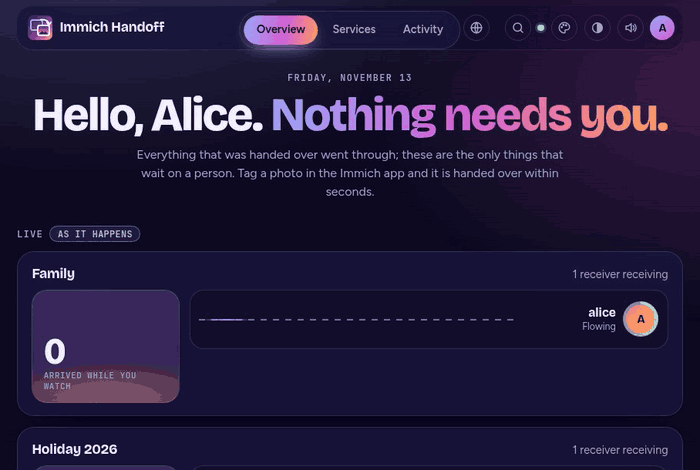 <b>Tag, and watch it go.</b> Photos fly along their lane, both ways, and the counters climb.</td>
    <td width="50%" valign="top" align="center">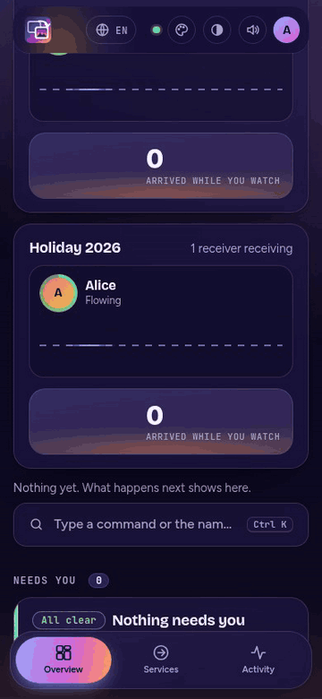 <b>On a phone,</b> the same page, and it installs like an app.</td>
  </tr>
  <tr>
    <td width="50%" valign="top">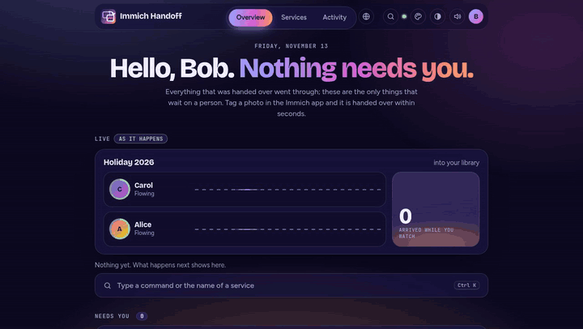 <b>Everything from the keyboard.</b> Ctrl K, type, Enter.</td>
    <td width="50%" valign="top">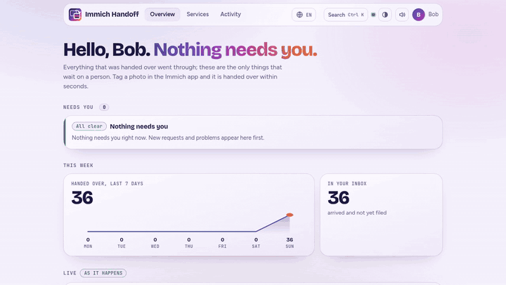 <b>Two colour schemes, light or dark,</b> as you like them; they also follow your phone or browser.</td>
  </tr>
  <tr>
    <td width="50%" valign="top">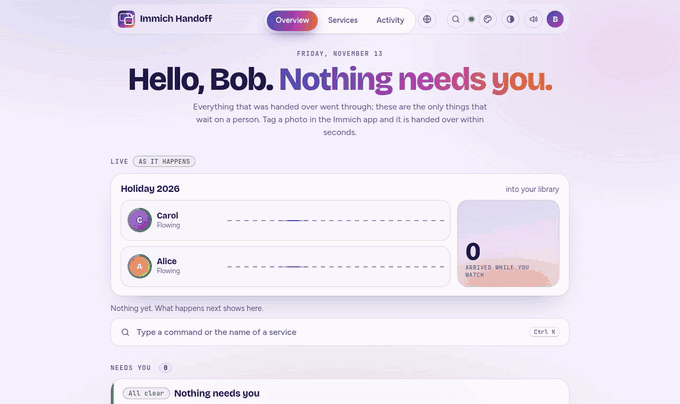 <b>Services open in place,</b> and the activity is a timeline.</td>
    <td width="50%" valign="top">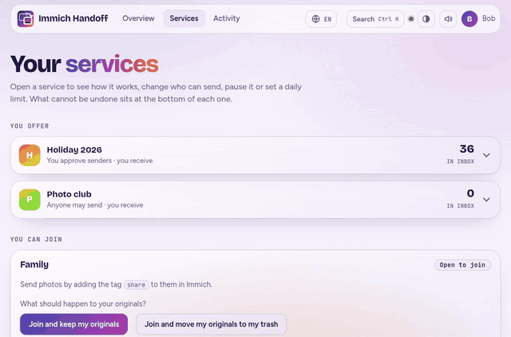 <b>Invite someone</b> with a link, a ready-written message or a QR code.</td>
  </tr>
  <tr>
    <td colspan="2" valign="top" align="center">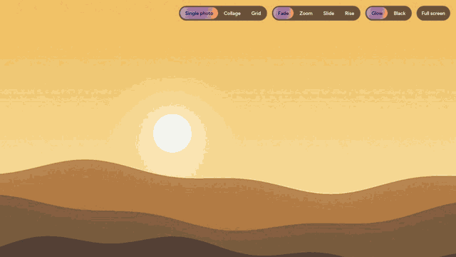 <b>A wall for the party.</b> Photos guests send arrive on a big screen, in the style you choose.</td>
  </tr>
</table>

## A closer look

<table>
  <tr>
    <td width="50%" valign="top">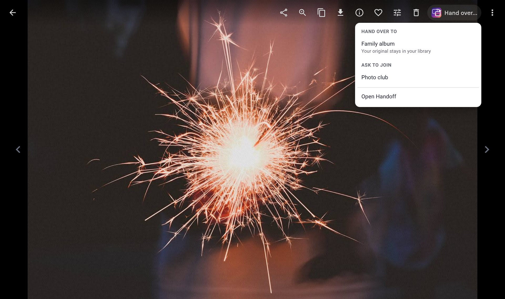 <b>A button inside Immich,</b> so nobody has to know about tags.</td>
    <td width="50%" valign="top">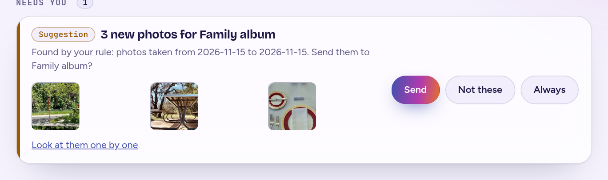 <b>Rules suggest,</b> you decide with one tap.</td>
  </tr>
</table>

<table>
  <tr>
    <td width="50%" valign="top"> <b>You choose</b> what happens to your originals when you join.</td>
    <td width="50%" valign="top">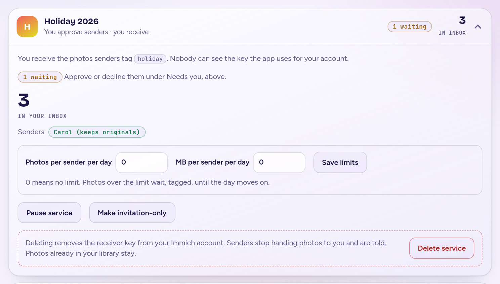 <b>Owners approve</b> senders and can share an invitation link.</td>
  </tr>
  <tr>
    <td width="50%" valign="top">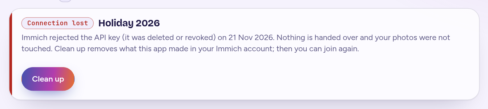 <b>Safe when keys disappear.</b> Nothing is handed over and no photo is touched.</td>
    <td width="50%" valign="top"> <b>What arrives</b> in the receiver's own Immich.</td>
  </tr>
</table>

Why this is different from shared albums and links: [Why Handoff](start/why-handoff.md).
