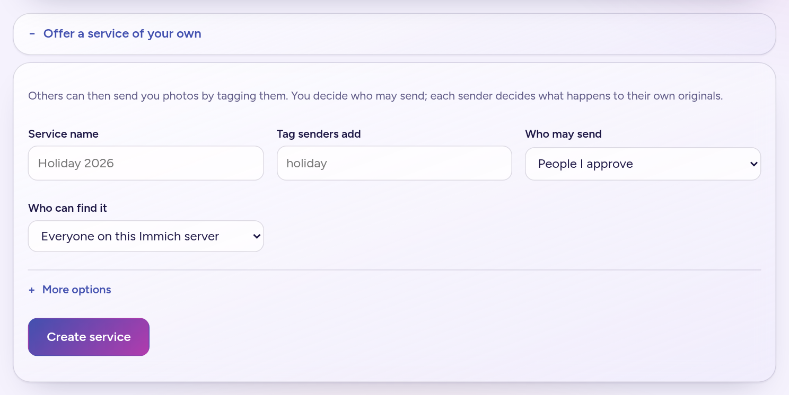
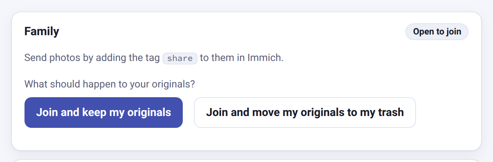
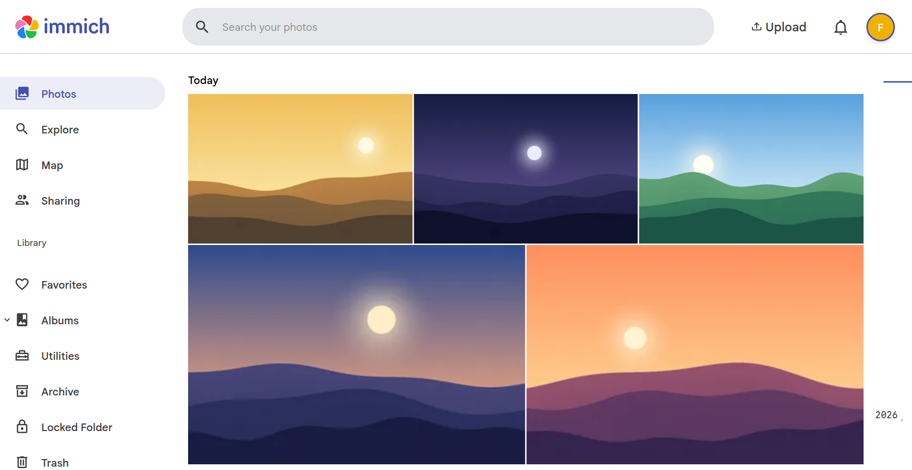

# Install

About ten minutes. You run one small container next to Immich; everyone else uses a web page and the Immich app they already have.

## Before you start

- **Immich 3.2.0 or newer.** Earlier versions cannot tell the app when a tag is added.
- **Docker**, on the machine that runs Immich (or one that shares a Docker network with it).
- **Every person who takes part, senders and receivers, must switch Tags on by hand** in Immich (Account Settings -> Features -> Tags). Immich has it off by default, separately for each user, and this app does not change it. Senders need it to add tags to photos. Receivers need it to see the inbox tag on what arrives. Without it a person cannot see or set tags in the Immich app, even though the hand-over itself still works. Ask each person to do this when they join.

## 1. Get the files

```
git clone https://github.com/vfuoglio/immich-handoff.git
cd immich-handoff
cp .env.example .env
```

## 2. Fill in three values

Open `.env` and set the three values in its **Required** section:

| Setting | What to put |
|---|---|
| `WEBHOOK_SECRET` | Any long random text. `openssl rand -hex 24` makes one. Immich sends it with every event, so nobody else can trigger hand-overs. |
| `HANDOFF_STORE_KEY` | Another long random text (16 characters or more). It encrypts the API keys the app keeps for people who join. **Keep a copy somewhere safe**: without it those keys cannot be read and people would have to join again. |
| `IMMICH_NETWORK` | The Docker network Immich runs on. Run `docker network ls` and look for the one that belongs to Immich, usually `immich_default`, which is already the default. |

The rest works as it is when Immich runs on that network under its standard service name, `immich-server`. You do **not** need to create any API keys: the app creates one for each person at the moment they join, through their own Immich login.

## 3. Start it

```
docker compose up -d --build
docker compose logs -f
```

You should see a line saying self-service joining is on. If the app stops with a message about `WEBHOOK_SECRET` or `HANDOFF_STORE_KEY`, the value is missing or too short.

## 4. Set up the first service

Open `http://<your-host>:8080/` in a browser **on the same hostname you use for Immich** (the page uses your Immich login; see [Operations](operations.md#putting-the-page-behind-your-reverse-proxy) for HTTPS and reverse proxies). Sign in to Immich first if you are asked to.

The person who should **receive** the photos, for example whoever looks after the family library, opens the page and chooses **Offer a service of your own**:



Give it a name (say "Family"), the tag senders will use (say `share`), who can find it, and who may send. Create it.

Everyone else now opens the same page. They see the service and **join** it, choosing for themselves what happens to their original photos:



## 5. Send a photo

A person who joined tags a photo `share` in the Immich app. Within a few seconds it is in the receiver's library, tagged `inbox`:



That is the whole setup. [Using it](using.md) explains what people see on the page, and [Operations](operations.md) covers HTTPS, backups and upgrades.

## Prefer to set the accounts up yourself?

If you would rather create the API keys yourself than let people join from the page, or you want several fixed services in a file, see [Fixed accounts](fixed-accounts.md).
