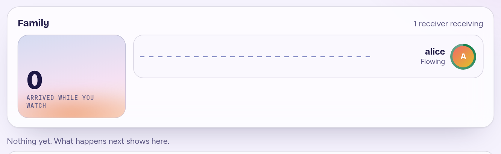
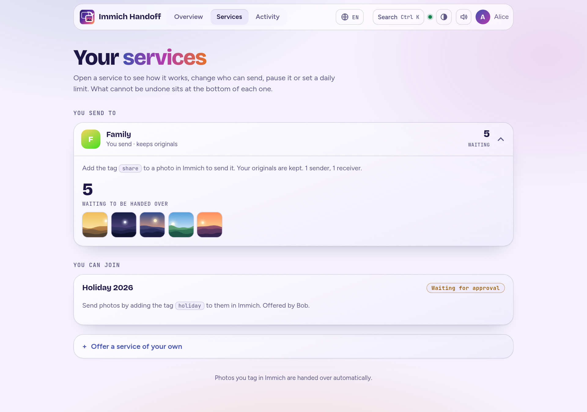
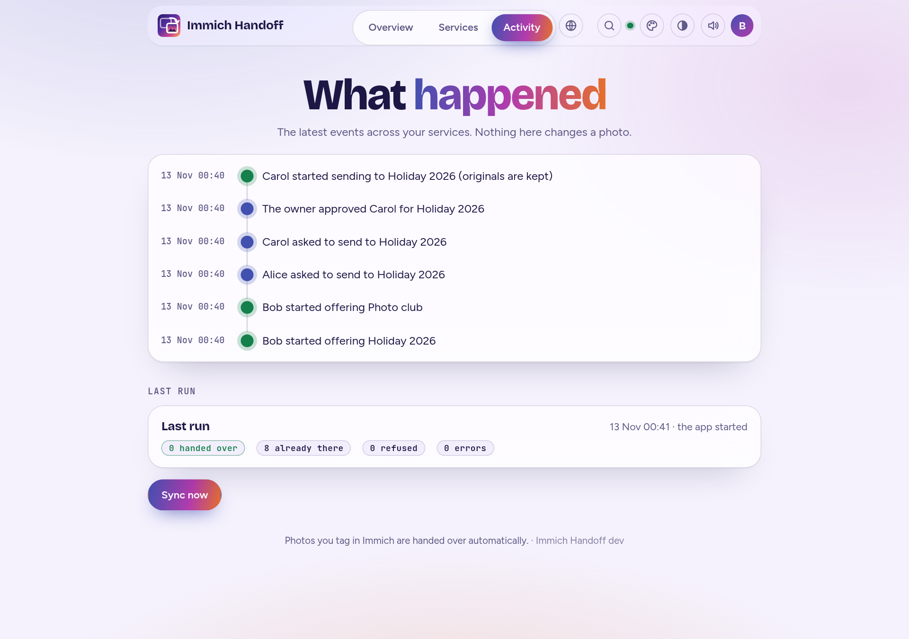
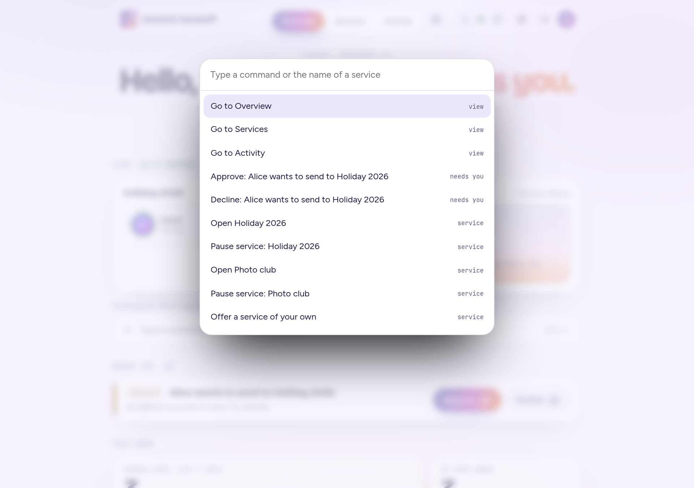

> [!NOTE]
> Questa pagina è stata tradotta automaticamente e non è ancora stata rivista da una persona. Le immagini mostrano l’interfaccia in inglese. In caso di dubbio vale la versione inglese.

# Orientarsi nella pagina

La pagina ha quattro viste e una barra di ricerca che fa ciò che chiedi. Questo è il giro di cinque minuti: dove sono le cose, cosa significano le parole e cosa ti mostra la scena in diretta.

## Prima di tutto: i tag

Handoff funziona con i **tag** di Immich, e i tag sono **disattivati per impostazione predefinita**, per ogni persona separatamente. Se i tuoi sono disattivati, la pagina mostra un avviso con un pulsante **Attiva i Tag** (puoi farlo anche in Immich: Impostazioni dell’account, Funzioni, **Tag**). I mittenti ne hanno bisogno per contrassegnare le foto, i destinatari per vedere il tag della posta in arrivo e filtrare per esso. Attivarli non basta: **ricarica la scheda o la finestra di Immich dopo**, altrimenti le opzioni dei tag non compaiono (nell’app per telefono, chiudila e riaprila).

## Le quattro viste

La barra in alto ha quattro viste, in una pillola al centro (su un telefono sono una barra in basso, con un’icona ciascuna). L’indirizzo ricorda la vista (`#services`), quindi puoi salvarla tra i preferiti, e la pagina vi torna dopo un’azione.

- **Panoramica.** La data e un saluto, la barra di ricerca, poi **Hai da fare**, la **scena in diretta** e **Questa settimana**, una sotto l’altra. La scheda **Inizia** sta in fondo finché non hai finito con essa.
- **Servizi.** Ogni servizio a cui invii, da cui ricevi, che offri o a cui puoi unirti. Se puoi creare più che servizi, un selettore in alto passa tra i tuoi servizi, drop box, stanze cliente, cornici e album condivisi.
- **Attività.** Cosa è successo, l’ultima esecuzione e **Sincronizza ora**.
- **Impostazioni.** Ciò che configuri una volta e poi dimentichi, in categorie (Notifiche, Foto, In condivisione, Schermi). La vista esiste solo se qualcosa vi è attivo per te.

### Hai da fare

Tutto ciò che aspetta una persona viene per primo, il più urgente in cima, ciascuno con il suo pulsante. Quando niente aspetta, lo dice.

- **Connessione persa** e **Rimosso dal proprietario**: **Ripulisci**, che elimina ciò che l’app ha creato nel tuo account Immich (poi puoi unirti di nuovo).
- **Disconnesso** (un servizio che offri): **Riconnetti**.
- **Richiesta**: qualcuno vuole inviare a un servizio che offri. **Approva** o **Rifiuta**; una richiesta si risponde qui e in nessun altro posto.
- **In pausa**: un servizio che hai messo in pausa, o il tuo invio (**Riprendi**), o un servizio messo in pausa dal suo proprietario (niente da premere per te).
- **Limite**: un mittente ha raggiunto il limite giornaliero, o tu (vedi [i limiti giornalieri](../../guides/automate/controls.md)).

### Questa settimana

Un piccolo grafico con un punto al giorno (giorni UTC, oggi a destra) di quante foto sono state consegnate negli ultimi sette giorni: le foto che **hai inviato** e quelle **arrivate nei servizi che offri**. Conta ciò che l’app ha registrato per le persone che si sono unite dalla pagina, quindi i mittenti configurati in `.env` o in un file di percorsi non compaiono. Accanto, **In attesa di partire** (foto che hai contrassegnato e devono ancora partire) e **Nella tua posta in arrivo** (ciò che è arrivato e non è ancora archiviato) si aggiornano da soli ogni volta che una consegna finisce.

### Inizia

La scheda attiva i tag, ti aiuta a unirti a un servizio o a offrirne uno e a consegnare una prima foto, e suggerisce altri passi adatti a ciò che fai (invitare qualcuno, una notifica). Ogni passo ha **Mostrami** e un **?** alla sua guida, e un anello mostra a che punto sei. Sparisce quando hai finito o quando premi **Nascondi questa guida**.

## La scena in diretta

Subito sotto la barra di ricerca, **In diretta** mostra ciò che accade mentre accade. Ogni servizio a cui partecipi ha un palcoscenico: una **corsia** per ogni mittente e una porta nella libreria che riceve. Un quadrato colorato luminoso percorre la corsia del mittente fino alla porta e si allarga un anello dove atterra; quando sei tu a inviare, un quadrato contornato con una freccia lascia invece la tua porta. Il contatore **arrivate mentre guardi** sale per ognuno. I quadrati sono solo quadrati: la scena non mostra mai una foto né un nome di file, e solo consegne vere, mai inventate.

Una corsia dice anche a parole in che stato è, così il colore non è mai l’unico segnale: **In corso**, **In pausa dal proprietario** o **In pausa dal mittente** (corsia tratteggiata), **Limite giornaliero raggiunto** con quante aspettano e fino a quando (ambra), **Connessione persa** (rosso, con una croce). Un breve registro sotto i palcoscenici elenca le ultime cose in una frase ciascuna, e a un lettore di schermo viene detta la stessa frase.

Resta calma: niente si muove finché non accade nulla, volano solo pochi quadrati alla volta, e con movimento ridotto o una scheda nascosta i quadrati vengono saltati e cambiano solo le etichette, il contatore e il registro. Se la connessione all’app cade, la scena si attenua e lo dice, poi si rimette in pari da sola.

Ogni servizio è una riga: la sua iniziale, il nome, cos’è, uno stato come In pausa o Limite, e il numero che conta (foto in attesa, o nella tua posta in arrivo). Premila per aprirla sul posto e vedere le sue impostazioni: il tag, l’album, chi invia e quanto, i limiti, il link d’invito e il pulsante di pausa. Ciò che non si può annullare sta a parte in fondo a un servizio aperto, in un riquadro tratteggiato che dice cosa fa: **Esci** (per un servizio a cui invii) ed **Elimina servizio** (per uno che offri). Ogni domanda viene posta in una finestra di dialogo nella pagina stessa, con una frase chiara e un pulsante chiamato come ciò che fa (rosso quando non si può annullare); Esc o Annulla non cambiano nulla.

## Rendila tua

- **Ctrl K** (o **Cmd K** su un Mac, o la lente nella barra, o la barra di ricerca della Panoramica) apre la **tavolozza dei comandi**: scrivi qualche lettera per passare a una vista o a un servizio, o per fare ciò che puoi fare (approvare una richiesta, mettere in pausa o riprendere, sincronizzare, aprire l’aiuto, fare il giro). Elenca solo ciò che ti è permesso, e preme lo stesso pulsante della pagina, quindi le domande vengono comunque poste.

  

- **Colori.** L’icona della tavolozza sceglie lo **schema di colori** (**Crepuscolo**, i colori dell’icona dell’app, o **Immich**, blu tranquilli su grigi quasi neutri), l’icona mezzaluna passa tra chiaro e scuro, e l’icona dell’altoparlante attiva o disattiva il suono lieve e la breve vibrazione del telefono quando atterra una foto (il primo clic o tasto sveglia il suono, una regola dei browser). Ciò che scegli resta in questo browser e prevale su ciò che l’amministratore ha impostato (`THEME` e `THEME_MODE`, vedi [Impostazioni](../../reference/settings.md)).
- **Lingua.** Il codice accanto al globo (en, de, fr, es, it, pt, ru) è il menu delle lingue: le pagine seguono la lingua del tuo browser e questo ne sceglie un’altra per sempre. Sono tradotte solo le pagine, non il registro.
- **Tasti.** **A** e **D** rispondono alla richiesta in attesa (i pulsanti portano il loro tasto), e **G** poi **O**, **S**, **A** o **T** va a Panoramica, Servizi, Attività o Impostazioni. Tacciono mentre scrivi o c’è una finestra di dialogo aperta.
- **Su un telefono** puoi aggiungere la pagina alla schermata iniziale perché si apra come un’app: vedi [Gestione](../../admin/operations.md).
- **Movimento.** La luce dietro la pagina scorre e divampa quando atterra una foto, le schede si inclinano verso un mouse e i numeri girano come su un tabellone delle partenze. Tutto viene saltato su un touch screen o con movimento ridotto, e niente si muove finché la pagina è ferma.
- **Album come cartelle** (un nome come `Viaggi / 2024 / Roma`) hanno una pagina propria: [Albero degli album](../../guides/show/album-tree.md).
- Il piè di pagina dice quale **versione** è in esecuzione, alle persone che hanno effettuato l’accesso a Immich.

## Le parole usate qui

| Parola | Significato |
|---|---|
| **Servizio** | Un luogo con un nome a cui si possono consegnare foto, con un tag. «Vacanze 2026» con il tag `share` è un servizio. |
| **Destinatario** (o **proprietario**) | La persona nella cui libreria atterrano le foto. Crea il servizio e decide chi può inviare. |
| **Mittente** | Qualcuno che contrassegna foto per consegnarle a un servizio. |
| **Tag** | L’etichetta che aggiungi a una foto in Immich per inviarla. Ogni servizio ha il suo. |
| **Posta in arrivo** | Un tag su tutto ciò che è appena arrivato, perché il destinatario trovi ciò che è nuovo. |
| **Drop box** | Un link, codice QR o indirizzo e-mail a cui chiunque può inviare foto senza account. Può anche essere un **evento** con galleria, muro e una selezione del meglio. |
| **Pool** | Un servizio in cui tutti inviano e tutti ricevono, per un viaggio o una festa. |
| **Stanza cliente** | Un link con cui un cliente guarda un album attraverso immagini contrassegnate e sceglie i preferiti. |
| **Regola** | Una ricerca nel tuo Immich (persone, luoghi, date, una frase) che suggerisce foto da consegnare. |
| **Album condiviso** | Un album che due persone su server diversi tengono allineato. |
| **Chiave** | La chiave API limitata che l’app crea nel tuo account Immich quando ti unisci, per poter contrassegnare e consegnare per te. Nessuno la vede, ed eliminarla in Immich ferma tutto in sicurezza. |

## Da sapere

- **Niente viene rimosso senza una copia.** Una foto va nel cestino solo dopo che ogni destinatario ha una copia verificata, e mai mentre una connessione è interrotta.
- **Una foto che il destinatario ha già nel suo cestino non viene consegnata.** L’originale viene conservato e riceve il tag `share-duplicate` (quello del servizio viene sostituito), così vedi perché. Quando il destinatario svuota il cestino, aggiungi di nuovo il tag.
- **Backup del telefono.** Una foto nel tuo cestino viene saltata dal backup del telefono. Quando Immich svuota il cestino, un telefono che ha ancora la foto può farne di nuovo il backup.
- **Un tag appena aggiunto è sparito.** Immich a volte perde un tag aggiunto nei primi istanti dopo il caricamento di una foto. Aggiungilo di nuovo.

Qualcosa non funziona? Vedi [Risoluzione dei problemi](../../reference/troubleshooting.md).

## Quando il tag della posta in arrivo sparisce

- **Archiviata in un album:** il tag viene rimosso entro circa 15 minuti, non subito.
- **In nessun album:** il tag viene rimosso quando la foto è rimasta nella libreria del destinatario per la scadenza del servizio (30 giorni di default). L’orologio parte da quando la foto è stata caricata in Immich dalla consegna, non da quando è stata scattata, e modificare o ricontrassegnare la foto non lo azzera.

**Perché un ritardo?** L’app viene a sapere delle nuove foto perché Immich glielo dice: un workflow scatta quando viene aggiunto un tag e chiama l’app. Immich 3.2.0 non offre un evento simile per gli album (gli unici trigger sono la creazione di un elemento, l’estrazione dei suoi metadati e l’aggiunta di un tag), quindi l’unico modo di accorgersene è guardare. L’app controlla con un timer, e il controllo è volutamente piccolo: una ricerca delle foto con il tag della posta in arrivo per destinatario, e nient’altro quando è vuota.

**Più veloce o più lento?** Cambia `CLEANUP_INTERVAL_MINUTES` ([Impostazioni](../../reference/settings.md)). Più breve significa più richieste (piccole) a Immich e attesa più corta; `0` spegne il timer e lascia il controllo giornaliero. Se Immich aggiunge un evento per gli album in una versione futura, questo potrà diventare immediato.

## E poi

- Consegnare la tua prima foto: [Avvio rapido](quickstart.md)
- Scegliere un obiettivo: [Uso](../using.md)
- Cercare qualcosa: [Le domande che si fanno per prime](../reference/faq.md)
