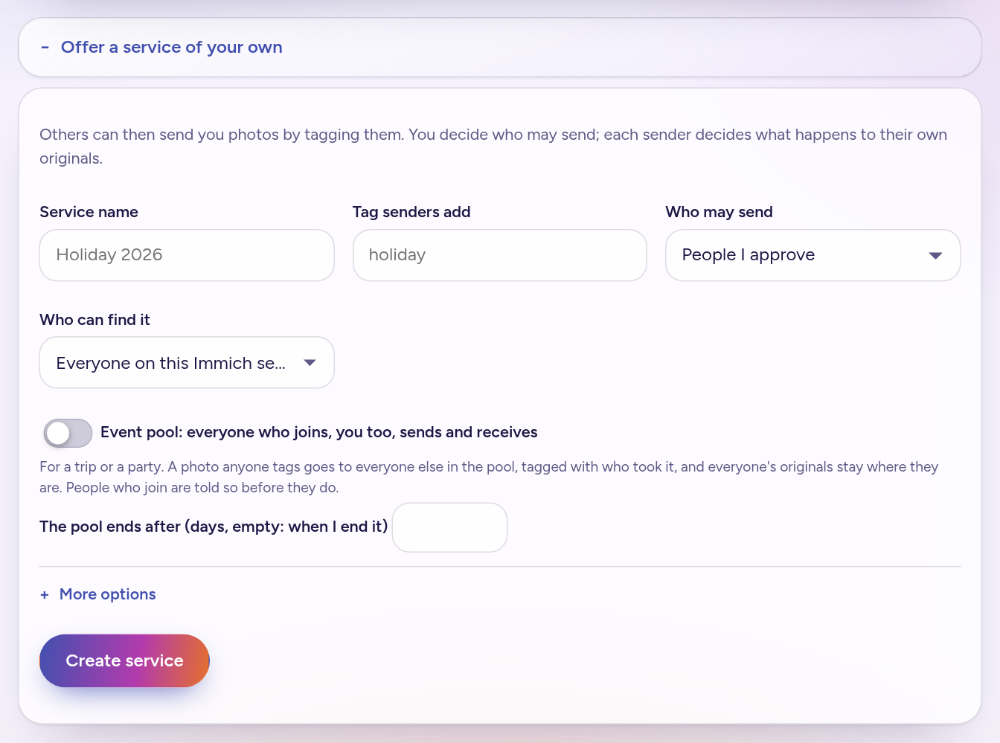
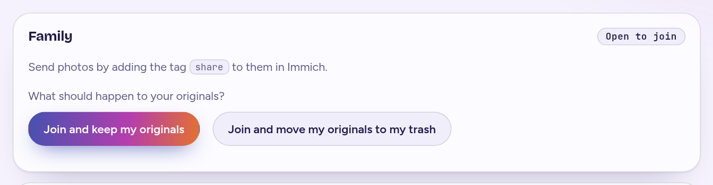

> [!NOTE]
> Esta página foi traduzida automaticamente e ainda não foi revista por uma pessoa. As imagens mostram a interface em inglês. Em caso de dúvida, vale a versão em inglês.

# Início rápido: a sua primeira entrega em dez minutos

Uma foto que você marca com uma etiqueta na aplicação Immich que já usa aparece na biblioteca de outra pessoa, com uma cópia verificada antes de o seu original se mexer.


**O que precisa:** Immich 3.2.0 ou posterior, Docker na máquina que o executa e cerca de dez minutos. Se quiser experimentar primeiro sozinho, [execute a demonstração](../../../demo/README.md): um comando, fotos de exemplo, nada seu é tocado.

## 1. Iniciar a aplicação

No Linux (num Mac, use `sed -i ''`):

```
git clone --branch v1.4.0 https://github.com/vfuoglio/immich-handoff.git && cd immich-handoff
cp .env.example .env
sed -i -e "s/^WEBHOOK_SECRET=.*/WEBHOOK_SECRET=$(openssl rand -hex 24)/" -e "s/^HANDOFF_STORE_KEY=.*/HANDOFF_STORE_KEY=$(openssl rand -hex 24)/" .env
docker compose up -d
```

> [!TIP]
> Se a sua rede do Immich não se chama `immich_default`, defina primeiro `IMMICH_NETWORK` no `.env`. **Guarde uma cópia de `HANDOFF_STORE_KEY`**: cifra as chaves que a aplicação guarda de quem se junta.

## 2. Iniciar sessão e oferecer um serviço

Abra `http://<o-seu-anfitrião>:8080/` com o mesmo nome de anfitrião que usa para o Immich e inicie sessão com a sua conta Immich. Escolha **Ofereça um serviço seu**, dê-lhe um nome (por exemplo «Férias 2026»), escolha a etiqueta que os remetentes vão usar (por exemplo `share`) e quem pode enviar. Ninguém cria uma chave de API à mão: a aplicação cria uma, restrita, em cada conta no momento em que alguém se junta, e pode apagá-la no Immich a qualquer momento.



## 3. Deixar alguém juntar-se

Partilhe a ligação de convite ou o código QR do serviço. A outra pessoa abre-o, inicia sessão com a sua própria conta Immich e junta-se, escolhendo ela mesma o que acontece aos seus originais: **mantê-los** e enviar uma cópia, ou **movê-los** para o lixo quando o seu lado tiver uma cópia verificada.



> [!WARNING]
> Escolha **manter** enquanto experimenta. **Mover** põe o original no lixo do remetente depois de a cópia ser verificada.

## 4. Marcar uma foto

Na aplicação Immich, adicione a etiqueta `share` a uma foto. Passados alguns segundos está na biblioteca do destinatário, com a etiqueta `inbox`, e a página mostra-a a caminho. Se não chegar, execute `docker compose exec immich-handoff /immich-handoff doctor`; diz o que está errado e como corrigir.


> [!IMPORTANT]
> Todas as pessoas que participam precisam das **etiquetas** ativadas no Immich (Definições da conta, Funcionalidades, Etiquetas) e têm de recarregar a página do Immich depois. A página repara nisso e oferece um botão **Ativar as Tags**.

## O que se segue

- Deixar de marcar à mão: [as regras](../../guides/automate/rules.md) e [o botão dentro do Immich](../../guides/automate/immich-button.md)
- Recolher fotos de convidados num evento: [as caixas de entrega](../../guides/collect/events.md)
- Enviar do telemóvel: [o separador Enviar](../../guides/collect/phone.md)
- Orientar-se na página: [a página](the-page.md)
- Operá-lo como deve ser: [instalação](../../admin/install.md), depois [operação](../../admin/operations.md)
