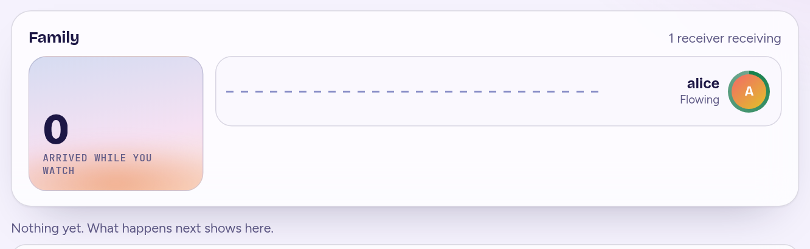
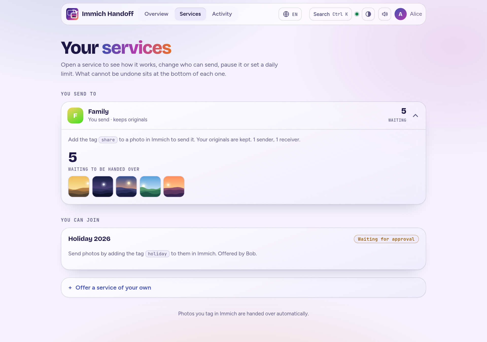
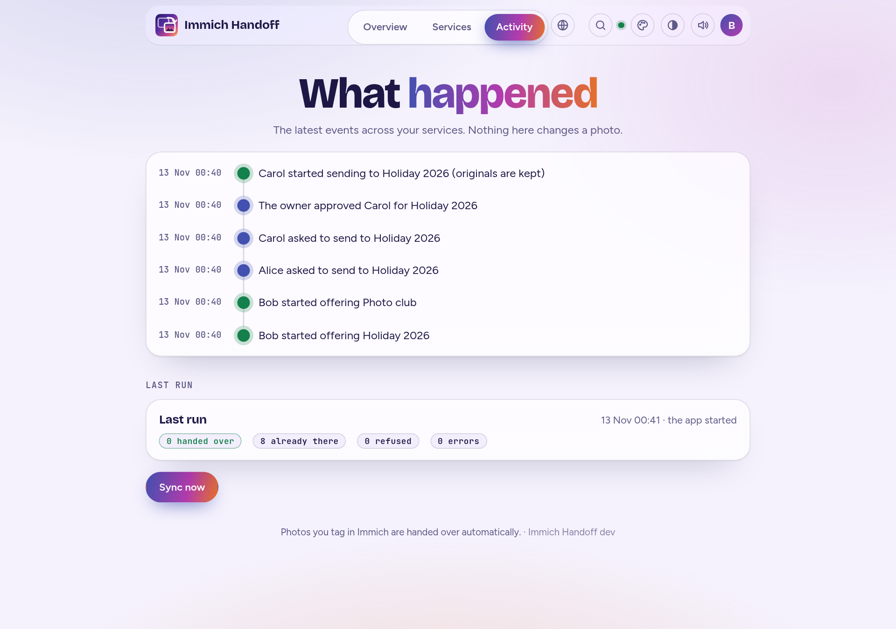
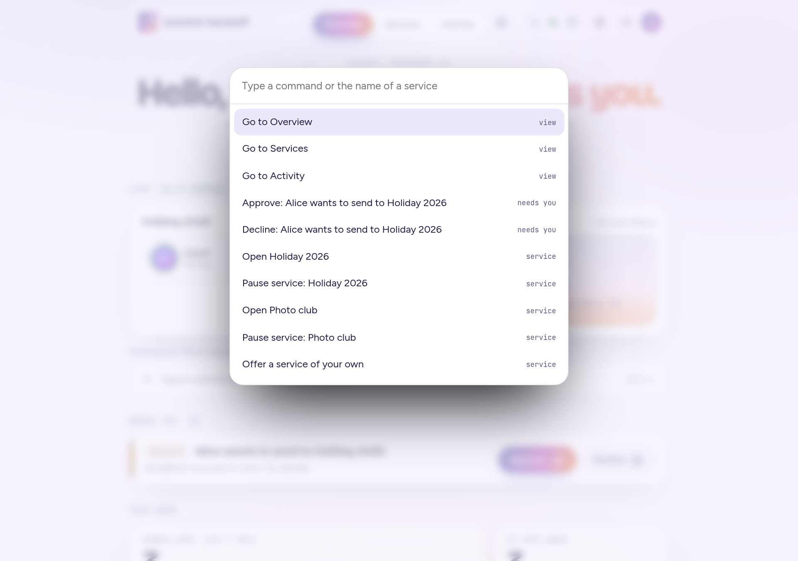

> [!NOTE]
> Эта страница переведена машинным переводом и ещё не проверена человеком. На картинках интерфейс на английском. В случае сомнений ориентируйтесь на английскую версию.

# Как ориентироваться на странице

На странице четыре раздела и строка поиска, которая делает то, что вы просите. Это пятиминутный обход: где что находится, что означают слова и что показывает сцена в реальном времени.

## Сначала: теги

Handoff работает на **тегах** Immich, а теги **по умолчанию выключены**, у каждого человека отдельно. Если ваши выключены, страница показывает уведомление с кнопкой **Включить теги** (то же можно сделать в Immich: Настройки аккаунта, Функции, **Теги**). Отправителям они нужны, чтобы помечать фото, получателям — чтобы видеть тег входящих и фильтровать по нему. Включить мало: **после этого обновите вкладку или окно Immich**, иначе параметры тегов не появятся (в мобильном приложении закройте его и откройте снова).

## Четыре раздела

В верхней панели четыре раздела, в «таблетке» посередине (на телефоне это панель внизу, у каждого значок). Адрес запоминает раздел (`#services`), так что его можно добавить в закладки, и страница возвращается к нему после действия.

- **Обзор.** Дата и приветствие, строка поиска, затем **Ждёт вас**, **сцена в реальном времени** и **На этой неделе**, одно под другим. Карточка **Начать** остаётся в конце, пока вы с ней не закончите.
- **Сервисы.** Каждый сервис, в который вы отправляете, из которого получаете, который предлагаете или к которому можно присоединиться. Если вы можете создавать не только сервисы, переключатель сверху переходит между вашими сервисами, ящиками для приёма, комнатами клиента, рамками и общими альбомами.
- **Активность.** Что произошло, последний запуск и **Синхронизировать сейчас**.
- **Настройки.** То, что настраивают один раз и забывают, по категориям (Уведомления, Фото, Обмен идёт, Экраны). Раздел существует, только если для вас там что-то включено.

### Ждёт вас

Всё, что ждёт человека, идёт первым, самое срочное сверху, у каждого пункта своя кнопка. Когда ничто не ждёт, так и сказано.

- **Соединение потеряно** и **Удалено владельцем**: **Очистить**, что удаляет созданное приложением в вашем аккаунте Immich (после этого можно присоединиться снова).
- **Отключён** (сервис, который вы предлагаете): **Переподключить**.
- **Запрос**: кто-то хочет отправлять в предложенный вами сервис. **Одобрить** или **Отклонить**; на запрос отвечают здесь и больше нигде.
- **На паузе**: сервис, который вы поставили на паузу, или ваша собственная отправка (**Возобновить**), или сервис, поставленный на паузу владельцем (нажимать нечего).
- **Лимит**: отправитель достиг суточного лимита, или вы (см. [суточные лимиты](../../guides/automate/controls.md)).

### На этой неделе

Небольшой график с точкой на каждый день (дни по UTC, сегодня справа): сколько фото передано за последние семь дней — фото, которые **вы отправили**, и те, что **пришли в предложенные вами сервисы**. Он считает то, что приложение записало о людях, присоединившихся со страницы, поэтому отправители, настроенные в `.env` или файле маршрутов, в нём не видны. Рядом **Ждут отправки** (помеченные вами фото, которым ещё предстоит уйти) и **В ваших входящих** (пришедшее и ещё не разложенное) обновляются сами, когда завершается передача.

### Начать

Карточка включает теги, помогает присоединиться к сервису или предложить свой и передать первое фото, а потом предлагает следующие шаги по тому, чем вы занимаетесь (пригласить кого-то, уведомление). У каждого шага есть **Покажи** и **?** к его руководству, а кольцо показывает, как далеко вы продвинулись. Она исчезает, когда вы закончили или нажали **Скрыть это руководство**.

## Сцена в реальном времени

Прямо под строкой поиска **В реальном времени** показывает происходящее по мере того, как оно происходит. У каждого сервиса, в котором вы участвуете, есть сцена: **дорожка** для каждого отправителя и дверь в принимающую библиотеку. Яркий цветной квадрат бежит по дорожке отправителя к двери, и там, где он приземлился, расходится кольцо; когда отправляете вы, квадрат с контуром и стрелкой уходит от вашей двери. Счётчик **поступило, пока вы смотрите** растёт для каждого. Квадраты — просто квадраты: сцена никогда не показывает ни фото, ни имени файла и только настоящие передачи, никогда не выдуманные.

Дорожка также словами называет своё состояние, чтобы цвет не был единственным признаком: **Идёт передача**, **Приостановлено владельцем** или **Приостановлено отправителем** (пунктирная дорожка), **Суточный лимит достигнут** с числом ожидающих и временем, до которого (янтарный), **Соединение потеряно** (красный, с крестиком). Короткий журнал под сценами перечисляет последние события по фразе на каждое, и скринридер получает ту же фразу.

Она остаётся спокойной: ничто не движется, пока ничего не происходит, одновременно летит лишь несколько квадратов, а при уменьшенном движении или скрытой вкладке квадраты пропускаются и меняются только подписи, счётчик и журнал. Если связь с приложением оборвётся, сцена тускнеет и сообщает об этом, затем догоняет сама.

Каждый сервис — это строка: его инициал, название, что это, состояние вроде «На паузе» или «Лимит» и важное число (ожидающие фото или фото во входящих). Нажмите на неё, чтобы раскрыть на месте и увидеть настройки: тег, альбом, кто отправляет и сколько, лимиты, ссылку-приглашение и кнопку паузы. То, что нельзя отменить, лежит отдельно внизу открытого сервиса в пунктирной рамке, которая говорит, что делает: **Выйти** (для сервиса, в который вы отправляете) и **Удалить сервис** (для предложенного вами). Каждый вопрос задаётся в диалоге самой страницы, с понятной фразой и кнопкой, названной по тому, что она делает (красная, когда отменить нельзя); Esc или «Отмена» ничего не меняют.

## Сделайте её своей

- **Ctrl K** (или **Cmd K** на Mac, или лупа в панели, или строка поиска на обзоре) открывает **палитру команд**: введите несколько букв, чтобы перейти в раздел или сервис или сделать то, что вам доступно (одобрить запрос, поставить на паузу или возобновить, синхронизировать, открыть справку, пройти тур). Она перечисляет только разрешённое вам и нажимает ту же кнопку, что и страница, поэтому вопросы по-прежнему задаются.

  

- **Цвета.** Значок палитры выбирает **цветовую схему** (**Сумерки**, цвета значка приложения, или **Immich**, спокойные синие на почти нейтральном сером), значок полумесяца переключает светлую и тёмную тему, а значок динамика включает или выключает тихий звук и короткую вибрацию телефона, когда приходит фото (первый клик или касание «будит» звук, таково правило браузеров). Выбранное хранится в этом браузере и перекрывает то, что задал администратор (`THEME` и `THEME_MODE`, см. [Настройки](../../reference/settings.md)).
- **Язык.** Код рядом с глобусом (en, de, fr, es, it, pt, ru) — меню языка: страницы следуют языку вашего браузера, а оно выбирает другой насовсем. Переведены только страницы, не журнал.
- **Клавиши.** **A** и **D** отвечают на ожидающий запрос (на кнопках указана их клавиша), а **G**, затем **O**, **S**, **A** или **T** переходит к обзору, сервисам, активности или настройкам. Они молчат, пока вы печатаете или открыт диалог.
- **На телефоне** страницу можно добавить на домашний экран, чтобы она открывалась как приложение: см. [Эксплуатация](../../admin/operations.md).
- **Движение.** Свет за страницей дрейфует и вспыхивает, когда приходит фото, карточки наклоняются к мыши, а числа прокручиваются, как на табло вылетов. Всё это пропускается на сенсорном экране или при уменьшенном движении, и ничто не движется, пока страница бездействует.
- **Альбомы как папки** (название вроде `Поездки / 2024 / Рим`) имеют свою страницу: [Дерево альбомов](../../guides/show/album-tree.md).
- Нижний колонтитул показывает, какая **версия** запущена, тем, кто вошёл в Immich.

## Слова, которые здесь используются

| Слово | Значение |
|---|---|
| **Сервис** | Именованное место, куда можно передавать фото, с тегом. «Отпуск 2026» с тегом `share` — это сервис. |
| **Получатель** (или **владелец**) | Человек, в чью библиотеку приходят фото. Он создаёт сервис и решает, кто может отправлять. |
| **Отправитель** | Тот, кто помечает фото, чтобы передать их в сервис. |
| **Тег** | Метка, которую вы добавляете фото в Immich, чтобы отправить его. У каждого сервиса свой. |
| **Входящие** | Тег на всём только что пришедшем, чтобы получатель находил новое. |
| **Ящик для приёма** | Ссылка, QR-код или адрес почты, куда любой может отправить фото без аккаунта. Может быть и **событием** с галереей, стеной и подборкой лучшего. |
| **Пул** | Сервис, где все отправляют и все получают, для поездки или праздника. |
| **Комната клиента** | Ссылка, по которой клиент смотрит альбом через размеченные изображения и выбирает любимые. |
| **Правило** | Поиск в вашем Immich (люди, места, даты, фраза), который предлагает фото для передачи. |
| **Общий альбом** | Альбом, который двое на разных серверах держат синхронизированным. |
| **Ключ** | Ограниченный API-ключ, который приложение создаёт в вашем аккаунте Immich при присоединении, чтобы помечать и передавать за вас. Его никто не видит, а удаление в Immich безопасно всё останавливает. |

## Полезно знать

- **Ничто не удаляется без копии.** Фото попадает в корзину только после того, как у каждого получателя есть проверенная копия, и никогда — пока соединение разорвано.
- **Фото, которое уже лежит в корзине получателя, не передаётся.** Оригинал сохраняется и получает тег `share-duplicate` (тег сервиса заменяется), чтобы вы видели причину. Когда получатель очистит корзину, добавьте тег снова.
- **Резервные копии телефона.** Фото в вашей корзине пропускается резервным копированием телефона. Когда Immich очистит корзину, телефон, у которого фото всё ещё есть, может сохранить его снова.
- **Только что добавленный тег пропал.** Immich иногда теряет тег, добавленный в первые мгновения после загрузки фото. Добавьте его снова.

Что-то не работает? См. [Устранение неполадок](../../reference/troubleshooting.md).

## Когда тег входящих исчезает

- **Разложено по альбому:** тег снимается примерно через 15 минут, не мгновенно.
- **Ни в одном альбоме:** тег снимается, когда фото пролежало в библиотеке получателя срок истечения сервиса (по умолчанию 30 дней). Отсчёт идёт с того момента, когда передача загрузила фото в Immich, а не когда оно снято, и правка или повторная пометка фото его не сбрасывает.

**Почему задержка?** Приложение узнаёт о новых фото, потому что Immich ему об этом говорит: воркфлоу срабатывает при добавлении тега и вызывает приложение. В Immich 3.2.0 для альбомов такого события нет (единственные триггеры — создание элемента, извлечение его метаданных и добавление тега), поэтому заметить это можно, только посмотрев. Приложение проверяет по таймеру, и проверка намеренно мала: поиск фото с тегом входящих по получателю и ничего больше, когда пусто.

**Быстрее или медленнее?** Измените `CLEANUP_INTERVAL_MINUTES` ([Настройки](../../reference/settings.md)). Короче — больше (небольших) запросов к Immich и меньше ожидания; `0` выключает таймер и оставляет суточную проверку. Если Immich добавит событие для альбомов в будущей версии, это может стать мгновенным.

## Что дальше

- Передайте первое фото: [Быстрый старт](quickstart.md)
- Выберите цель: [Использование](../using.md)
- Найдите что-нибудь: [Вопросы, которые задают первыми](../reference/faq.md)
