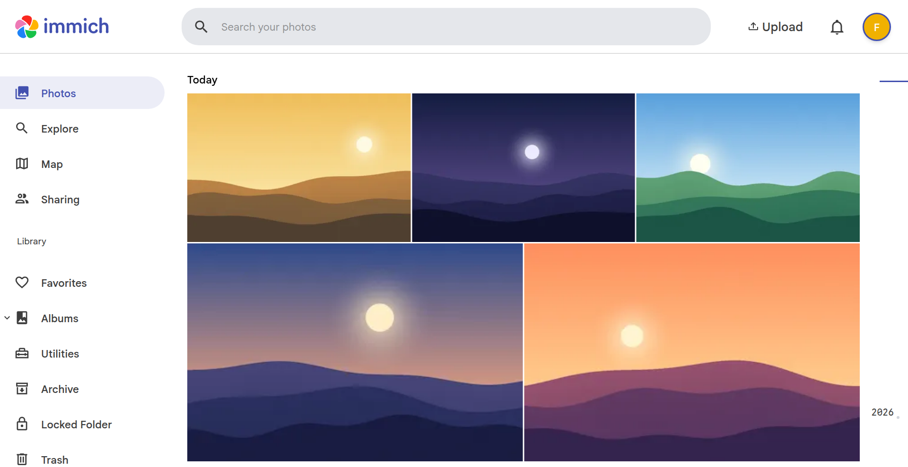

# Quick start: your first hand-over in ten minutes

A photo you tag in the Immich app you already use shows up in someone else's library, with a verified copy before your original ever moves.


**What you need:** Immich 3.2.0 or newer, Docker on the machine that runs it, and about ten minutes. To try it by yourself first, [run the demo](../../demo/README.md): one command, sample photos, nothing of yours touched.

## 1. Start the app

On Linux (on a Mac use `sed -i ''`):

```
git clone --branch v1.4.0 https://github.com/vfuoglio/immich-handoff.git && cd immich-handoff
cp .env.example .env
sed -i -e "s/^WEBHOOK_SECRET=.*/WEBHOOK_SECRET=$(openssl rand -hex 24)/" -e "s/^HANDOFF_STORE_KEY=.*/HANDOFF_STORE_KEY=$(openssl rand -hex 24)/" .env
docker compose up -d
```

> [!TIP]
> If your Immich network is not called `immich_default`, set `IMMICH_NETWORK` in `.env` first. **Keep a copy of `HANDOFF_STORE_KEY`**: it encrypts the keys the app holds for people who join.

## 2. Sign in and offer a service

Open `http://<your-host>:8080/` on the same hostname you use for Immich and sign in with your Immich account. Choose **Offer a service of your own**, name it (say "Holiday 2026"), pick the tag senders will use (say `share`) and who may send. Nobody makes an API key by hand: the app makes a restricted one in each account at the moment a person joins, and they can delete it in Immich at any time.


## 3. Let someone join

Share the service's invitation link or QR code. The other person opens it, signs in with their own Immich account and joins, choosing for themselves what happens to their originals: **keep** them and send a copy, or **move** them to their trash once your side has a verified copy.


> [!WARNING]
> Choose **keep** while you are trying things out. **Move** puts the original in the sender's trash after the copy is checked.

## 4. Tag a photo

In the Immich app, add the tag `share` to a photo. Within a few seconds it is in the receiver's library, tagged `inbox`, and the page shows it travelling. If it does not arrive, run `docker compose exec immich-handoff /immich-handoff doctor`; it names what is wrong and how to fix it.



> [!IMPORTANT]
> Everyone who takes part needs **Tags** switched on in Immich (Account Settings, Features, Tags) and must reload the Immich page afterwards. The page notices and offers a **Turn on Tags** button.

## What next

- Stop tagging by hand: [rules](../guides/automate/rules.md) and [the button inside Immich](../guides/automate/immich-button.md)
- Collect photos from guests at an event: [drop boxes](../guides/collect/events.md)
- Send from your phone: [the Send tab](../guides/collect/phone.md)
- Find your way around the page: [the page](the-page.md)
- Run it properly: [install](../admin/install.md), then [operations](../admin/operations.md)
