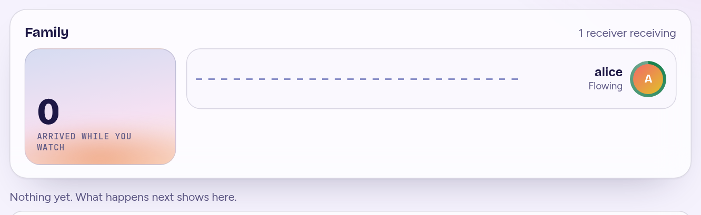
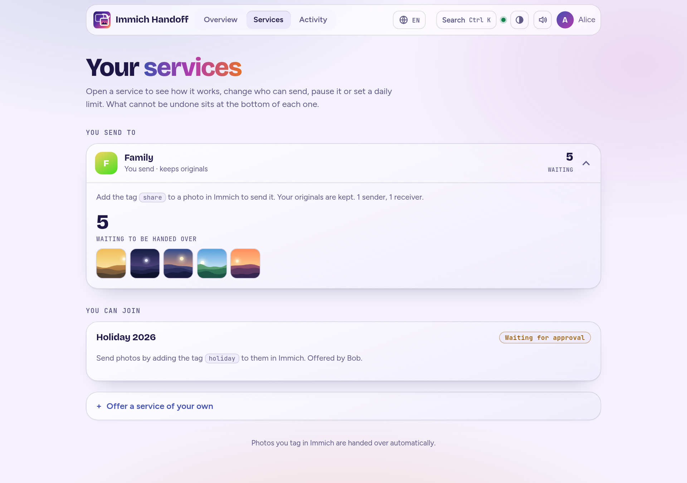
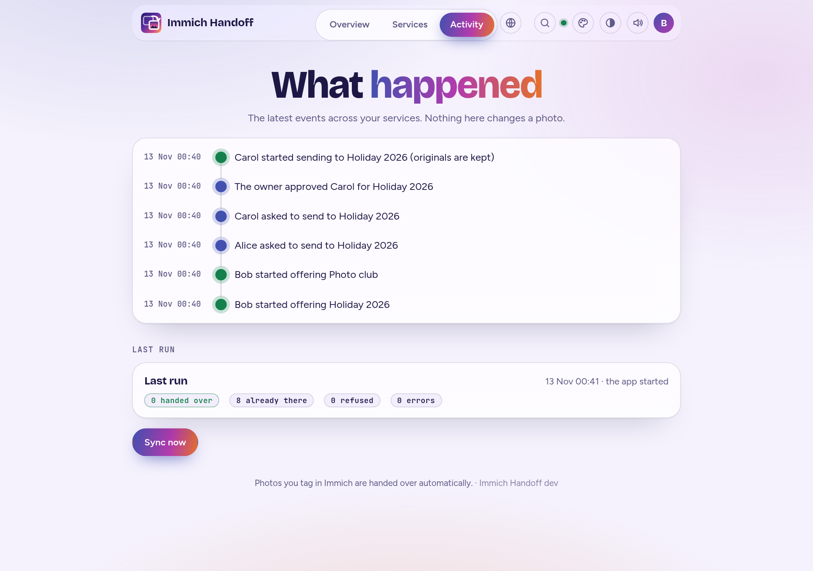
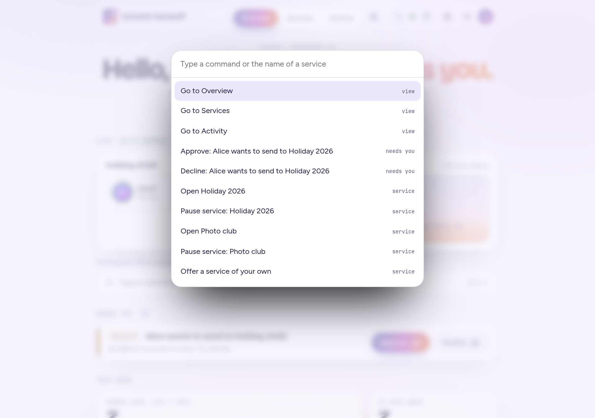

# Finding your way around the page

The page has four views and a search bar that does what you ask. This is the five-minute tour: where things are, what the words mean and what the live scene is showing you.

## Before anything else: Tags

Handoff works through Immich **tags**, and Tags are **off by default**, separately for each person. If yours is off, the page shows a notice with a **Turn on Tags** button (you can also do it in Immich under Account Settings, Features, **Tags**). Senders need Tags to tag photos, and receivers need them to see the inbox tag and filter by it. Switching them on is not enough: **refresh the Immich tab or window afterwards**, or the tag options do not show up (on the phone app, close and reopen it).

## The four views

The bar at the top has four views, in a pill in its middle (on a phone they are a bar at the bottom, with an icon each). The address remembers the view (`#services`), so you can bookmark it, and the page comes back to it after an action.

- **Overview.** The date and a greeting, the search bar, then **Needs you**, the **live scene** and **This week**, one under the other. The **Get started** card sits at the end until you are done with it.
- **Services.** Every service you send to, receive from, offer or can join. If you can make more than services, a switch at the top moves between your services, drop boxes, client rooms, frames and shared albums.
- **Activity.** What happened, the last run, and **Sync now**.
- **Settings.** The things you set up once and then forget, in categories (Notifications, Photos, Sharing, Screens). The view is there only when something in it is on for you.

### Needs you

Everything that waits on a person comes first, most urgent first, each with its button. When nothing waits, it says so.

- **Connection lost** and **Removed by its owner**: **Clean up**, which deletes what the app made in your Immich account (then you can join again).
- **Disconnected** (a service you offer): **Reconnect**.
- **Request**: someone wants to send to a service you offer. **Approve** or **Decline**; a request is answered here and nowhere else.
- **Paused**: a service you paused, or your own sending (**Resume**), or a service its owner paused (nothing for you to press).
- **Limit**: a sender is at the daily limit, or you are (see [Daily limits](../guides/automate/controls.md#daily-limits-for-senders)).

### This week

A small chart with one point a day (UTC days, today on the right) of how many photos were handed over in the last seven days: the photos **you sent** and the ones that **arrived in services you offer**. It counts what the app recorded for people who joined from the page, so senders set up in `.env` or a routes file do not appear. Next to it, **Waiting to go** (photos you tagged that are still to go) and **In your inbox** (what arrived and is not yet filed) refresh by themselves whenever a hand-over finishes.

### Get started

The card turns on Tags, helps you join or offer a service and hand over a first photo, and suggests more steps that fit what you do (inviting someone, a notification). Each step has **Show me** and a **?** to its guide, and a ring shows how far you are. It goes away when you are done or when you press **Hide this guide**.

## The live scene

Right under the search bar, **Live** shows what is happening as it happens. Each service you take part in has a stage: one **lane** for each sender and a gate into the receiving library. A glowing coloured square travels along the sender's lane into the gate and a ring spreads where it lands; when you are the one sending, an outlined square with an arrow leaves your gate instead. The **arrived while you watch** counter goes up for each one. The squares are only squares: the scene never shows a photo or a file name, and only real hand-overs, never made-up ones.

A lane also says in words what state it is in, so colour is never the only sign: **Flowing**, **Paused by the owner** or **Paused by the sender** (a dashed lane), **Daily limit reached** with how many wait and until when (amber), **Connection lost** (red, with a cross). A short log under the stages lists the last few things in a sentence each, and a screen reader is told the same sentence.

It stays calm: nothing moves while nothing happens, only a few squares fly at once, and with reduced motion or a hidden tab the squares are skipped and only the labels, the counter and the log change. If the connection to the app drops, the scene dims and says so, then catches up by itself.

Each service is one line: its initial, name, what it is, any state such as Paused or Limit, and the number that matters (photos waiting, or in your inbox). Press it to open it in place and see its settings: the tag, the album, who sends and how much they have used, the limits, the invitation link and the pause button. What cannot be undone sits apart at the bottom of an open service, in a dashed box that says what it does: **Leave** (for a service you send to) and **Delete service** (for one you offer). Every question is asked in a dialog in the page itself, with one clear sentence and a button named for what it does (red when it cannot be undone); Escape or Cancel changes nothing.

## Make it yours

- **Ctrl K** (or **Cmd K** on a Mac, or the magnifier in the bar, or the search bar on the Overview) opens the **command palette**: type a few letters to jump to a view or a service, or to do what you can do (approve a request, pause or resume, sync, open Help, take the tour). It lists only what you are allowed to do, and it presses the same button the page has, so questions are still asked.

  

- **Colours.** The palette icon chooses the **colour scheme** (**Twilight**, the colours of the app's icon, or **Immich**, calm blues on near-neutral greys), the half-moon icon switches light and dark, and the speaker icon turns the soft chime and short phone buzz off and on when a photo lands (the first click or key press wakes the sound, a browser rule). What you choose is kept in this browser and wins over what the administrator set (`THEME` and `THEME_MODE`, see [Settings](../reference/settings.md)).
- **Language.** The code next to the globe (en, de, fr, es, it, pt, ru) is the language menu: the pages follow your browser's language and this picks another for good. Only the pages are translated, not the log.
- **Keys.** **A** and **D** answer the request that is waiting (the buttons wear their key), and **G** then **O**, **S**, **A** or **T** goes to Overview, Services, Activity or Settings. They stay quiet while you type or a dialog is open.
- **On a phone** you can add the page to the home screen so it opens like an app: see [Operations](../admin/operations.md#installing-the-page-on-a-phone).
- **Motion.** The light behind the page drifts and flares when a photo lands, cards tilt toward a mouse and numbers roll like a departures board. It is all skipped on a touch screen or with reduced motion, and nothing moves while the page is idle.
- **Albums as folders** (a name like `Trips / 2024 / Rome`) have a page of their own: [Album tree](../guides/show/album-tree.md).
- The footer says which **version** is running, to people signed in to Immich.

## Words used here

| Word | Meaning |
|---|---|
| **Service** | A named place photos can be handed to, with one tag. "Holiday 2026" with the tag `share` is a service. |
| **Receiver** (or **owner**) | The person whose library the photos land in. They create the service and decide who may send. |
| **Sender** | Someone who tags photos to hand them to a service. |
| **Tag** | The label you add to a photo in Immich to send it. Each service has its own. |
| **Inbox** | A tag on everything that just arrived, so the receiver can find what is new. |
| **Drop box** | A link, QR code or email address that anyone can send photos to without an account. It can also be an **event** with a gallery, a wall and a best-of. |
| **Pool** | A service where everybody sends and everybody receives, for a trip or a party. |
| **Client room** | A link for one client to look at an album through marked pictures and choose favourites. |
| **Rule** | A search in your Immich (people, places, dates, a phrase) that suggests photos to hand over. |
| **Shared album** | An album two people on different servers keep in step. |
| **Key** | The restricted API key the app makes in your own Immich account when you join, so it can tag and hand over for you. Nobody sees it, and deleting it in Immich stops everything safely. |

## Good to know

- **Nothing is removed without a copy.** A photo only goes to the trash after every receiver holds a verified copy, and never while a connection is broken.
- **A photo the receiver already has in their trash is not handed over.** The original is kept and tagged `share-duplicate` (the service's tag is replaced), so you can see why. Once the receiver empties their trash, add the tag again.
- **Phone backups.** A photo in your trash is skipped by your phone's backup. Once Immich empties the trash, a phone that still has the photo may back it up again.
- **A tag you just added is gone.** Immich occasionally drops a tag added in the first moments after a photo was uploaded. Add it again.

Something not working? See [Troubleshooting](../reference/troubleshooting.md).

## When the inbox tag goes away

- **Filed in an album:** the tag is removed within about 15 minutes, not instantly.
- **Not in any album:** the tag is removed once the photo has been in the receiver's library for the service's expiry (30 days by default). The clock starts when the photo was uploaded to Immich by the hand-over, not when it was taken, and editing or re-tagging the photo does not restart it.

**Why a delay?** The app learns about new photos because Immich tells it: a workflow fires when a tag is added and calls the app. Immich 3.2.0 offers no such event for albums (the only triggers are an asset being created, its metadata being extracted and a tag being added), so the only way to notice is to look. The app checks on a timer, and the check is deliberately small: one search for photos carrying the inbox tag per receiver, and nothing more when that is empty.

**Faster or slower?** Change `CLEANUP_INTERVAL_MINUTES` ([Settings](../reference/settings.md)). Shorter means more (small) requests to Immich and a shorter wait; `0` turns the timer off and leaves it to the daily check. If Immich adds an album event in a future version, this can become instant.

## What next

- Hand over your first photo: [Quick start](quickstart.md)
- Pick a goal: [Using it](../using.md)
- Look something up: [Questions people ask first](../reference/faq.md)
