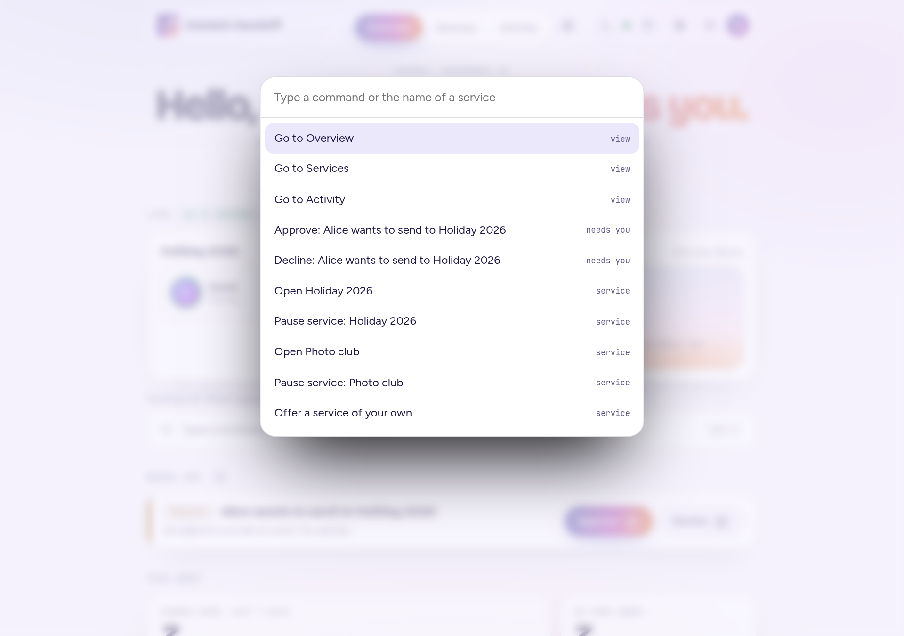
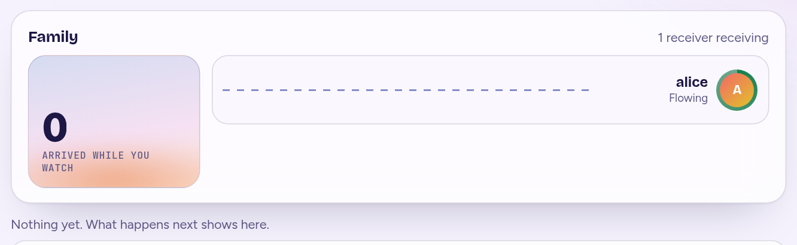
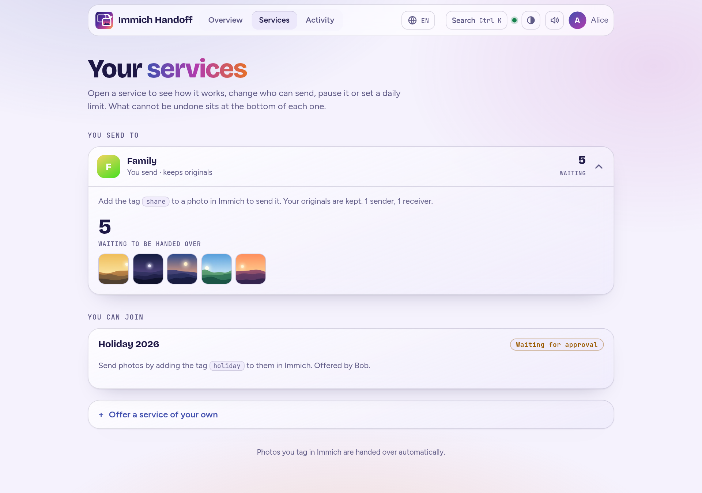
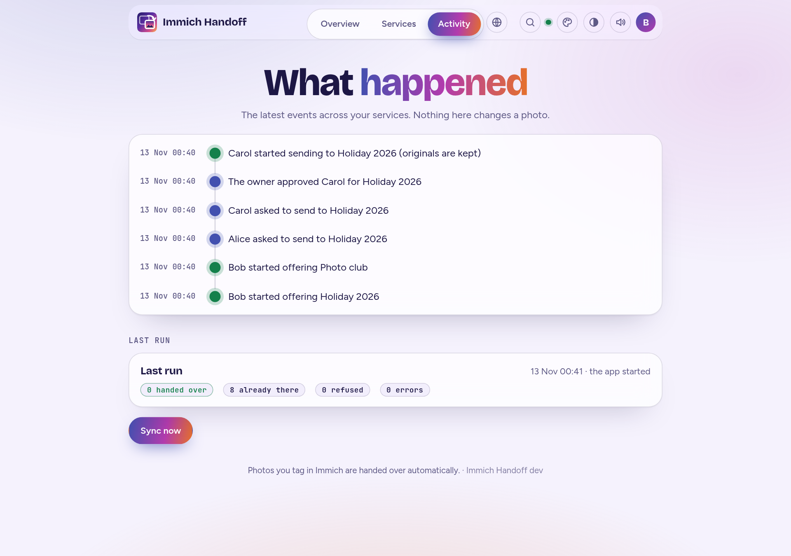
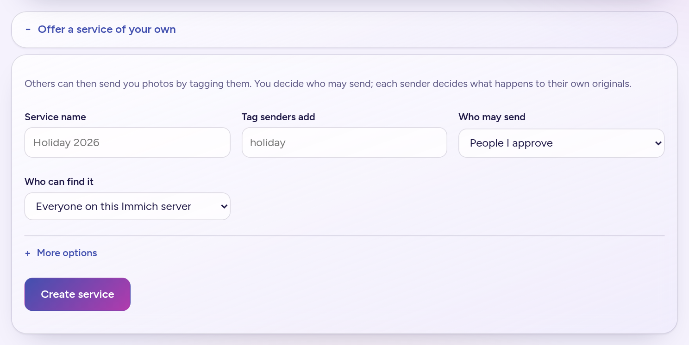

# Using it

This page is for the people who send and receive photos. Everything happens on the handoff web page and in the normal Immich app.

## Words used here

| Word | Meaning |
|---|---|
| **Service** | A named place photos can be handed to, with one tag. "Holiday 2026" with the tag `share` is a service. |
| **Receiver** (or **owner**) | The person whose library the photos land in. They create the service and decide who may send. |
| **Sender** | Someone who tags photos to hand them to a service. |
| **Tag** | The label you add to a photo in Immich to send it. Each service has its own. |
| **Inbox** | A tag on everything that just arrived, so the receiver can find what is new. |

> **Before you start: Tags must be on in Immich.** It is off by default and each person has it for their own account. If it is off, this page shows a notice with a **Turn on Tags** button; you can also do it in Immich under Account Settings, then Features, **Tags**. Senders need it to tag photos; receivers need it to see the inbox tag and filter by it. Switching it on is not enough: **refresh the Immich tab or window afterwards**, or the tag options do not show up (on the phone app, close and reopen it).

## Finding your way

The bar at the top has three tabs: **Overview** (what needs you, the week's numbers, the live scene), **Services** (all your services, what you can join, offering your own) and **Activity** (what happened, the last run, Sync now). The address remembers the tab (`#services`), so you can bookmark it and the page comes back to it after an action. Next to them: **Search** (also **Ctrl K**, or **Cmd K** on a Mac) opens a command palette: type a few letters to jump to a tab or a service, or to do what you can do (approve a request, pause or resume, sync); it lists only what you are allowed to do, and it presses the same button the page has, so questions are still asked. On a phone you can add the page to the home screen so it opens like an app (see [Operations](operations.md#installing-the-page-on-a-phone)). The half-moon icon switches the light and the dark theme, and the speaker icon turns the soft chime (and a short phone buzz) off and on when a photo lands (the first click or key press wakes the sound, a browser rule). 

Both choices are kept in this browser. The code next to them (en, de, fr, es, it, pt, ru) is the language menu: the pages follow your browser's language and this picks another for good; only the pages are translated, not the log or the documentation.

A few small touches make it feel alive and can be ignored: the light behind the page drifts slowly, leans toward your pointer and flares when a photo lands, cards tilt a little toward a mouse, and numbers roll like a departures board. They are skipped with a touch screen or when your browser asks for reduced motion, and nothing moves while the page is idle.

The footer of every page says which **version** of Immich Handoff is running, after the line about tagging. It is read from the running program (a release says `1.2.0`, a build from a checkout says `dev`), so it is what you are running, not what the page was written for. It is shown only to people signed in to Immich, never on the sign-in page or to a drop box's guests.
## The Overview

The page opens with what matters, in this order:

1. **Needs you.** Everything that waits on a person, most urgent first, each with its button:
   - **Connection lost** and **Removed by its owner**: **Clean up**, which deletes what the app made in your Immich account (then you can join again).
   - **Disconnected** (a service you offer): **Reconnect**.
   - **Request**: someone wants to send to a service you offer; **Approve** or **Decline**.
   - **Paused**: a service you paused, or your own sending (**Resume**), or a service its owner paused (nothing for you to press).
   - **Limit**: a sender is at the daily limit, or you are (see [Daily limits](#daily-limits-for-senders)).
   When nothing waits, it says so. A request is answered here and nowhere else.
2. **This week.** How many photos were handed over in the last seven days, as a small chart with one point per day (UTC days, today on the right). It counts what the app recorded for people who joined from the page: the photos **you sent**, and the ones that **arrived in services you offer**. Senders set up in `.env` or a routes file are not recorded, so they do not appear in it. Next to it, **Waiting to go** (photos you tagged that are still to be handed over, if you send) and **In your inbox** (what arrived and is not yet filed, if you receive). They refresh by themselves whenever a hand-over finishes.
3. **Get started**, until you are done: turn on Tags, join or offer a service, hand over your first photo. A ring shows how far you are. It goes away by itself after the first hand-over, or when you press **Hide this guide**, and does not come back.

Below that are your services, in sections by what you do with them: **You send to**, **You receive**, **You offer** (services you created) and **You can join**. Each service is one line (its initial, name, what it is, any state such as Paused or Limit, and the number that matters: photos waiting, or in your inbox). Press it to open it in place and see its settings: the tag, the album, who sends and how much they have used, the limits, the invitation link and the pause button. With only one service it starts open.

What cannot be undone sits apart at the bottom of an open service, in a dashed box that says what it does: **Leave** (for a service you send to) and **Delete service** (for one you offer). Every question, such as joining, pausing, leaving or deleting, is asked in a dialog in the page itself, with a title, one clear sentence and a button named for what it does (red when it cannot be undone); Escape or Cancel changes nothing.

### The live scene

Near the bottom of the Overview, **Live** shows what is happening as it happens. Each service you take part in has a stage: one **lane** for each sender (you send to a service: your own lane; you offer or receive from it: the senders), and a gate into the receiving library on the right. When a photo is handed over, a small coloured square travels along the sender's lane into the gate and the **arrived while you watch** counter goes up. The squares are only squares: the scene never shows a photo or a file name, and it shows only real hand-overs, never made-up ones.

A lane also says in words what state it is in, so the colour is never the only sign: **Flowing**, **Paused by the owner** or **Paused by the sender** (dashed lane), **Daily limit reached** with how many wait and until when (amber), **Connection lost** (red, with a cross). A short log under the stages lists the last few things in a sentence each, and a screen reader is told the same sentence.

It stays calm: nothing moves while nothing happens, only a few squares fly at once (a big upload counts the rest without more squares), and if your browser asks for reduced motion, or the tab is hidden, the squares are skipped and only the labels, the counter and the log change. If the connection to the app drops, the scene dims and says so, then catches up by itself when it is back.

## Sending photos

Open the page. It shows your services and what is waiting:

What reaches the receiver is the photo's file, its name, its dates and the favourite mark. Things Immich keeps only in its own database, such as a description you typed in Immich, albums and edits, do not travel: see [What is carried over](what-is-carried-over.md). To send a photo, add the service's tag to it in the Immich app (select photos, **Add tags**). Within a few seconds the photo is copied into the receiver's library, and the page's **Waiting** count goes back to zero. The page also works on a phone, and follows its light or dark setting:

### Joining a service

Under **Services you can send to** you see the services you may join. Joining asks one question that is yours alone to answer, **what should happen to your originals?**

- **Join and keep my originals** (the usual choice). A copy goes to the receiver and your photo stays where it is. The app's key for you has no permission to delete anything.
- **Join and move my originals to my trash.** Once the receiver has a verified copy, your photo goes to your trash, where Immich keeps it for 30 days, so a mistake can be undone.

You can choose differently for different services. To change your mind, leave the service and join again.

When you join, the app creates an API key named `handoff: <service>` in your own Immich account, using your login, and keeps it encrypted. Nobody sees it, not even you. You can end it any time (see below).

Some services need the owner's approval. You press **Ask to join**, the owner approves, and then you press **Activate**. (The app can only create a key in your account while you are signed in, which is why the last step is yours.)

### Handing over a whole album

Instead of tagging photos one by one, you can link one of your own albums to a service you joined from this page. On the service's card press **Hand over a whole album**, choose the album, and confirm. Everything in it is handed over to that service, **now and whatever you add to it later**, with no tag.

- **Why not just tag the album?** Immich tags belong to single photos, not to albums, so there is no such thing as tagging an album. Linking is different: the app keeps looking at the album.
- **It is checked on a timer.** Immich sends no event when a photo is added to an album (see [why the inbox tag takes minutes to go](#when-the-inbox-tag-goes-away)), so the app looks at linked albums every 15 minutes (`ALBUM_CHECK_MINUTES`). Linking an album starts a pass at once, so what is already in it goes within seconds; photos added to it later wait for the next round. Tagging a photo is still instant.
- **Each photo goes once.** With **keep my originals**, a handed-over photo stays in your album and is marked with the `handed-over` tag, which is how the app knows to leave it alone. With **move**, the original goes to your trash. A photo the receiver refused (they have it in their trash) is tagged `share-duplicate` and left alone until you remove that tag.
- **Only your own photos.** An album can hold other people's photos (a shared album); those are never handed over.
- **One album per service.** Linking another replaces the first. **Stop handing over this album** on the card unlinks it. Photos already handed over stay where they are.
- **Move mode asks first,** because it sends every photo in the album to your trash once the other side has a copy.
- **The key gets one more permission.** Linking adds `album.read` to your existing key, using your own login, so you do not have to join again. It can read albums and nothing more. See [Security](security.md#what-a-key-can-do).
- **Progress.** The "waiting to be handed over" number on the card counts down photo by photo while a long hand-over runs. When photos from an album have been handed over, a line appears under **Recent events**, and a big one (20 photos or more) also sends a notification to `NOTIFY_URL` if the person running the app set one.
- **If the album cannot be read** (you deleted it, or the key lost the permission), photos you tag are still handed over, and the problem is logged and notified once. Link another album to fix it.
- Services defined in a routes file or `.env` cannot have a linked album; this is for services you joined from the page.

## Receiving photos

### Offering a service

Under **Offer a service of your own**, choose:

- a **name** and the **tag** senders will use;
- **who can find it**: everyone on this Immich server, or only people you send a link to;
- **who may send**: people you approve, or anyone;
- optionally (**More options**) the tag put on what arrives, how many days an unfiled photo keeps it, and an **album** to put arrivals in.

Each service gets its own inbox tag by default, for example `inbox/Holiday 2026`, which Immich shows nested under `inbox`. Filter by it in Immich to see what arrived through that service. The inbox tag removes itself once a photo is in an album, or after 30 days; photos are never deleted by that. [When exactly](#when-the-inbox-tag-goes-away) is explained below.

### Putting arrivals in an album

Give a service an album (for example "Holiday 2026") and every photo handed over to it is put in that album in your Immich account, so there is nothing to file by hand.

- **Instead of the inbox tag.** A photo in the album does not also get the inbox tag. The album is where you look; the page counts its photos. (The inbox tag would be removed within minutes anyway, because the photo is in an album.)
- **The album is yours.** The app uses an album you own with exactly that name, and makes one when the first photo arrives if you do not have it. It never uses an album that was only shared with you. If two of your albums have that name, it uses the first Immich lists.
- **If you delete or rename it,** the next photo makes a new album under the configured name. Photos already in the old one stay with it.
- **Photos you already had** (the same photo handed over again) are left where you put them; only new arrivals are filed.
- **It cannot get in the way of a hand-over.** If the album cannot be used, for example because the key is missing the album permissions, the photo still arrives, tagged inbox as without an album, and the log and the notification say why.
- **The key asks for more.** Creating a service with an album gives its key permission to find, create and add to albums, and nothing more. A service without an album does not. See [Security](security.md#what-a-key-can-do). The album is chosen when the service is created.

### Approving senders and sharing a link

Your services appear on the page with who is waiting and who is connected:

- **Approve** or **Decline** each request. Anyone you approve then activates their own side.
- For an invitation-only service the card shows an **invitation link**. Whoever opens it, signed in to Immich, lands on a page for exactly that service. **New link** makes a fresh link and the old one stops working at once; people already approved or joined are not affected. **Copy a message** copies a short invitation with the link in it, and **QR code** shows a code a phone can scan from your screen. The link is only as private as the way you share it. The administrator's page has a **Share this page** box with the same three, for the address people use to join.
- **List for everyone** and **Make invitation-only** switch between the two. **Delete service** ends it.

You see each sender's name and, on a request, their email address. Senders see only your name.

## Pausing

A sender can press **Pause sending** on a service they joined from the page, and **Resume sending** later. An owner can press **Pause service** on a service they offer, and **Resume service**. Both are for being away, or for sorting something out, without leaving and losing the key and the workflow.

- While paused, **nothing is handed over and nothing is touched**: photos tagged meanwhile stay tagged, in the sender's account, and the daily check and the album check skip them too.
- On **Resume**, the waiting photos are handed over at once.
- Everyone involved can see it: a sender sees "You paused" or "The owner paused this service" on the card, and an owner sees "(paused)" next to a sender who paused. It also shows on the [administrator's page](admin.md) and in the recent events.
- A pause survives a restart of the app. It does not change what is stored in Immich, and a sender can still leave while paused.

## Daily limits for senders

When anyone on the Immich server may send, one person could fill the receiver's storage. An owner can cap what **each sender** hands over to a service in a day: a number of **photos**, a number of **megabytes**, or both (**More options** when creating the service, or **Save limits** on the service's card later). Empty or 0 means no limit.

- "A day" is the **last 24 hours**, not the calendar day: a photo counts until 24 hours after it was handed over.
- Only photos that were actually handed over count (not duplicates and not refusals), by the size of the original. The size limit stops further photos once it is reached, so the last photo may take a sender slightly past it.
- When a sender is at the limit, the rest of their tagged photos **wait, still tagged**. The sender's card says "The daily limit is reached, so N photos wait... They are handed over from <time>", the owner sees each sender's use ("12 photos, 340 MB in the last 24 hours") and a line in the recent events, and `NOTIFY_URL` is told once. The photos go on their own as soon as the oldest hand-over is 24 hours old, or at once when the owner raises or removes the limit.
- It applies to photos from a linked album too. It applies to people who joined from the page; senders set up in `.env` or the routes file have no stored membership and are not limited.
- What was handed over is recorded from the start, so a limit set today already counts today's photos. Records older than eight days are forgotten (the Overview's weekly chart uses them too).

## Quiet hours, and what a service accepts

An owner can set two kinds of rules for a service (**Hand over only between** and the rules under it, in the service's settings), and the administrator can set quiet hours for the whole app (`QUIET_HOURS`, see [Settings](settings.md)).

**Quiet hours.** "Hand over only between 01:00 and 06:00": outside those hours photos **wait, still tagged**, and go when the hours begin (a window that ends before it starts, such as 22:00 to 06:00, crosses midnight). With **Only files larger than (MB)** set, only big files wait and small ones go at once, which suits a slow line: photos now, long videos at night. The time zone is the app's (`TZ`). The sender's card says "The quiet hours are not open, so N photos wait... They are handed over from <time>", and the card of every sender shows the hours. A service's own hours replace the app-wide ones.

**What a service accepts.** An owner can say that a service takes only photos rated at least 1 to 5 stars, only photos (no videos), only landscape or only portrait pictures, and nothing larger than a number of megabytes. This turns a service into a feed for a photo frame or a relative's tablet. Whatever does not match is **not handed over**: its service tag comes off and the **refused tag** (`share-duplicate` unless set otherwise) goes on, so the sender finds it in Immich, and the activity says "N photos were not handed over to <service>: they do not match what the service accepts". The sender's card lists what the service accepts, in words. Some details:

- The **tagged photo** is the one judged: a stack or a live photo goes, or stays, as one.
- The rating and the size come from Immich. A rule the app cannot check because Immich does not say (no dimensions, no size) lets the photo through; an unrated photo is below any minimum rating.
- Changing the rules looks at waiting photos again at once. A photo that was refused stays refused: tag it again.
- A service in a routes file sets these in the file ([routes example](fixed-accounts.md#fixed-accounts)); a plain `.env` install sets them with `ACCEPT_*`.

## Tagging a photo for a date

To hand a photo over **on a day** (a surprise, an anniversary, Christmas morning), tag it with the service's tag, a separator and the date: `share/2027-06-01` (in the Immich app type the slash and Immich makes a tag inside `share`), or `share 2027-06-01`, `share-2027-06-01` or `share_2027-06-01`. The photo waits, still tagged, and is handed over from the start of that day in the app's time zone (`TZ`). Details:

- Immich tells the app when you tag, as it does for any tag, so a date that has already come (today or in the past) hands the photo over at once. For a future date the app arranges a pass for that day, and the daily sweep is the safety net (also after a restart).
- A photo with both the plain tag and a future date waits for the date. A photo with only the plain tag goes at once, as always.
- To cancel, take the dated tag off. The receiver is not told that something is on its way.
- Photos tagged only for a date are **not counted** in the page's "Waiting to go" until their day.
- Checked against a real Immich 3.2.0: a tag inside `share` (such as `share/2999-01-01`) is also found by a search for `share`, which is why the app skips photos whose day has not come.

## Hand-overs that expire

An owner can make the copies that arrive **expire**: "Move copies to my trash after N days" in the service's settings. A copy that is still **unfiled** (in no album) and still has the inbox tag when its time is up goes to the owner's **trash**, never deleted for good, so it can be put back for as long as Immich keeps the trash. To keep a copy, file it in an album or take the inbox tag off; both leave it alone. It is meant for photos that should not stay, such as a school picture sent to a teacher, or for a service that is only ever a place to look at things.

- The time is counted from the day the copy arrived. A service with a lifetime does not take the inbox tag off at the usual inbox expiry first; the lifetime decides.
- Senders are told on their card that photos expire ("moved to the receiver's trash after N days unless they file them in an album"), and the owner's activity says when copies expired.
- It needs the administrator to allow it (`RECEIVER_DELETE`, on by default; see [Settings](settings.md)). A service made before that existed gets the permission when its owner opens the page, which is also when they set a lifetime.
- Without the permission (a key made by hand, see [Fixed accounts](fixed-accounts.md)) the setting does nothing, and the log says so once.

## Taking back the last hand-over

A sender who joined from the page sees **Take back the last hand-over** on a service's card for 24 hours after handing photos over. It undoes what the last pass handed over to that service, as far as it can be undone:

- The receiver's **copies** go to the receiver's trash (not deleted for good).
- Your **originals** come back from your trash, if you moved them, and lose the service tag so they are not handed over again. With **keep my originals** nothing was in the trash; the "handed over" tag comes off.
- A copy the receiver has **already filed in an album** is theirs now: it stays, and so does your original's state. The page says how many stayed.
- A stack and a live photo (with its motion clip) are taken back whole.
- It takes back the most recent hand-over not yet taken back, so pressing it again takes back the one before. Only people who joined from the page have it (accounts set up in `.env` or the routes file are not recorded). It needs `RECEIVER_DELETE` (on by default); if the owner's key cannot move photos to the trash yet, the page asks the sender to tell the owner to open the page once.

## Drop boxes: photos from people who do not have Immich

A drop box is a link for people without an Immich account: relatives at a wedding, guests at an event. You make one on the **Services** tab, under **Make a drop box**, and share its link, a message with it, or its QR code. Guests open it in any browser, choose photos and send them. What arrives goes into **your** library, tagged `inbox/<name of the box>`, to look through before you file it. Nothing else changes: it is not a service, nobody has to be approved, and there is no sender.

What a guest sees: the name of the box, your message, a form to choose photos (and videos, unless the box is for photos only), and afterwards what became of each file. **They cannot see your library, what other guests sent, or even what they sent themselves once they leave the page.** Immich's own shared link with uploads switched on shows guests the whole album; a drop box does not.

What you set, all optional:

| Setting | What it does |
|---|---|
| **Open for (days)**, **Opens at**, **Closes at** | When the link works. By default it opens now and stops after the days you give (at most 365). Set **Opens at** to open later, and **Closes at** for an exact end (it replaces the days), for example Saturday 14:00 to Sunday 12:00. Times are in the app's time zone (`TZ`). Before it opens and after it closes the link looks like one that does not exist. |
| **Message for guests** | Shown above the form. |
| **Largest file / most megabytes / most files** | The most one file may weigh, and the most the box takes in all. A file that would go past the total is refused before it is stored. `0` is no limit. |
| **Album**, **Another tag** | Where what arrives is filed besides the `inbox/<name>` tag: an album of yours with that name (made when the first photo arrives) and a tag of your own, for example the event's name. Choosing an album gives the box's key permission to find, make and add to albums, nothing more. The same photo sent twice is stored once: Immich recognises it by its checksum, the second copy is not kept, and the guest is told it was already there. |
| **Shot list**, **Every photo must say which one it is for** | See [A shot list](#a-shot-list). |
| **A guest book** | See [The guest book](#the-guest-book). |
| Wall, best-of, hand the photos on | See [The wall](#the-wall), [A best-of](#a-best-of) and [Handing the photos on](#handing-the-photos-on). |
| **I look at every file before it is kept** | See [Approving files before they are kept](#approving-files-before-they-are-kept). |
| **Guests may take back what they sent** | See [Guests taking back what they sent](#guests-taking-back-what-they-sent). |
| **Photos only** | Videos are turned away. |
| **Password** | Guests must give it. Five wrong tries from one guest in ten minutes silence that guest for ten minutes. |

What a drop box checks: it looks at the first bytes of every file, not at its name, and takes only what Immich can show as a photo or a video (JPEG, PNG, GIF, WebP, BMP, HEIC, AVIF, TIFF and DNG, MP4, MOV, WebM, 3GP). Pages, programs and archives are turned away and the log says so. A file is stored under a clean name with the extension its content calls for.

From the box's row you can see what it has taken so far (files, guests, the busiest hour), **Pause** it (the link then looks like one that does not exist), **Resume** it, copy its link or message, show its **QR code**, read its **log**, and **Revoke** it. Revoking ends it for good: the link stops working at once and the key is deleted from your Immich account. The photos already received stay in your library, and the log stays readable for a month.

### Approving files before they are kept

With **I look at every file before it is kept**, nothing a guest sends reaches your library until you say so. The file is checked as usual, then kept on the server's disk (in the data folder, under `dropbox-pending`, and not in backups) and shown to you on the box's row as a thumbnail with its name and size. Tick the ones you want and press **Approve chosen** or **Reject chosen**, or **Approve all** or **Reject all**. An approved file is stored in your library and filed (tags and album); a rejected one is deleted and its room goes back to the box's limits. Files nobody decides on are deleted after two weeks, and at most 1000 files or 10 GB wait in one box; past that the box tells guests it is full. Guests are told their files will be looked at, and see "waiting for approval" next to each. This needs the app to have a data folder (self-service switched on). Thumbnails are shown for photos; a video appears as a label with its name and size.

### Co-hosts

An owner can ask other people on the same Immich server to help with a box: under **Co-hosts** on the box's row, give their email and choose **Approve, pause and extend** or **Only look**. They find the box on their own Services tab. A co-host who manages can approve and reject files, pause and resume the box, extend it and see its log and link; one who only looks sees the summary and the log (and that files are waiting, not what they are), and not the link. **Nobody but the owner can end the box or choose co-hosts**, and no co-host ever sees your library or the key: they act through the app, which uses the box's key. A co-host can stop helping at any time from the box's row, and the owner can remove one. A box has at most ten.

### Closing time

A box with an end reminds and sums up. About a day before it closes, `NOTIFY_URL` is told (so you remember); when it has closed, the log and `NOTIFY_URL` say what it took ("42 files (310.5 MB) from 12 guests"). On the box's row, **Extend by a day** or **by a week** (the owner and co-hosts who manage) moves the end later, from the old end or from now if it already ended, and opens the box again; extending resets the reminder and the summary. A box can never be set to end more than a year from now.

### The guest page

On a phone the page offers the camera ("Or take a photo now"); on a computer you can also drop files on it. Each file is sent on its own, with a progress bar, and the page says what became of it. **Interrupted uploads carry on:** if the connection drops, the page waits for it (it notices when the phone is back online) and tries the file again, up to eight times with growing pauses; a file that cannot be sent is marked, and the others are not held up. The page also remembers, in the guest's browser, which files it has already sent, so reloading and choosing the same files again skips them. This works file by file: a file cut off halfway is sent again from its start, not from where it stopped, and a photo sent twice is stored once anyway (the library recognises it). Without JavaScript the page is a plain form that still works.

Under **The look of the guest page** on a box's row you can set:

| Setting | What it does |
|---|---|
| **Colour** | The page's accent (`#rrggbb`), also the colour of the installed app's bar. |
| **Language** | The language of the page for guests who have not chosen one. A guest's own choice in the language menu wins. Default: their browser's. |
| **Cover photo** | A JPEG, PNG or WebP of up to 900 KB above the name. |
| **Shrink photos larger than** | 1600, 2400 or 4000 pixels, or never. Done **in the guest's browser** before sending, which saves their data and your storage. A shrunk photo is re-saved as a JPEG and **loses its metadata** (date, place); a photo the browser cannot decode (HEIC in most browsers) is sent as it is, and a shrunk file is never bigger than the original. It is off by default: leave it off to keep every photo exactly as taken. |

The page can be **installed** on a phone ("Add to home screen") under the box's name and colour, like the app's own pages; it only works while the box is open.

### More ways in

A box has a long link, which cannot be guessed, and can have more:

- **A short link** (**Make a short link**): ten letters and digits, `.../d/xxxxxxxxxx`, easy to type or read out. It opens the same box. It is easier to guess than the long link, so for a box that must stay private give it a password too. **Remove short link** ends it and leaves the long link and anything printed with it working; **New long link** (the owner only) ends the long link, and every card printed with it, and leaves the short one working. The long link, the short one and the printed cards are ended one at a time.
- **A printable card** (**Printable card with a QR code**): a page with the box's name, your message and a QR code of the link, to print for table cards or a poster (the print dialog leaves out everything else). There is one for the short link too.
- **By email**, so a guest can send photos by mail, is **not** offered. It needs the app to read a mailbox, which is a different kind of access (and different settings) from everything else here; it is better decided on its own than slipped in.

### Templates and copies

**Templates and copies** on a box's row, and **Start from a template** under the list, save time when you hold the same kind of event again. A template keeps a box's settings (message, limits, filing, approval, the look, how many days it stays open), not its name, link, password, cover photo, guests or co-hosts. **Save template** keeps the settings of a box under a name; **Start from a template** makes a new box from one, with the name you give and, if you want, when it opens and closes; **Make a copy** does the same from a box directly. Wedding, Birthday and School trip are there for everyone (School trip is photos only, approved by you, and shrunk to 4000 pixels); yours are private, at most twenty. A built-in template that needs approval makes a box without it on an install that has no place to keep waiting files.

### Guests taking back what they sent

Switch on **Guests may take back what they sent, while it is still in the inbox** when you make a box. The guest's browser then keeps a secret (a cookie, `HttpOnly`; the server stores only a hash of it), the page links to **your uploads**, and each of a guest's files has **Take back**. A file that still waits for your approval is deleted. A photo already in your library goes to **your trash** (never deleted for good) if it still carries the box's inbox tag; **once you have taken that tag off or filed the photo, it is yours**, and the guest is told to ask you. A guest sees only what their own browser sent, and only in that browser. For this the box's key also gets `asset.read` and `asset.delete`, so it is the one kind of box whose key can move a photo to the trash; it is off unless you choose it, and it cannot be switched on later for a box that exists (make a copy instead). Taken-back files are counted in the summary and the log.

### A shot list

Give a box a **shot list** (one prompt per line, at most twenty, each up to 60 characters, no slash or comma: "The first dance", "The oldest guest", "The best hat") and the guest page asks "What is the photo for?" with the list to choose from, and shows it as a checklist with a tick on each prompt that already has a photo, so guests can see what is still missing. Tick **Every photo must say which one it is for** to make the choice compulsory; a photo with none is refused. With a list, a photo for a prompt is tagged `inbox/<box>/<prompt>` as well as `inbox/<box>`, so **Immich lists the photos grouped by prompt** (open the tag in Immich). Each prompt on the owner's page shows how many photos came for it. The list can be edited later under **Shot list and guest book** (the owner and co-hosts who manage): a prompt that stays keeps its photos and its count, a new one starts at none, and photos already tagged keep their tags. Each guest chooses a prompt for the files they add at that moment, so one visit can cover several prompts. A prompt is shown as written; it is not translated per guest.

### The guest book

Switch on **A guest book** and the guest page has a **Leave a message** form: a name (optional), a few words (up to 1000 characters) and, on a browser that can record, a **voice message** of up to 90 seconds. A message needs words or a voice note, or both. **Messages and voice notes are not photos, so they are not put in Immich: they are kept in this app's own data file** (and so in its backups), and only the owner and the co-hosts who manage the box can read and play them, on the box's row under **Guest book**. A viewer co-host cannot. The owner can remove a message, or **download the guest book** as a zip with every message, oldest first, and each voice note as a file. A box holds at most 500 messages, a voice note is at most 2 MB, and the file's first bytes must say it is audio (WebM, Ogg, MP4/M4A, WAV or MP3). Without a script the form still sends the words. Recording needs the browser's permission to use the microphone, and over HTTPS.

### Sharing the photos back

When the event is over, **Share the photos back with the guests** (the owner only, under that name on the box's row) gives them something in return. It puts what the box received (every photo under its inbox tag) into an album of yours, the box's own album if it has one, otherwise one named after the box, and makes a **link in Immich's own shared-link page**, view-only, that anyone who has it can open **without an account**, to look at the photos and download them one by one or all at once. You choose how many days it stays open (1 to 365), an optional password, and a thank-you message that Immich shows with the album. It cannot upload or change anything. Copy the link, a ready-written message or its QR code and send them to the guests. The app does it with **your own session**, so the box's key gets no new permission. Press the button again later to add what came since: the new link replaces the old one. **Stop sharing** ends the link; the album and the photos stay in your library.

Two things to know. **Immich only allows downloads on a link that also shows the photos' details** (dates, places, cameras), so this link does: guests who open it can see those details of every photo, not only their own. And the box's own link, once the box has closed, **leads to the photos** while a shared link is open (a guest who opens their old link sees your thanks and a **See the photos** button); a closed box that shared nothing still looks like a link that does not exist.

### The wall

A **wall** shows a box's photos full screen on a TV or a projector, one after another, as they arrive. The owner starts it on the box's row under **Wall**; the screen opens the link it gives, with **no sign-in**, so nobody's session is left on a shared device, and the wall has a link of its own that can be renewed (**New wall link**) or ended (**Stop the wall**) without touching the box or its other links. The page asks the app every few seconds what is new, so a photo appears within a few seconds of arriving. Choose how it looks with the buttons that appear when you move the mouse, or in the address: **Single photo** (a gentle cross-fade, new photos first), **Collage** (the newest nine, a little tilted) or **Grid** (the newest twelve); **Full screen** is there too. When a photo has a prompt (a [shot list](#a-shot-list)) its name is shown as a caption, and **guest-book messages** you mark **Show on the wall** appear now and then; none do until you choose them.

What it shows: only photos the box has put in the library. Files waiting for approval, rejected ones and photos a guest took back never show. To fetch the pictures the box's key gets **one more permission** (to view photos), added with your own sign-in when you start the wall and taken off when you stop it; only the owner can start or stop it, and co-hosts who manage can see its link. A wall keeps working after the box has closed, until you stop it.

### A best-of

Under **Best-of** the owner can ask for a **suggested best-of set** of a box's photos. The app looks at each photo in the box's inbox tag (through the small picture Immich made of it) and leaves out:

- photos that are **too dark** or **too bright**,
- photos that are **blurred** (little fine detail),
- and, of what is left, all but the sharpest of any shots of **the same moment**: pictures that look alike and were taken within an hour of each other.

What is kept goes into an album of yours called "*box name* best of". **Nothing is deleted or changed**, and the box's own photos stay where they are. **How much to leave out** is **relaxed**, **normal** or **strict**; running it again with another setting **corrects the album** (what is no longer kept leaves it, and anything you put in it yourself stays). **Why N photos were left out** lists each photo left out with its reason ("too dark, brightness 9 of 255", "the same moment as a better photo"), so you can overrule it by adding the photo to the album in Immich. It runs in the background and the row says how far it is (reload the page to see). Only the owner can ask for one, because it reads the photos with the owner's own sign-in. It looks at the photos' content only: it uses no face recognition and no model, so it cannot tell a good moment from a boring one, only a technically poor shot from a good one. Photos Immich keeps only as WebP previews cannot be looked at here and are kept. It can be run at any time, not only when a box has closed.

### Handing the photos on

When the event is over the whole set can go through the hand-over that already exists, to a service you send to: a family member's library, a print service. Under **Hand the photos on** (the owner) choose the **service**, one you have joined as a sender, and then **Hand everything on now** or, once you have made a best-of, **Hand the best-of on now**. The app **tags the photos with the service's tag in your own library**, which is what hands a photo over, so all the usual rules apply: the service's daily limit, quiet hours and accept rules, the receiver's copy that expires, and the sender's **Take back the last hand-over**. If you chose to keep your originals when you joined the service they stay; **if you chose to move them, they go to your trash once handed over** (the list shows which each service does). Tick **Hand everything on by itself when the box closes** and it happens once, when the box closes, with everything (never the best-of: that waits for you to look at it); the box's closing summary and its log say how many photos went and where, or why they could not (for example if you have left the service). Each time is kept in the list under the box, with when, what, where and by whom.

**The log** shows each file that arrived or was turned away, and each time a guest was refused for asking too much, with a short mark such as `guest 3fa9c1` instead of an address, so you can tell guests apart without the app keeping where they are. Nothing in it is a name or an address.

**Protection against abuse.** One guest can make 30 upload requests in ten minutes and 300 files in an hour; a box takes four uploads at once and the whole app sixteen. If a box takes 1000 files in ten minutes, or turns away 200 files or guests in ten minutes, it **pauses by itself**, the log says why, and `NOTIFY_URL` is told. Look at the log, then resume it. The limits are the same for every box. More on what a link allows is in [Security](security.md#drop-boxes).

**Making the link reachable.** Guests do not have your Immich login, so `/drop/` on the page must be open to the internet *without* any sign-in in front of it. See [Letting guests reach a drop box](operations.md#letting-guests-reach-a-drop-box).

## Receiving on another Immich server

Someone you share with may run an Immich of their own. A service can hand its photos to them as well: this is a **bridge**. It is off until an administrator sets `BRIDGE_ENABLE=true` ([Settings](settings.md)).

1. On the service's card, press **Invite someone on another server**. You get a link, good for a week and for one connection; a new link replaces the old one. Send it to them.
2. They open it. **They need no login on your server.** The page says who is asking, tells them to make a key in their own Immich with four permissions (`user.read`, `tag.create`, `tag.asset`, `asset.upload`; and, if they wish, `asset.delete` so that a hand-over can be taken back, see below) and asks for their server's address, the key and a name.
3. Nothing is kept until the address is allowed and the server and key pass the checks: the server answers as a supported Immich, and the key has those four permissions (and at most the optional fifth). A key that can do more, **for example one that can read their library, is refused** with the reason, and so is one that can do less. Their mistake is corrected on the same page.

From then on every photo tagged for the service goes to **you and to them**. It arrives in their library with the tag `from/<the sender's name>`. The original is touched only after both of you hold the copy.

**What the other side cannot do.** The key can upload photos and put a tag on them, and that is all: it cannot read, search or download anything in their library. Photos arrive as separate photos (no stacks, no album), and **letting copies expire does not work across servers**: the app cannot see whether the receiver filed or kept a copy, and it would trash photos they wanted. The app cannot read the copy back to compare its checksum, so a copy is trusted on Immich's answer to the upload.

**Taking a hand-over back, if they allow it.** The receiver may add a fifth, optional permission, `asset.delete`, to their key (the page says what it allows before they connect; a new key and link are needed to change it). The sender's **Take back the last hand-over** then also moves the copies that last hand-over left on their server to **their trash** (never deleted for good, and only within the same 24 hours). The app remembers the ids it was given and reads nothing there, so it cannot tell whether the receiver has since filed a copy in an album: that copy goes to the trash as well, and the receiver can put it back from there. Without the permission, or once the receiver has removed it from the key (it is checked again at every pass and when a hand-over is taken back), the sender's own side is taken back as usual and the message says how many copies stayed on the other server. The service's card says which of the two applies. If their server cannot be reached, nothing is taken back and the sender can try again.

**When their server is away or the key is revoked.** Photos stay tagged in the senders' libraries, and **nothing is handed over by the service until it works again, to you either**, because a photo is only removed once every receiver has it.

- If their server cannot be reached, the card says **Cannot be reached**, you are told once (`NOTIFY_URL`), and the app tries again after a minute, then two, four and so on up to an hour (`BRIDGE_RETRY_MINUTES`). When it answers, waiting photos go and you are told that too.
- If their key was deleted or revoked, the card says **Key revoked**, you are told once, and **the app does not try again** until they make a new key and you send a new link.
- **Remove** on the card ends the connection; waiting photos then go to you alone, and what already arrived there stays there.

`immich-handoff doctor` checks the connection and says what is wrong. See [Security](security.md#bridges-a-receiver-on-another-server).

## Leaving, and when a connection breaks

- A sender presses **Leave** on a service to stop. The app deletes the key it made in their account and the workflow it set up.
- An owner presses **Delete service**. Its senders then see **Removed by its owner** and press **Clean up** to remove their own key.
- Either side can also delete the key named `handoff: ...` in Immich (Account Settings -> API Keys). The app notices, pauses that connection, tells both sides, and **does not touch any photo**.

A sender whose key was deleted presses **Clean up** and can join again; photos they tagged meanwhile are handed over once they have. An owner whose own key was deleted presses **Reconnect**, and senders resume by themselves.

If an Immich administrator removes you from a service, or removes the service, you see why on this page with a **Clean up** button. Your API key in Immich stays valid until you delete it, which **Clean up** does for you ([why](admin.md#why-removal-cannot-delete-the-keys)).

The page also lists recent events (joined, asked, approved, connection lost, reconnected) for the services you take part in.

## Good to know

- **Nothing is removed without a copy.** A photo only goes to the trash after every receiver holds a verified copy, and never while a connection is broken.
- **A photo the receiver already has in their trash is not handed over.** The original is kept and tagged `share-duplicate` (the service's tag is replaced), so you can see why. Once the receiver empties their trash, add the tag again.
- **Phone backups.** A photo in your trash is skipped by your phone's backup. Once Immich empties the trash, a phone that still has the photo may back it up again.
- **A tag you just added is gone.** Immich occasionally drops a tag added in the first moments after a photo was uploaded. Add it again.

Something not working? See [Troubleshooting](troubleshooting.md).

## When the inbox tag goes away

- **Filed in an album:** the tag is removed within about 15 minutes, not instantly.
- **Not in any album:** the tag is removed once the photo has been in the receiver's library for the service's expiry (30 days by default). The clock starts when the photo was uploaded to Immich by the hand-over, not when it was taken, and editing or re-tagging the photo does not restart it.

**Why a delay, and not an instant removal?** The app learns about new photos because Immich tells it: a workflow fires when a tag is added and calls the app. Immich 3.2.0 offers no such event for albums. The only workflow triggers are an asset being created, its metadata being extracted and a tag being added, so the app cannot be told "this photo was just put in an album". The only way to notice is to look. So the app checks on a timer, and the check is deliberately small: one search for photos carrying the inbox tag per receiver, and nothing more when that is empty.

**If you want it faster or slower,** change `CLEANUP_INTERVAL_MINUTES` ([Settings](settings.md)). Shorter means more (small) requests to Immich and a shorter wait; `0` turns the timer off and leaves it to the daily check. If Immich adds an album event in a future version, this can become instant.
