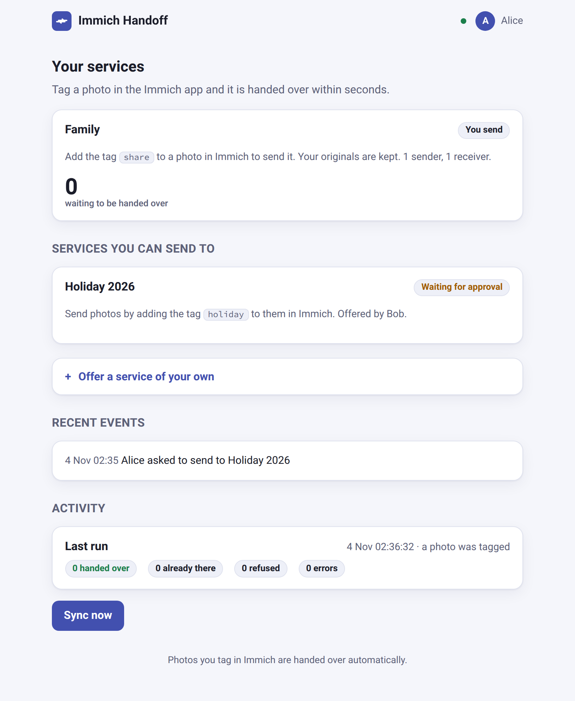
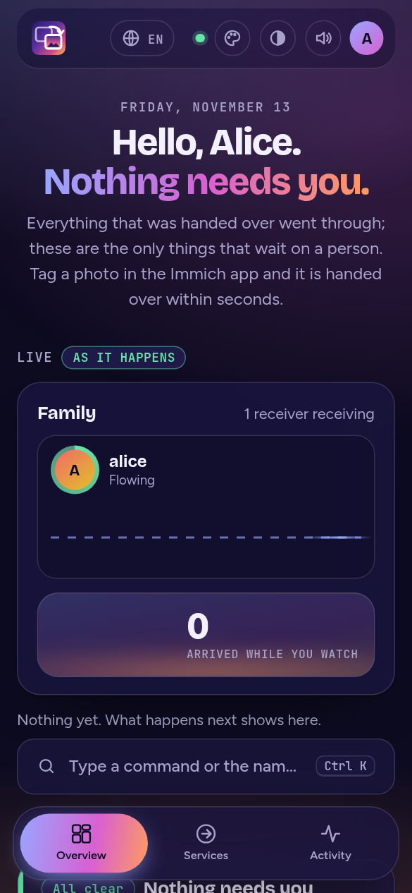
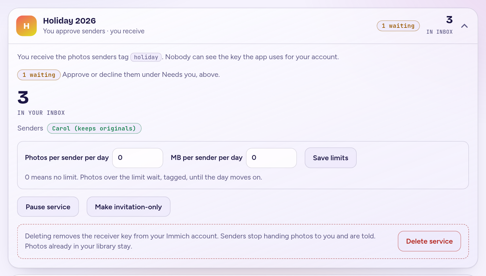
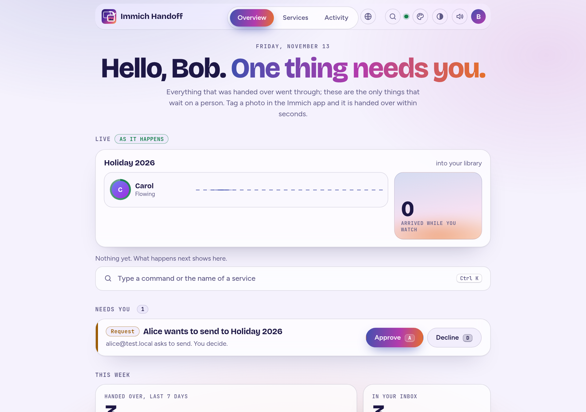
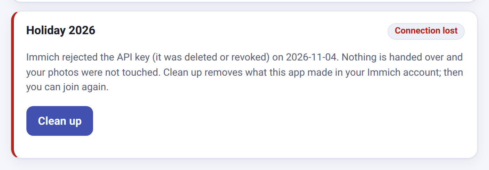

# Using it

This page is for the people who send and receive photos. Everything happens on the handoff web page and in the normal Immich app.

## Words used here

| Word | Meaning |
|---|---|
| **Service** | A named place photos can be handed to, with one tag. "Family" with the tag `share` is a service. |
| **Receiver** (or **owner**) | The person whose library the photos land in. They create the service and decide who may send. |
| **Sender** | Someone who tags photos to hand them to a service. |
| **Tag** | The label you add to a photo in Immich to send it. Each service has its own. |
| **Inbox** | A tag on everything that just arrived, so the receiver can find what is new. |

## Sending photos

Open the page. It shows your services and what is waiting:

To send a photo, add the service's tag to it in the Immich app (select photos, **Add tags**). Within a few seconds the photo is copied into the receiver's library, and the page's **Waiting** count goes back to zero. The page also works on a phone, and follows its light or dark setting:

### Joining a service

Under **Services you can send to** you see the services you may join. Joining asks one question that is yours alone to answer, **what should happen to your originals?**

- **Join and keep my originals** (the usual choice). A copy goes to the receiver and your photo stays where it is. The app's key for you has no permission to delete anything.
- **Join and move my originals to my trash.** Once the receiver has a verified copy, your photo goes to your trash, where Immich keeps it for 30 days, so a mistake can be undone.

You can choose differently for different services. To change your mind, leave the service and join again.

When you join, the app creates an API key named `handoff: <service>` in your own Immich account, using your login, and keeps it encrypted. Nobody sees it, not even you. You can end it any time (see below).

Some services need the owner's approval. You press **Ask to join**, the owner approves, and then you press **Activate**. (The app can only create a key in your account while you are signed in, which is why the last step is yours.)

## Receiving photos

### Offering a service

Under **Offer a service of your own**, choose:

- a **name** and the **tag** senders will use;
- **who can find it**: everyone on this Immich server, or only people you send a link to;
- **who may send**: people you approve, or anyone;
- optionally (**More options**) the tag put on what arrives, and how many days an unfiled photo keeps it.

Each service gets its own inbox tag by default, for example `inbox/Holiday 2026`, which Immich shows nested under `inbox`. Filter by it in Immich to see what arrived through that service. The inbox tag removes itself once a photo is in an album, or after 30 days; photos are never deleted by that. [When exactly](#when-the-inbox-tag-goes-away) is explained below.

### Approving senders and sharing a link

Your services appear on the page with who is waiting and who is connected:

- **Approve** or **Decline** each request. Anyone you approve then activates their own side.
- For an invitation-only service the card shows an **invitation link**. Whoever opens it, signed in to Immich, lands on a page for exactly that service. **New link** makes a fresh link and the old one stops working at once; people already approved or joined are not affected. The link is only as private as the way you share it.
- **List for everyone** and **Make invitation-only** switch between the two. **Delete service** ends it.

You see each sender's name and, on a request, their email address. Senders see only your name.

## Leaving, and when a connection breaks

- A sender presses **Leave** on a service to stop. The app deletes the key it made in their account and the workflow it set up.
- An owner presses **Delete service**. Its senders then see **Removed by its owner** and press **Clean up** to remove their own key.
- Either side can also delete the key named `handoff: ...` in Immich (Account Settings -> API Keys). The app notices, pauses that connection, tells both sides, and **does not touch any photo**.

A sender whose key was deleted presses **Clean up** and can join again; photos they tagged meanwhile are handed over once they have. An owner whose own key was deleted presses **Reconnect**, and senders resume by themselves.

The page also lists recent events (joined, asked, approved, connection lost, reconnected) for the services you take part in.

## Good to know

- **Nothing is removed without a copy.** A photo only goes to the trash after every receiver holds a verified copy, and never while a connection is broken.
- **A photo the receiver already has in their trash is not handed over.** The original is kept and tagged `share-duplicate` (the service's tag is replaced), so you can see why. Once the receiver empties their trash, add the tag again.
- **Phone backups.** A photo in your trash is skipped by your phone's backup. Once Immich empties the trash, a phone that still has the photo may back it up again.
- **A tag you just added is gone.** Immich occasionally drops a tag added in the first moments after a photo was uploaded. Add it again.

Something not working? See [Troubleshooting](troubleshooting.md).

## When the inbox tag goes away

- **Filed in an album:** the tag is removed within about 15 minutes, not instantly.
- **Not in any album:** the tag is removed once the photo has gone unchanged for the service's expiry (30 days by default). The clock is Immich's "last updated" date, so editing the photo (a rating, a description) restarts it.

**Why a delay, and not an instant removal?** The app learns about new photos because Immich tells it: a workflow fires when a tag is added and calls the app. Immich 3.2.0 offers no such event for albums. The only workflow triggers are an asset being created, its metadata being extracted and a tag being added, so the app cannot be told "this photo was just put in an album". The only way to notice is to look. So the app checks on a timer, and the check is deliberately small: one search for photos carrying the inbox tag per receiver, and nothing more when that is empty.

**If you want it faster or slower,** change `CLEANUP_INTERVAL_MINUTES` ([Settings](settings.md)). Shorter means more (small) requests to Immich and a shorter wait; `0` turns the timer off and leaves it to the daily check. If Immich adds an album event in a future version, this can become instant.
